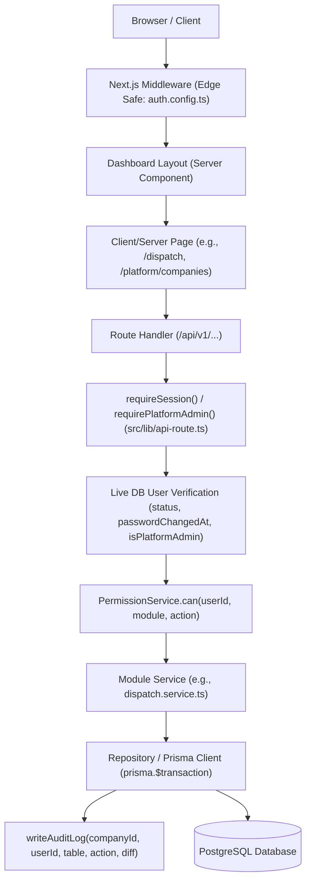
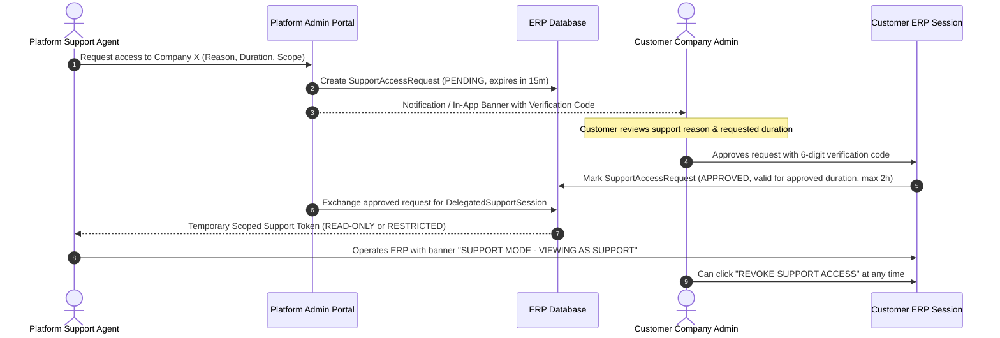
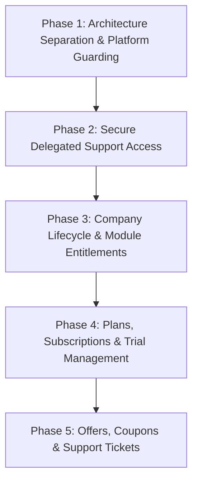

# Fashion ERP — Platform Administration & SaaS Architecture Audit Report

**Audit Mode**: Read-Only Inspection  
**Working Branch**: `main`  
**Date**: 2026-10-12  
**Status**: AUDIT COMPLETE — AWAITING APPROVAL FOR IMPLEMENTATION  

---

## 1. Executive Summary

This codebase is an enterprise multi-tenant Fashion ERP built with:
- **Framework**: Next.js 16.3.1 (React 19, Turbopack, TypeScript 5)
- **Database / ORM**: PostgreSQL via Prisma 6.19.2 (`prisma/schema.prisma`)
- **Authentication**: NextAuth v5 (Auth.js beta) with JWT strategy (`src/core/auth/auth.ts`)
- **Authorization**: Granular multi-tenant RBAC (`src/core/rbac/PermissionService.ts`, `src/config/rbac.ts`)
- **Async Workers**: BullMQ + Redis (`src/core/jobs/worker.ts`)
- **Audit System**: Transactional database audit logging (`src/core/audit/AuditLogger.ts`)
- **Security / Encryption**: AES-256-GCM (`src/core/security/encryption.ts`)

### Key Discoveries & Current State
1. **Platform Administration is partially built as an inline feature**:
   - `User.isPlatformAdmin` boolean exists directly on the tenant `User` model (`prisma/schema.prisma:327`).
   - A tenant provisioning service exists in `src/modules/platform/platform-company.service.ts` and API route `/api/v1/platform/companies`.
   - A single UI page exists inside the customer dashboard route group: `src/app/(dashboard)/platform/companies/page.tsx`.
2. **Current Tenant Isolation & Critical Privilege Escalation Risk**:
   - A platform user is currently stored **inside a tenant Company table** (`company_id` is foreign-keyed to `Company.id` and non-nullable on `User`).
   - In `src/core/rbac/PermissionService.ts:122`: `if (user.isPlatformAdmin) return true;` gives platform admins **unrestricted bypass across all customer ERP modules and actions**.
   - In `src/components/layout/CompanySwitcher.tsx` and `src/core/auth/auth.config.ts:55`, platform admins can freely swap their JWT session `companyId` to **any customer company in the database** with zero customer authorization, zero audit reason, and no time expiry.
3. **Subscriptions, Plans, Coupons, Offers, and Tickets**:
   - Genuinely **absent** from the database and codebase. There are no models, services, or routes for SaaS billing, plans, or support tickets.
4. **Architectural Recommendation**:
   - Rather than creating a separate repository or separate Next.js app (which would duplicate Prisma schemas, types, and DB connection pooling), create a **dedicated route group `src/app/(platform)/`** with independent layout, independent navigation, strict session guards, and an isolated Platform Admin identity model.
   - Replace arbitrary company switching with **Delegated Support Access** (Target Requirement B), enforced via customer-authorized one-time codes and temporary, time-bound session tokens.

---

## 2. Verified Current Architecture

### 2.1 Stack & Project Structure
- `src/app/(auth)/` — Customer & user login (`/login`)
- `src/app/(dashboard)/` — Customer ERP workspace (all business modules)
- `src/app/(dashboard)/platform/` — Partial platform administration UI (currently inside the customer dashboard layout)
- `src/app/api/v1/` — REST API route handlers
- `src/core/rbac/PermissionService.ts` — Central RBAC engine with live DB re-check
- `src/lib/api-route.ts` — `requireSession()` and `requirePlatformAdmin()` guards

### 2.2 Trace Data Flow


---

## 3. Existing Platform User and RBAC Analysis

### Answers to Mandatory Questions
1. **Where are Platform Users stored?**
   - Directly in the customer `users` table (`prisma/schema.prisma:292`).
2. **How are they identified?**
   - Through `User.isPlatformAdmin` boolean column (`prisma/schema.prisma:327`).
3. **Which roles and permissions do they have?**
   - They hold regular tenant roles in `user_branch_roles` within their home company (e.g. `SUPER_ADMIN`), but when `isPlatformAdmin === true`, `PermissionService.ts:122` bypasses all permission checks:
     ```typescript
     if (user.isPlatformAdmin) return true;
     ```
4. **How are they authenticated?**
   - Through the standard `/login` route using NextAuth Credentials provider (`src/core/auth/auth.ts`).
5. **Can they access company ERP modules?**
   - **Yes**. They currently share the exact same `(dashboard)` layout as regular ERP users. They see all ERP navigation menus (`Sidebar.tsx:86`) and can execute every transaction in any module.
6. **Can they access data from multiple companies?**
   - **Yes**. Through the UI component `src/components/layout/CompanySwitcher.tsx`, any platform admin can trigger `useSession().update({ companyId })`, which updates the session token to point to any company ID.
7. **Which menus and routes are visible?**
   - Every single ERP module is visible, plus an appended "Platform" section with a single link to `/platform/companies` (`src/components/layout/Sidebar.tsx:14-18`).
8. **Are permissions enforced server-side?**
   - Yes, `PermissionService.can()` and `requirePlatformAdmin()` re-verify live state from the database on every request. However, because `can()` explicitly bypasses for `isPlatformAdmin`, the platform admin has unconstrained server-side power.
9. **Are there existing company-switching or impersonation mechanisms?**
   - **Yes**. `CompanySwitcher.tsx` allows instant company-switching without permission or authorization from the target tenant.
10. **Are there tenant-isolation or privilege-escalation risks?**
    - **Critical High Risk**:
      - A single compromised platform user password exposes every customer tenant's financial, employee, and sales order data.
      - Support staff can accidentally edit or create records in customer databases under normal operating procedures.
      - Audit logs record the action under the target company ID, but with the platform user's `userId`, which does not belong to that company's user directory.

---

## 4. Existing Module and Settings Audit

| Existing Module | Current Settings | Company Scoped? | Platform Controlled? | Gap | Recommended Change | Code Evidence |
|---|---|---|---|---|---|---|
| **Platform** | None | Global across tenants | Yes (`requirePlatformAdmin`) | Only lists and creates companies; no tenant suspension, plans, or settings | Extend with tenant suspension, plan assignment, and module enablement | `src/modules/platform/platform-company.service.ts` |
| **Administration (Company)** | Basic details (name, legalName, taxReg, fiscalYearStart) | Yes (`companyId`) | No (Tenant Super Admin) | No platform controls or resource limits | Keep tenant operational settings in Company Admin; add plan limits | `src/modules/administration/company-settings.service.ts` |
| **Submodule Visibility** | Tab visibility for Fabric Config (GSM, Dye, etc.) | Yes (`companyId_submoduleKey`) | No (Tenant Super Admin) | Only controls 6 fabric master tabs; not a general module entitlement gate | Keep as tenant UI preference; build platform-level Module Entitlement separately | `src/core/submodule-visibility/SubmoduleVisibilityService.ts` |
| **Production Settings** | Supervisor approval, piece-rate tracking, worker rates | Yes (`companyId` unique) | No (Tenant Super Admin) | Tenant-only operational policy | Reuse as tenant settings; no need to move to platform | `src/core/production-settings/ProductionSettingsService.ts` |
| **Dispatch Settings** | Allow extra dispatch, approval thresholds | Yes (`companyId` unique) | No (Tenant Super Admin) | Tenant-only operational policy | Reuse as tenant settings; no need to move to platform | `src/core/dispatch-settings/DispatchSettingsService.ts` |
| **CRM Settings** | Duplicate rules, custom fields, pipelines, stages | Yes (`companyId` scoped) | No (Tenant Management/Admin) | Tenant-only CRM configuration | Reuse as tenant settings; module can be toggled by subscription | `src/modules/crm/settings/crm-settings.service.ts` |
| **AI Designer / Providers** | Provider API keys, model failover, budgets | Mixed (Global AI Provider vs company AI projects) | Partial | Shared API keys in `AIProvider` model without tenant billing quotas | Add company-level token/budget caps linked to subscription plan | `src/modules/ai-designer/ai-designer-settings.service.ts` |
| **Action Display Settings** | Table action button visibility | Yes (`companyId` unique) | No (Tenant Admin) | Tenant-only display preference | Reuse as tenant settings | `src/core/action-display/ActionDisplayService.ts` |

---

## 5. Existing Subscription, Billing, Offers, Coupons & Trial Audit

1. **Subscription Models / Plans**: **Not Found** in database schema or source code.
2. **Billing / Payment Records for SaaS**: **Not Found**. (Existing `Payment` and `CustomInvoice` models in `src/modules/accounts/` represent customer garment sales & supplier purchasing invoices, NOT SaaS billing).
3. **Feature Entitlements / Usage Limits**: **Not Found**.
4. **Offers / Coupons / Discounts**: **Not Found**.
5. **Free Plans / Trial Lifecycle**: **Not Found**.
6. **Company Activation / Suspension**:
   - `Company.isActive` boolean column exists in `prisma/schema.prisma:25`.
   - Currently, there is **no platform UI or API endpoint to suspend or reactivate a company**.
   - If `Company.isActive` is set to `false`, `requireSession()` currently does **not** check company status—it only checks `user.status === "ACTIVE"`. Thus, users of an inactive company can still log in and operate.

---

## 6. Secure Support Access & Threat Model (Target Requirement B)

### 6.1 Flaws in Existing Support Access
Currently, support staff use the unrestricted `CompanySwitcher.tsx`, which triggers `useSession().update({ companyId })`.
- **Zero Tenant Consent**: Support staff can view any company's sensitive data unannounced.
- **Permanent Access**: No auto-expiry or session timeout.
- **Full Write Access**: Support staff can modify financial records or approve production stages.
- **Audit Contamination**: Actions are logged with foreign `userId`s in customer audit tables.

### 6.2 Proposed Secure Delegated Access Architecture


### 6.3 Threat Model & Mitigations
| Threat | Existing Risk | Proposed Mitigation |
|---|---|---|
| **Unauthorized Tenant Access** | High (Platform admin can switch to any company instantly) | Require explicit customer-side approval via OTP / verification code |
| **Privilege Escalation** | High (`PermissionService.ts` gives platform admins god-mode) | Support session is read-only by default; write actions strictly blocked |
| **Verification Code Replay** | High (No code mechanism exists) | Single-use cryptographically random 6-digit code; 15-minute TTL; invalidated on use |
| **Session Hijacking / Staleness** | High (JWT valid for 30 days) | Support token restricted to max duration (e.g., 2 hours); verified live against DB on every request |
| **Audit Log Tampering / Denial** | Medium (Foreign userId in customer audit log) | Dedicated `support_access_logs` recording support agent ID, target tenant, reason, timestamps, and customer approver ID |

---

## 7. REUSE / MODIFY / EXTEND / NEW / REPLACE Classification Matrix

| Capability | Current Status | Classification | Existing Files/Models | Required Changes | Dependencies | Risk |
|---|---|---|---|---|---|---|
| **Platform Portal Route Group** | Partial (only `/platform/companies` in dashboard) | **MODIFY** | `src/app/(dashboard)/platform` | Move out of `(dashboard)` into a dedicated `(platform)` route group with its own layout, nav, and guards | Next.js App Router | Low |
| **Platform User Storage** | Partial (stored on tenant `User`) | **EXTEND** | `User` model, `isPlatformAdmin` | Add dedicated `PlatformUser` table or decouple platform identity from tenant `Company` | Prisma schema, NextAuth | Medium |
| **Tenant Isolation in RBAC** | Flawed bypass (`can()` returns true) | **MODIFY** | `src/core/rbac/PermissionService.ts` | Remove universal bypass; platform users cannot access ERP routes unless via active `DelegatedSupportSession` | RBAC | High |
| **Company Switcher** | Existing (unrestricted) | **REPLACE** | `src/components/layout/CompanySwitcher.tsx` | Replace arbitrary company switcher with Secure Delegated Support Session exchange | NextAuth session callback | High |
| **Secure Support Access Workflow** | Absent | **NEW** | None | Add `SupportAccessRequest`, `SupportAccessSession`, verification code generation, customer approval modal | BullMQ (expiry), Email/Notification | Medium |
| **Company Suspension Enforcement** | Incomplete (`Company.isActive` exists but unenforced) | **MODIFY** | `src/lib/api-route.ts`, `Company` model | Check `company.isActive` inside `requireSession()` | `api-route.ts` | Low |
| **Subscription & Plans** | Absent | **NEW** | None | Add `SubscriptionPlan`, `CompanySubscription`, billing period, and status checks | Prisma, Company | Medium |
| **Company-wise Module Entitlements** | Absent (only 6-submodule UI visibility exists) | **NEW** | `src/core/submodule-visibility/` | Add `CompanyModuleEntitlement` model and wrap navigation & API guards | `PermissionService.ts`, Navigation | Medium |
| **Offers & Coupons Management** | Absent | **NEW** | None | Add `Coupon`, `DiscountRule`, and redemption tracking | Subscription Module | Low |
| **Free Plans & Trial Management** | Absent | **NEW** | None | Add trial lifecycle (trial start/end date, auto-expiry to read-only state) | BullMQ scheduled jobs | Medium |
| **Customer Support Tickets** | Absent | **NEW** | None | Add `SupportTicket`, `TicketMessage`, status tracking | Notification system | Low |

---

## 8. Database Change Impact Matrix (Proposed)

*All changes are purely additive. Zero destructive modifications or column drops required.*

| Proposed Model | Scope | Purpose | Relationships | Backward Compatibility |
|---|---|---|---|---|
| `PlatformUser` | Global | Dedicated identity for platform super admins and staff | Independent from `Company` | High (preserves tenant `User` integrity) |
| `PlatformRole` | Global | RBAC for platform team (Billing Admin, Support Agent, Super Admin) | `PlatformUser` | High |
| `SubscriptionPlan` | Global | Plans catalog (Starter, Professional, Enterprise) | Has many `CompanySubscription` | High |
| `CompanySubscription` | Global/Tenant | Active plan, billing cycle, trial end, status (ACTIVE, TRIAL, SUSPENDED) | `Company`, `SubscriptionPlan` | High |
| `CompanyModuleEntitlement`| Tenant | Enables/disables entire ERP modules per company based on plan | `Company` | High |
| `Coupon` / `Offer` | Global | Promotional codes and discount rules | `CompanySubscription` | High |
| `SupportAccessRequest` | Tenant | Ephemeral support access request with verification code & expiration | `Company`, `PlatformUser`, Approver `User` | High |
| `SupportAccessSession` | Tenant | Active delegated support session token and audit trail | `SupportAccessRequest` | High |
| `SupportTicket` | Tenant | In-app support tickets created by customers | `Company`, `User`, `PlatformUser` | High |
| `SupportTicketMessage` | Tenant | Messages and attachments within support tickets | `SupportTicket` | High |

---

## 9. Platform Portal Architecture Recommendation

### Recommendation: Route Group Isolation within the Existing App
- **Rejected Alternative 1: Completely separate Next.js application / repository**
  - *Drawback*: Requires maintaining duplicate Prisma schemas, database migrations, shared types, and double connection pool overhead without providing tangible security advantages over strict route-level isolation.
- **Rejected Alternative 2: Subdomain routing on same app**
  - *Drawback*: Adds unnecessary DNS and cookie sharing (`.domain.com`) complexity for local development and multi-environment deployments.
- **Recommended Solution: Dedicated Route Group `src/app/(platform)/`**
  - Create `src/app/(platform)/layout.tsx` completely separate from `src/app/(dashboard)/layout.tsx`.
  - Independent navigation and sidebar (Companies, Subscriptions, Plans, Coupons, Tickets, Platform Users).
  - Strict middleware and layout guard: only users with valid platform credentials can access any `/(platform)` route.
  - Platform users accessing `/(dashboard)` are blocked unless they hold an active, customer-approved `DelegatedSupportSession`.

---

## 10. Additional Features Justified by Project Evidence

1. **Company Suspension Live Enforcement**:
   - *Evidence*: `Company.isActive` already exists in `prisma/schema.prisma:25`, but is not checked in `requireSession()`. A suspended tenant's users can currently still use the ERP.
   - *Consequence if omitted*: When a subscription lapses or a tenant is suspended for non-payment, their users continue making ERP transactions.
   - *Priority*: **Critical**.
2. **Read-Only Grace Period on Subscription Expiry**:
   - *Evidence*: Fashion ERP has deep multi-stage dependencies (cutting, stitching, finishing, QC, dispatch). Suddenly hard-locking a company prevents factory floor workers from checking garments or recording completed lots, causing physical factory disruption.
   - *Consequence if omitted*: Physical production lines halt abruptly on billing cycle renewal dates.
   - *Priority*: **High**.
3. **AI Token / Budget Quota Per Tenant**:
   - *Evidence*: `AIProvider` model in `schema.prisma:11599` stores shared API keys for OpenAI/Gemini/Anthropic. AI Garment Flow and AI Designer execute heavy multimodal inference runs without per-company billing limits.
   - *Consequence if omitted*: A single trial customer could exhaust the platform's third-party AI provider budget.
   - *Priority*: **High**.

---

## 11. Implementation Roadmap



### Phase 1: Architecture Separation & Platform Guarding (Mandatory Security)
- Move Platform Admin UI to `src/app/(platform)/`.
- Add `company.isActive` verification to `requireSession()` in `src/lib/api-route.ts`.
- Remove universal `isPlatformAdmin` bypass from `src/core/rbac/PermissionService.ts`.
- Restrict `CompanySwitcher.tsx` from arbitrary company switching.

### Phase 2: Secure Delegated Support Access (Target Requirement B)
- Schema additions: `SupportAccessRequest`, `SupportAccessSession`.
- Customer approval UI: in-app modal with 6-digit verification code.
- Scoped support sessions with strict time limits (max 2 hours) and read-only defaults.
- End-to-end audit logging of all support activities in customer tenants.

### Phase 3: Company Lifecycle & Module Entitlements (Target Requirement C2 & C3)
- Platform company management: activate, suspend, view tenant metrics.
- Company Module Entitlements: enable/disable modules per company (e.g. Sampling, CRM, AI Designer, Barcodes).
- Navigation and API route guards checking module entitlement before granting access.

### Phase 4: Plans, Subscriptions & Trial Management (Target Requirement C1 & C6)
- Schema additions: `SubscriptionPlan`, `CompanySubscription`.
- Trial lifecycle management via BullMQ scheduled jobs.
- Read-only grace period enforcement upon plan expiration.

### Phase 5: Offers, Coupons & Customer Support Tickets (Target Requirement C4, C5 & C7)
- Schema additions: `Coupon`, `SupportTicket`, `SupportTicketMessage`.
- In-app customer support widget & ticket submission.
- Platform ticketing inbox and resolution workflow.

---

## 12. Unresolved Business Decisions

The following items are purely business/operational choices that must be decided prior to implementing subscriptions and support:
1. **Support Session Permissions**: Should customer support staff ever be permitted write/edit access to customer ERP data, or must all support sessions be strictly **Read-Only**?
2. **Subscription Expiry Behavior**: When a company's subscription or trial expires:
   - Option A: Immediate complete lockout (no login allowed).
   - Option B: Read-only access for a 7-day grace period (view existing data, no new orders or stage updates).
3. **Platform User Identity**:
   - Option A: Retain `User` table and use a reserved `SystemCompany` / `null` company ID for platform admins.
   - Option B: Introduce a separate `PlatformUser` table to guarantee that platform staff credentials never intermingle with customer tenant tables. *(Architecturally Recommended)*

---

## 13. Exact Recommended First Implementation Phase

**Recommended First Step**: **Phase 1 — Architecture Separation & Platform Guarding**.
- **Why**: Before introducing billing or support tickets, the existing security loophole (unrestricted platform admin bypass across all customer tenants) must be closed. This stabilizes tenant isolation and provides a clean foundation for all subsequent SaaS modules.

---

**AUDIT COMPLETE — AWAITING APPROVAL FOR IMPLEMENTATION.**
