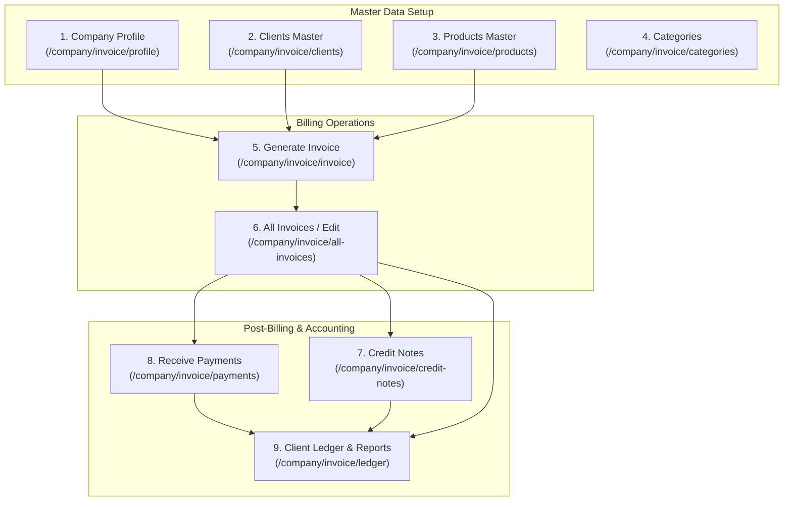
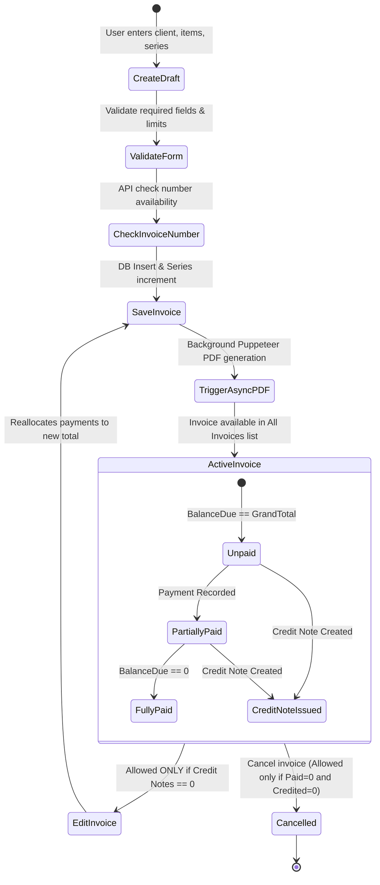
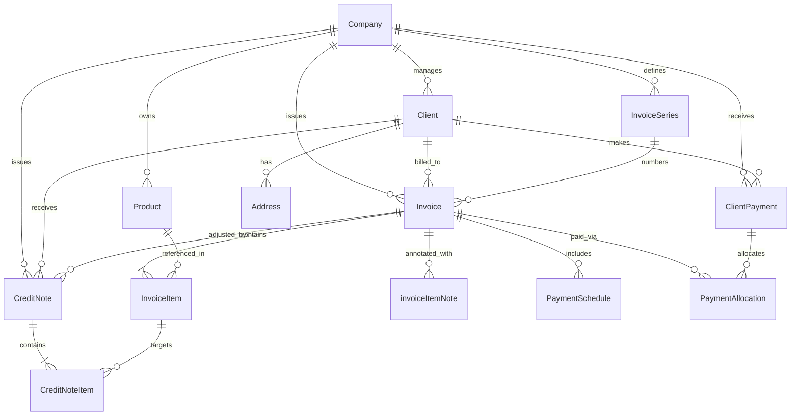

# Invoice Module Documentation (Reference: Indradhar vs Fashion ERP)

> **Document Status:** Complete Audit & Architecture Specification  
> **Target Project:** `D:\office-data\claude-projects\fashion-erp`  
> **Reference Module:** `https://indradhar.in/company/invoice` (Source: `D:\office-data\Project\indradhar\internal_project`)  
> **Audit Date:** 2026-10-14  
> **Implementation Scope:** Strictly Audit & Documentation Only (No Code Modifications)

---

## 1. Scope & Audit Methodology

### 1.1 Scope (कार्यक्षेत्र)
इस डॉक्यूमेंटेशन का उद्देश्य Indradhar Reference Invoice Module (`https://indradhar.in/company/invoice`) के समस्त फ़ीचर्स, स्क्रीन्स, डेटा फ़ील्ड्स, बिज़नेस लॉजिक, टैक्सेशन, वर्कफ़्लो तथा टेक्निकल आर्किटेक्चर का पूर्ण, साक्ष्य-आधारित (evidence-based) विश्लेषण प्रस्तुत करना है, ताकि Fashion ERP (`D:\office-data\claude-projects\fashion-erp`) के मौजूदा Custom Invoice मॉड्यूल को भविष्य में बिना किसी वित्तीय त्रुटि या डेटा करप्शन के अपग्रेड किया जा सके।

### 1.2 Audit Methodology (जाँच पद्धति)
ऑडिट प्रक्रिया केवल UI पृष्ठ देखकर नहीं, बल्कि निम्नलिखित प्राथमिक स्रोतों की पंक्ति-दर-पंक्ति (line-by-line) कोड समीक्षा द्वारा पूरी की गई है:
1. **Reference Backend Code:** `solopreneur-backend/controller/invoice.js`, `routes/invoice.js`, `services/invoicePdf.service.js`, `prisma/schema.prisma`
2. **Reference Frontend Code:** `solopreneur-frontend/app/company/invoice/*`, `solopreneur-frontend/component/invoice/*`
3. **Target ERP Backend & Models:** `fashion-erp/prisma/schema.prisma`, `src/modules/accounts/custom-invoice.*`, `src/modules/accounts/invoice-series.*`, `src/modules/accounts/custom-invoice-payment.*`, `src/modules/accounts/custom-invoice-credit-note.*`, `src/modules/accounts/custom-invoice-ledger.*`
4. **Target ERP Frontend Pages:** `fashion-erp/src/app/(dashboard)/accounts/custom-invoices/*`

प्रत्येक निष्कर्ष को **`Verified`**, **`Partially Verified`** या **`Not Verified`** के रूप में चिन्हित किया गया है।

---

## 2. Reference Module Overview (`https://indradhar.in/company/invoice`)

Indradhar का इनवॉइस मॉड्यूल 9 अंतर्संबंधित (interconnected) उप-मॉड्यूल (Sub-modules) का एक एकीकृत सूट है:

### Reference Sub-modules विवरण
1. **Company Profile (`/company/invoice/profile`):** कंपनी का नाम, GSTIN, पैन, बैंक विवरण, इनवॉइस थीम (`invoicetheme`) तथा डिफ़ॉल्ट नियम व शर्तें (`paymentSchedule`) कॉन्फ़िगर करता है।
2. **Categories (`/company/invoice/categories`):** आय (Income) वर्गीकरण हेतु श्रेणियाँ।
3. **Clients Master (`/company/invoice/clients`):** ग्राहक विवरण, कंपनी नाम, GSTIN, पैन, और बहु-पते (multiple addresses - डिफ़ॉल्ट व डिलीवरी)।
4. **Products Master (`/company/invoice/products`):** उत्पाद एवं सेवा मास्टर (Name, HSN/SAC, Unit, Price, GST %)।
5. **Generate Invoice (`/company/invoice/invoice`):** नया टैक्स या प्रोफॉर्मा इनवॉइस बनाना।
6. **Edit Invoice / All Invoices (`/company/invoice/all-invoices`):** इनवॉइस सूची, खोज, फ़िल्टर, रो-विस्तार (expandable row), PDF डाउनलोड, Excel एक्सपोर्ट और एडिट नेविगेशन।
7. **Credit Notes (`/company/invoice/credit-notes`):** रिटर्न या छूट हेतु क्रेडिट नोट जारी करना व इनवॉइस बैलेंस कम करना।
8. **Receive Payments (`/company/invoice/payments`):** इनवॉइस के विरुद्ध या ग्राहक स्तर पर भुगतान प्राप्त व आवंटित करना।
9. **Report / Ledger (`/company/invoice/ledger`):** ग्राहक-वार खाता बही (Client Ledger), ट्रांज़ैक्शन इतिहास, रनिंग बैलेंस, Tally एक्सपोर्ट।

---

## 3. Complete Screen Inventory

### Screen 1: Invoice Landing Page
- **URL / Route:** `/company/invoice`
- **File:** `solopreneur-frontend/app/company/invoice/page.js` (Lines 1–135)
- **Status:** `Verified`
- **घटक व Actions:** 9 कार्ड्स का ग्रिड। प्रत्येक कार्ड अपने उप-मॉड्यूल का लिंक, आइकन, शीर्षक और विवरण प्रदर्शित करता है।

### Screen 2: All Invoices List & Report
- **URL / Route:** `/company/invoice/all-invoices`
- **Files:** `solopreneur-frontend/app/company/invoice/all-invoices/page.jsx` (Lines 1–277), `solopreneur-frontend/component/invoice/allInvoiceTable.jsx` (Lines 1–190)
- **Backend API:** `POST /invoice` (controller: `getInvoice`, lines 1269–1370), `POST /invoice/excel` (controller: `getInvoiceforExcel`, lines 1374–1530)
- **Status:** `Verified`
- **नियंत्रण एवं फ़िल्टर:**
  - **Search by Invoice Number:** लाइव ऑटोकम्प्लीट ड्रॉपडाउन (शीर्ष 10 परिणाम)।
  - **Client Filter:** क्लाइंट चयन ड्रॉपडाउन (`SelectClient.jsx`)।
  - **Date Range Filter:** `From Date` (डिफ़ॉल्ट: चालू माह की 2 तारीख) और `To Date` (डिफ़ॉल्ट: आज की तिथि)।
  - **Export Buttons:** `Export Excel` (ExcelJS / SheetJS) तथा `Export Pdf`।
  - **Table Columns:**
    1. Expand/Collapse Arrow (`▲` / `▼`)
    2. Invoice # (`invoice.number`)
    3. Client Name (`invoice.client.name`)
    4. Date (`invoice.date`)
    5. Items Count (`invoice.items.length`)
    6. Basic Amount (`subtotal`)
    7. IGST (`igst`)
    8. CGST (`cgst`)
    9. SGST (`sgst`)
    10. Total (`grandTotal`)
    11. Actions (`Edit` और `Download`)
  - **Expandable Row:** क्लिक करने पर इनलाइन तालिका खुलती है: Item Name, Quantity + Unit, Price, Line Total.
  - **Action Permissions:** `Edit` बटन केवल तभी दिखाई देता है जब `invoice._count.creditNotes === 0` हो। क्रेडिट नोट बनने के बाद एडिट बटन गायब हो जाता है।
  - **Download Action:** `/invoice/download/:id` से बाइनरी PDF फ़ाइल फ़ेच करके ब्राउज़र में सीधे डाउनलोड कराता है।
  - **Pagination:** पृष्ठ संख्या (`page`), पृष्ठ आकार (`pageSize: 10`), कुल पृष्ठ (`totalPages`), `Previous` व `Next` बटन।

### Screen 3: Create Invoice Screen
- **URL / Route:** `/company/invoice/invoice`
- **File:** `solopreneur-frontend/app/company/invoice/invoice/page.jsx` (Lines 1–1123)
- **Backend API:** `POST /invoice/create` (`solopreneur-backend/controller/invoice.js`, Lines 802–945)
- **Status:** `Verified`
- **स्क्रीन अनुभाग (Sections):**
  1. Header: Back बटन, Title ("Create Invoice").
  2. Date & Type: `Invoice Date` (डिफ़ॉल्ट आज), `Invoice Type` (`Tax` / `Proforma`).
  3. Payment Due Date: टॉगल स्विच ("Set Payment Due Date"). सक्षम करने पर `dueDate` इनपुट दिखाई देता है।
  4. Invoice Series & Number: `InvoiceNumber.jsx` कंपोनेंट। सिरीज़ चयन, जनरेटेड नंबर, इनलाइन "Edit" तथा "Verify" बटन।
  5. Client & Address: क्लाइंट ड्रॉपडाउन, "+ Create Client" बटन, "Change Address" टॉगल, "+ Add New Address" मॉडल।
  6. Invoice-level Discount: `Discount(%)` संख्यात्मक इनपुट।
  7. Delivery Address: यदि क्लाइंट के कई पते हों तो डिलीवरी एड्रेस ड्रॉपडाउन।
  8. Type Filter: `Product` vs `Service` ड्रॉपडाउन (आइटम सूची को `unit !== ""` के आधार पर फ़िल्टर करता है)।
  9. Line Items: अधिकतम 5 उत्पाद/सेवा। Item Name (एडिट/सेव बटन के साथ), Qty, HSN, Price (पेंसिल आइकन से इनपुट टॉगल), GST %, Line Total, Remove बटन।
  10. Dynamic Notes: "+ Add Note" बटन, प्रत्येक नोट के लिए टेक्स्ट इनपुट व डिलीट बटन।
  11. Advance Payment: 70:30 अनुपात में Title इनपुट और Amount इनपुट।
  12. Payable Amount: 70:30 अनुपात में Title इनपुट और Amount इनपुट।
  13. Terms & Conditions: गतिशील सूची, अधिकतम 4 शर्तें, कंपनी प्रोफ़ाइल से स्वतः प्री-फ़िल।
  14. RCM Checkbox: "Tax is payable on reverse charge basis." (चेक करने पर GST शून्य हो जाता है)।
  15. Submission Button: "Create Invoice" (सत्यापन के बाद बैकएंड पर सेव करता है और Puppeteer PDF जनरेशन ट्रिगर करता है)।

### Screen 4: Edit Invoice Screen
- **URL / Route:** `/company/invoice/edit/[id]`
- **File:** `solopreneur-frontend/app/company/invoice/edit/[id]/page.jsx` (Lines 1–1238)
- **Backend API:** `POST /invoice/edit/:id` (`solopreneur-backend/controller/invoice.js`, Lines 980–1218)
- **Status:** `Verified`
- **व्यवहार:**
  - इनवॉइस का सारा मौजूदा डेटा प्री-फ़िल करता है।
  - यदि क्रेडिट नोट मौजूद हो तो बैकएंड तुरंत त्रुटि देता है: *"We Can Not edit invoice whose credit Note is issued!"*
  - सेव करने पर बैकएंड ट्रांज़ैक्शन में पुराने पेमेंट एलोकेशन्स को क्लाइंट बैलेंस में रिस्टोर करता है, इनवॉइस को अपडेट करता है और नए ग्रैंड टोटल तक पुराने भुगतानों को पुनः आवंटित करता है।

### Screen 5: Client Ledger & Statement
- **URL / Route:** `/company/invoice/ledger`
- **Files:** `solopreneur-frontend/app/company/invoice/ledger/page.jsx`, `component/invoice/Ledger/LedgerDashboard.jsx`
- **Backend API:** `POST /credit/report`, `GET /credit/ledger/client/:id`, `GET /invoice/export-to-tally`
- **Status:** `Verified`
- **व्यवहार:** KPI कार्ड्स (Total Invoiced, Credit Notes, Payments, Net Outstanding), तिथि एवं ग्राहक फ़िल्टर, लेजर एंट्रीज़ (Invoices [Debit], Payments [Credit], Credit Notes [Credit], Running Balance), Tally एक्सपोर्ट और ईमेल भेजने का विकल्प।

---

## 4. Complete Field Inventory

### 4.1 Invoice Header Fields
| Field Name (UI) | Internal Name | Type | Required | Default | Source | Editable | Validation Rules | Business Purpose | Dependencies | Calculation Formula | Verification Status | Evidence File & Line |
|---|---|---|---|---|---|---|---|---|---|---|---|---|
| Invoice Date | `date` / `invoiceDate` | Date (YYYY-MM-DD) | Required | Today's Date | Manual / System | Create, Edit | मान्य तिथि स्ट्रिंग | इनवॉइस की जारी होने की कानूनी तिथि | None | None | `Verified` | `invoice/page.jsx#L76`, `controller/invoice.js#L870` |
| Invoice Type | `type` / `invoiceType` | Select (`Tax`, `Proforma`) | Required | `"Tax"` | Manual | Create, Edit | केवल "Tax" या "Proforma" | कानूनी टैक्स इनवॉइस अथवा प्रोफॉर्मा इनवॉइस वर्गीकरण | None | None | `Verified` | `invoice/page.jsx#L77`, `controller/invoice.js#L869` |
| Set Payment Due Date | `payableDueDate` / `hasDueDate` | Boolean (Toggle) | Optional | `false` | Manual | Create, Edit | Boolean | भुगतान की देय तिथि सक्षम/अक्षम करना | `dueDate` इनपुट की विजिबिलिटी | None | `Verified` | `invoice/page.jsx#L547-L559` |
| Payment Due Date | `dueDate` | Date | Conditional | `""` | Manual | Create, Edit | यदि `payableDueDate === true` हो तो अनिवार्य | भुगतान प्राप्त करने की अंतिम सीमा | `payableDueDate` | None | `Verified` | `invoice/page.jsx#L296-L299` |
| Invoice Series | `invoiceSeriesId` | Select (UUID/Int) | Required | Default Series ID | Master (`InvoiceSeries`) | Create, Edit | मान्य व सक्रिय सिरीज़ ID होना चाहिए | मल्टी-सिरीज़ नंबरिंग और प्रीफ़िक्स प्रबंधन | सिरीज़ बदलने पर नंबर स्वतः बदलता है | None | `Verified` | `invoiceNumber.jsx#L48-L64` |
| Invoice Number | `number` / `invoiceNumber` | Text | Required | Auto-suggested | Auto + Manual | Create (Editable via Verify button) | कंपनी में यूनिक होना अनिवार्य, खाली नहीं | कानूनी इनवॉइस पहचान संख्या | `invoiceSeriesId` | `${series.prefix}/${series.suffix}/${series.nextNumber}` | `Verified` | `invoiceNumber.jsx#L55`, `controller/invoice.js#L844-L851` |
| Select Client | `clientId` / `customerId` | Select / Searchable | Required | None | Master (`Client`) | Create, Edit | मान्य क्लाइंट ID आवश्यक | बिलिंग पार्टी की पहचान | पते व पुराने लेजर लोड होते हैं | None | `Verified` | `invoice/page.jsx#L288-L291` |
| Delivery Address | `deliveryAddressId` | Select (Int) | Required | Client Default Address | Master (`Address`) | Create, Edit | मान्य पता ID आवश्यक | माल या सेवा की वास्तविक डिलीवरी का स्थान (GST राज्य निर्धारण हेतु) | `clientId` | None | `Verified` | `invoice/page.jsx#L391-L393`, `allInvoiceTable.jsx#L61` |
| Discount (%) | `discount` / `discountPercentage` | Number (0–100) | Optional | `0` | Manual | Create, Edit | `Number >= 0 && Number <= 100` | संपूर्ण इनवॉइस पर लागू प्रतिशत छूट | प्रत्येक लाइन आइटम की रियायती दर पर प्रभाव | `discountRate = discount / 100` | `Verified` | `invoice/page.jsx#L145-L163`, `custom-invoice.service.ts#L36-L53` |
| Reverse Charge Basis | `isRCM` / `isReverseCharge` | Checkbox (Boolean) | Optional | `false` | Manual | Create, Edit | Boolean | यह इंगित करना कि GST क्रेता द्वारा देय है (RCM) | जब RCM true हो तो लाइन GST शून्य हो जाता है | `if (isRCM) gstAmount = 0` | `Verified` | `invoice/page.jsx#L183-L190`, `custom-invoice.service.ts#L39` |
| Subtotal Amount | `subtotal` / `subtotalAmount` | Number / Decimal | Calculated | `0` | Calculated | View Only | Positive Decimal | रियायती मूल्य पर सभी उत्पादों का कुल मूल मूल्य | Items Qty, Price, Discount | `sum(qty * discountedPrice)` | `Verified` | `invoice/page.jsx#L149`, `custom-invoice.service.ts#L56` |
| Tax Amount | `gstAmount` / `taxAmount` | Number / Decimal | Calculated | `0` | Calculated | View Only | Positive Decimal | लागू कुल GST राशि | Subtotal, GST %, RCM | `sum(lineTaxAmount)` | `Verified` | `invoice/page.jsx#L150`, `custom-invoice.service.ts#L59` |
| Grand Total | `grandTotal` | Number / Decimal | Calculated | `0` | Calculated | View Only | Positive Decimal | इनवॉइस की अंतिम कुल देय राशि | Subtotal + Tax | `subtotal + taxAmount` | `Verified` | `invoice/page.jsx#L280`, `custom-invoice.service.ts#L60` |
| Advance Payment Title | `advancePaymentTitle` / `advanceDescription` | Text | Conditional | `""` | Manual | Create, Edit | यदि राशि दी गई हो तो शीर्षक अनिवार्य (Max 200) | अग्रिम भुगतान का नाम/विवरण | `advancePayment` | None | `Verified` | `invoice/page.jsx#L329-L337`, `controller/invoice.js#L856-L861` |
| Advance Payment Amount | `advancePayment` / `advanceAmount` | Number / Decimal | Conditional | `0` | Manual | Create, Edit | `advancePayment <= grandTotal` | इनवॉइस बनने से पूर्व प्राप्त अग्रिम राशि | `advancePaymentTitle` | Deducted from Grand Total | `Verified` | `invoice/page.jsx#L282-L286`, `controller/invoice.js#L852-L854` |
| Payable Amount Title | `payableTitle` / `payableAmountTitle` | Text | Optional | `""` | Manual | Create, Edit | Text (Max 200) | तत्काल देय राशि का शीर्षक | `payableAmount` | None | `Verified` | `invoice/page.jsx#L414`, `controller/invoice.js#L874` |
| Payable Amount | `payableAmount` / `payableAmountValue` | Number / Decimal | Optional | `0` | Manual | Create, Edit | Number | तत्काल देय राशि (बाकी राशि देय तिथि पर) | `grandTotal`, `advancePayment` | `grandTotal - advancePayment` | `Verified` | `invoice/page.jsx#L283-L285` |
| Balance Due | `balanceDue` | Number / Decimal | Calculated | `0` | Calculated | View Only | Decimal | ग्राहक पर इनवॉइस के विरुद्ध शेष बकाया | Grand Total, Advance, Payable, Payments, Credits | Formula in Section 5 | `Verified` | `controller/invoice.js#L875`, `custom-invoice.service.ts#L79-L89` |
| Invoice Theme | `invoicetheme` | String | Required | `"classic"` | User Profile | View/Print | Valid Theme Identifier | PDF प्रिंटिंग हेतु विज़ुअल टेम्प्लेट | Company/User Settings | None | `Verified` | `controller/invoice.js#L879`, `schema.prisma#L454` |

---

### 4.2 Line Item Fields (उत्पाद / सेवा पंक्ति विवरण)
| Field Name (UI) | Internal Name | Type | Required | Default | Source | Editable | Validation Rules | Business Purpose | Calculation Formula | Verification Status | Evidence File & Line |
|---|---|---|---|---|---|---|---|---|---|---|---|
| Product / Service Picker | `productId` | Select (Int/UUID) | Optional | `null` | Master (`Product`) | Create, Edit | मास्टर से चयन होने पर डेटा स्वतः भरता है | उत्पाद या सेवा मास्टर से ऑटो-फ़िल | None | `Verified` | `invoice/page.jsx#L121-L134` |
| Item Name | `name` / `updatedName` / `itemName` | Text | Required | `""` | Master / Manual | Create, Edit | Min 1 char, Max 300, खाली नहीं | माल या सेवा का मुद्रित नाम | None | `Verified` | `invoice/page.jsx#L342-L349`, `custom-invoice.schema.ts#L7` |
| HSN / SAC Code | `hsnSacCode` / `hsnCode` | Text | Optional | `""` | Master / Manual | Create, Edit | Max 20 chars | GST वैधानिक वर्गीकरण कोड | None | `Verified` | `invoice/page.jsx#L132`, `custom-invoice.schema.ts#L8` |
| Quantity | `qty` / `quantity` | Number / Decimal | Required | `1` | Manual | Create, Edit | `Number > 0` (शून्य या ऋणात्मक अमान्य) | बिल की गई मात्रा | None | `Verified` | `invoice/page.jsx#L350-L353`, `custom-invoice.schema.ts#L9` |
| Unit | `unit` | Text | Optional | `""` | Master (`Product`) | Read-only | String | माप की इकाई (Pcs, Mtr, Box, Kg) | None | `Verified` | `invoice/page.jsx#L129`, `allInvoiceTable.jsx#L164` |
| Unit Price | `price` / `unitPrice` | Number / Decimal | Required | `0` | Master / Manual | Create, Edit | `Number >= 0` | प्रति इकाई मूल विक्रय दर (GST पूर्व) | None | `Verified` | `invoice/page.jsx#L354-L357`, `custom-invoice.schema.ts#L10` |
| GST (%) | `gst` / `gstPercentage` | Number (0–100) | Required | `0` | Master / Manual | Create, Edit | `0 <= GST <= 100` | लागू GST स्लैब दर (0, 5, 12, 18, 28) | None | `Verified` | `invoice/page.jsx#L133`, `custom-invoice.schema.ts#L11` |
| Discounted Price | `discountedPrice` | Number / Decimal | Calculated | Unit Price | Calculated | View Only | Decimal | इनवॉइस छूट कटौती के बाद प्रति इकाई दर | `round2(unitPrice * (1 - discountPercentage / 100))` | `Verified` | `invoice/page.jsx#L147`, `custom-invoice.service.ts#L37` |
| Line Subtotal Amount | `subtotal` / `lineAmount` | Number / Decimal | Calculated | `0` | Calculated | View Only | Decimal | लाइन का कर-योग्य मूल्य (Taxable Value) | `round2(quantity * discountedPrice)` | `Verified` | `invoice/page.jsx#L149`, `custom-invoice.service.ts#L38` |
| Line Tax Amount | `gstAmount` / `lineTaxAmount` | Number / Decimal | Calculated | `0` | Calculated | View Only | Decimal | इस लाइन पर लगा कुल GST | `isRCM ? 0 : round2(lineAmount * (gstPercentage / 100))` | `Verified` | `invoice/page.jsx#L185`, `custom-invoice.service.ts#L39` |
| Line Total | `total` / `lineTotal` | Number / Decimal | Calculated | `0` | Calculated | View Only | Decimal | कर सहित लाइन की कुल राशि | `round2(lineAmount + lineTaxAmount)` | `Verified` | `invoice/page.jsx#L186`, `custom-invoice.service.ts#L40` |
| Credited Amount | `creditedAmount` | Number / Decimal | Accumulator | `0` | System | View Only | `creditedAmount <= lineTotal` | इस लाइन के विरुद्ध क्रेडिट नोट द्वारा घटाई गई राशि | Sum of issued credit note lines | `Verified` | `schema.prisma#L5663`, `custom-invoice-credit-note.service.ts#L88` |

---

### 4.3 Notes & Terms Fields
| Field Name (UI) | Internal Name | Type | Required | Default | Source | Editable | Validation Rules | Business Purpose | Verification Status | Evidence File & Line |
|---|---|---|---|---|---|---|---|---|---|---|
| Notes | `invoiceItemNotes` / `notes` | Array of Strings | Optional | `[]` | Manual | Create, Edit | कोई भी खाली नोट स्ट्रिंग सेव नहीं हो सकती | डिलीवरी, पैकेजिंग या विशेष निर्देश | `Verified` | `invoice/page.jsx#L360-L365`, `custom-invoice.schema.ts#L32` |
| Terms & Conditions | `paymentSchedule` / `termsAndConditions` | Array / Text | Optional | Profile Default | Master / Manual | Create, Edit | खाली विवरण नहीं हो सकता, अधिकतम 4 शर्तें | भुगतान व कानूनी शर्तें | `Verified` | `invoice/page.jsx#L237-L240`, `custom-invoice.schema.ts#L37` |

---

## 5. Business Rules & Calculation Formulas

### 5.1 Verification Checklist of Rules
| Rule ID | Business Rule | Verification Status | Source Code Evidence |
|---|---|---|---|
| `BR-01` | **Line Discount Calculation:** छूट प्रतिशत इनवॉइस स्तर पर दिया जाता है लेकिन प्रत्येक लाइन की यूनिट दर पर लागू होता है। | `Verified` | `solopreneur-frontend/app/company/invoice/invoice/page.jsx#L147`, `fashion-erp/src/modules/accounts/custom-invoice.service.ts#L37` |
| `BR-02` | **Line Taxable Amount:** रियायती यूनिट दर को मात्रा से गुणा करने पर लाइन का कर-योग्य मूल्य निकलता है। | `Verified` | `invoice/page.jsx#L149`, `custom-invoice.service.ts#L38` |
| `BR-03` | **Reverse Charge Mechanism (RCM):** यदि RCM चेक किया गया है, तो इनवॉइस पर GST शून्य (0) होगा (खरीदार द्वारा स्वयं देय)। | `Verified` | `invoice/page.jsx#L184-L190`, `custom-invoice.service.ts#L39` |
| `BR-04` | **Inter-state vs Intra-state GST:** कंपनी के राज्य कोड और डिलीवरी पते के राज्य कोड की तुलना से CGST/SGST या IGST तय होता है। | `Verified` | `solopreneur-frontend/component/invoice/allInvoiceTable.jsx#L61-L66` |
| `BR-05` | **Advance Payment Restriction:** अग्रिम भुगतान इनवॉइस के Grand Total से अधिक नहीं हो सकता। | `Verified` | `controller/invoice.js#L852-L854`, `custom-invoice.service.ts#L64-L71` |
| `BR-06` | **Advance Payment Title Coupling:** यदि अग्रिम भुगतान राशि प्रविष्ट की गई है, तो उसका शीर्षक अनिवार्य है, और इसके विपरीत भी। | `Verified` | `controller/invoice.js#L856-L861`, `custom-invoice.schema.ts#L43-L50` |
| `BR-07` | **Balance Due Formula:** बकाया राशि की गणना वास्तविक समय में होती है। | `Verified` | `controller/invoice.js#L875`, `custom-invoice.service.ts#L86-L89` |
| `BR-08` | **Edit Locking on Credit Note:** यदि इनवॉइस के विरुद्ध कोई भी क्रेडिट नोट जारी हुआ हो, तो इनवॉइस संपादन (Edit) पूरी तरह प्रतिबंधित है। | `Verified` | `controller/invoice.js#L1030-L1034`, `allInvoiceTable.jsx#L115`, `custom-invoice.service.ts#L237-L244` |
| `BR-09` | **Max Items & Terms Limits:** Reference UI में अधिकतम 5 उत्पाद और 4 शर्तें जोड़ने की सीमा हार्डकोडेड है। | `Verified` | `invoice/page.jsx#L207-L209` (5 items), `L237-L239` (4 terms) |
| `BR-10` | **Atomic Series Counter Increment:** इनवॉइस बनने पर सिरीज़ का `nextNumber` डेटाबेस स्तर पर सुरक्षित रूप से 1 से बढ़ाया जाता है। | `Verified` | `controller/invoice.js#L928-L931`, `custom-invoice.service.ts#L160` |

---

### 5.2 Mathematical Formulas & Worked Examples

#### Formula 1: Line Item Calculation
$$\text{Discount Rate} = \frac{\text{discountPercentage}}{100}$$
$$\text{Discounted Price} = \text{round}_2\big(\text{unitPrice} \times (1 - \text{Discount Rate})\big)$$
$$\text{Line Amount (Taxable)} = \text{round}_2\big(\text{quantity} \times \text{Discounted Price}\big)$$
$$\text{Line Tax Amount} = \begin{cases} 0 & \text{if } \text{isReverseCharge} = \text{true} \\ \text{round}_2\Big(\text{Line Amount} \times \frac{\text{gstPercentage}}{100}\Big) & \text{if } \text{isReverseCharge} = \text{false} \end{cases}$$
$$\text{Line Total} = \text{round}_2(\text{Line Amount} + \text{Line Tax Amount})$$

#### Formula 2: Tax Split (Intra-state vs Inter-state)
$$\text{Is Intra-State} = (\text{Company State Code} == \text{Delivery Address State Code})$$
$$\text{CGST} = \begin{cases} \text{round}_2\Big(\frac{\text{Total Tax}}{2}\Big) & \text{if Is Intra-State} \\ 0 & \text{otherwise} \end{cases}$$
$$\text{SGST} = \begin{cases} \text{round}_2\Big(\frac{\text{Total Tax}}{2}\Big) & \text{if Is Intra-State} \\ 0 & \text{otherwise} \end{cases}$$
$$\text{IGST} = \begin{cases} \text{Total Tax} & \text{if Not Intra-State} \\ 0 & \text{otherwise} \end{cases}$$

#### Formula 3: Invoice Totals & Balance Due
$$\text{Subtotal Amount} = \sum \text{Line Amount}$$
$$\text{Gross Amount} = \sum (\text{quantity} \times \text{unitPrice})$$
$$\text{Discount Amount} = \text{round}_2(\text{Gross Amount} - \text{Subtotal Amount})$$
$$\text{Tax Amount} = \sum \text{Line Tax Amount}$$
$$\text{Grand Total} = \text{round}_2(\text{Subtotal Amount} + \text{Tax Amount})$$
$$\text{Balance Due} = \text{round}_2\big(\text{Grand Total} - (\text{advancePayment} \text{ or } 0) - (\text{payableAmount} \text{ or } 0) - \text{paidAmount} - \text{creditedAmount}\big)$$

---

#### 5.3 Worked Numerical Example
**परिदृश्य:**
- कंपनी का राज्य: Rajasthan (State Code: `08`)
- डिलीवरी पता: Rajasthan (State Code: `08`) $\rightarrow$ Intra-State
- इनवॉइस छूट: $10\%$
- Reverse Charge: `false`
- उत्पाद 1: 10 Pcs @ ₹100, GST $18\%$
- उत्पाद 2: 5 Mtr @ ₹200, GST $12\%$
- अग्रिम भुगतान: ₹300 (Title: "Booking Advance")
- Payable Amount: ₹500 (Title: "Immediate Payable")

**चरण 1: उत्पाद 1 की गणना**
- Discounted Price $= 100 \times (1 - 0.10) = ₹90.00$
- Line Amount $= 10 \times 90.00 = ₹900.00$
- Line Tax $= 900.00 \times 18\% = ₹162.00$
- Line Total $= 900.00 + 162.00 = ₹1,062.00$

**चरण 2: उत्पाद 2 की गणना**
- Discounted Price $= 200 \times (1 - 0.10) = ₹180.00$
- Line Amount $= 5 \times 180.00 = ₹900.00$
- Line Tax $= 900.00 \times 12\% = ₹108.00$
- Line Total $= 900.00 + 108.00 = ₹1,008.00$

**चरण 3: इनवॉइस टोटल्स**
- Gross Amount $= (10 \times 100) + (5 \times 200) = ₹2,000.00$
- Subtotal Amount $= 900.00 + 900.00 = ₹1,800.00$
- Total Discount Amount $= 2,000.00 - 1,800.00 = ₹200.00$
- Total Tax Amount $= 162.00 + 108.00 = ₹270.00$
- Grand Total $= 1,800.00 + 270.00 = ₹2,070.00$

**चरण 4: टैक्स विभाजन (Intra-State होने के कारण)**
- CGST $= 270.00 / 2 = ₹135.00$
- SGST $= 270.00 / 2 = ₹135.00$
- IGST $= ₹0.00$

**चरण 5: बकाया राशि (Balance Due)**
- $\text{Balance Due} = 2,070.00 - 300.00 (\text{Advance}) - 500.00 (\text{Payable}) - 0 (\text{Paid}) - 0 (\text{Credited}) = \mathbf{₹1,270.00}$

---

## 6. Invoice Lifecycle & Workflow

### 6.1 State Transition Diagram

### 6.2 विस्तृत कार्यप्रवाह चरण (Detailed Step-by-Step Workflow)
1. **डेटा तैयारी:** इनवॉइस बनाने से पहले कम से कम एक सक्रिय सिरीज़ (`InvoiceSeries`), एक ग्राहक (`Client`) और एक उत्पाद/सेवा (`Product`) का होना आवश्यक है।
2. **नंबर आवंटन:** सिरीज़ चुनने पर `prefix/suffix/nextNumber` प्री-फ़िल होता है। यदि यूज़र "Edit" पर क्लिक करता है, तो मैन्युअल नंबर डालने के बाद "Verify" बटन दबाना अनिवार्य है (अन्यथा सेव ब्लॉक हो जाता है)।
3. **सत्यापन (Validation):** क्लाइंट, तिथि, कम से कम 1 उत्पाद, मात्रा > 0, दर >= 0, वैध छूट, और अग्रिम भुगतान के शीर्षक का सत्यापन होता है।
4. **डेटाबेस इन्सर्शन:**
   - इनवॉइस हेडर, लाइन आइटम्स, नोट्स और पेमेंट्स शिड्यूल एक ही ट्रांज़ैक्शन में सेव होते हैं।
   - संबंधित `InvoiceSeries.nextNumber` को 1 से बढ़ाया जाता है।
5. **असिंक्रोनस PDF निर्माण:** सेव होने के तुरंत बाद बैकग्राउंड में `generateInvoicePdfAsync(invoice.id)` ट्रिगर होता है, जो Puppeteer द्वारा HTML को A4 PDF में बदलकर `uploads/invoice/invoice_<id>.pdf` में सेव करता है तथा इनवॉइस के `pdfUrl` कॉलम को अपडेट करता है।
6. **संपादन नियम (Edit Rules):**
   - यदि इनवॉइस पर क्रेडिट नोट जारी हो चुका है, तो एडिट ब्लॉक है।
   - यदि इनवॉइस पर भुगतान आवंटित हैं, तो संपादन के दौरान पुराने भुगतान क्लाइंट बैलेंस में वापस लौटते हैं, इनवॉइस अपडेट होती है, और नए टोटल के अनुसार भुगतान पुनः लिंक होते हैं।
7. **रद्दीकरण नियम (Cancellation Rules):**
   - रद्दीकरण केवल तभी संभव है जब उस पर कोई सक्रिय भुगतान या क्रेडिट नोट न हो। पहले संबंधित भुगतान/क्रेडिट नोट रद्द करने होंगे।

---

## 7. Technical Architecture & Data Relationships

### 7.1 Entity Relationship Diagram (ERD)

### 7.2 Source Code File Mapping
| Layer | Reference Project File Path | Target Fashion ERP File Path |
|---|---|---|
| **Prisma Schema** | `solopreneur-backend/prisma/schema.prisma` (L416–510) | `fashion-erp/prisma/schema.prisma` (L5521–5790) |
| **Invoice Controller / Service**| `solopreneur-backend/controller/invoice.js` | `fashion-erp/src/modules/accounts/custom-invoice.service.ts` |
| **Validation Schema** | Controller validation inside `invoice.js` | `fashion-erp/src/modules/accounts/custom-invoice.schema.ts` |
| **API Routes** | `solopreneur-backend/routes/invoice.js` | `fashion-erp/src/app/api/v1/custom-invoices/*` |
| **List View Component** | `solopreneur-frontend/component/invoice/allInvoiceTable.jsx` | `fashion-erp/src/app/(dashboard)/accounts/custom-invoices/CustomInvoicesListClient.tsx` |
| **Form Component** | `solopreneur-frontend/app/company/invoice/invoice/page.jsx` | `fashion-erp/src/app/(dashboard)/accounts/custom-invoices/new/CustomInvoiceForm.tsx` |
| **Detail & Workflow Panel**| Split across pages | `fashion-erp/src/app/(dashboard)/accounts/custom-invoices/[id]/CustomInvoiceWorkflowPanel.tsx` |
| **Series Management** | `solopreneur-frontend/component/invoice/InvoiceSeriesForm.jsx` | `fashion-erp/src/modules/accounts/invoice-series.*` |
| **PDF Generation Engine** | `solopreneur-backend/services/invoicePdf.service.js` (Puppeteer) | `fashion-erp/src/core/documents/document-pdf.tsx` (@react-pdf) |
| **Client Ledger** | `solopreneur-frontend/component/invoice/Ledger/LedgerDashboard.jsx` | `fashion-erp/src/modules/accounts/custom-invoice-ledger.service.ts` |

---

## 8. Permissions, Validations & Error Handling

### 8.1 Validation Hierarchy
1. **Frontend Input Guarding:**
   - क्लाइंट चयन अनिवार्य।
   - इनवॉइस नंबर खाली नहीं हो सकता और यदि एडिट किया गया हो तो "Verify" होना आवश्यक।
   - उत्पाद पंक्ति में नाम खाली नहीं हो सकता, मात्रा > 0, दर >= 0।
   - नोट खाली नहीं छोड़ा जा सकता (या तो टेक्स्ट भरें या डिलीट करें)।
   - अग्रिम भुगतान > ग्रैंड टोटल होने पर तत्काल त्रुटि टोस्ट।
2. **Backend Integrity Constraints:**
   - यूनिकनेस गार्ड: `@@unique([companyId, number])` (Reference) और `@@unique([companyId, invoiceNumber])` (Fashion ERP).
   - डुप्लिकेट इनवॉइस नंबर होने पर HTTP 400 (`DUPLICATE_DOC_NUMBER`).
   - विदेशी कुंजी (Foreign Key) सुरक्षा: `onDelete: Restrict` उत्पादों पर, ताकि इनवॉइस में प्रयुक्त उत्पाद को हटाया न जा सके।
3. **Concurrency & Optimistic Locking:**
   - Reference: Prisma Transactions (`$transaction`).
   - Fashion ERP: Compare-and-swap गार्ड्स (`paidAmount: invoice.paidAmount` के साथ `updateMany`), जिससे रेस कंडीशन में ओवर-पेमेंट की संभावना शून्य हो जाती है।

---

## 9. Integrations and Dependencies

1. **Customers / Clients Module:**
   - ग्राहक मास्टर से GSTIN, पैन, ईमेल, फ़ोन और कई पते (बिलिंग व शिपिंग) प्राप्त होते हैं।
2. **Products / Style Variants Master:**
   - उत्पाद मास्टर से नाम, HSN कोड, डिफ़ॉल्ट दर, GST प्रतिशत और माप इकाई (Unit) प्राप्त होती है।
3. **Accounts & Ledger Integration:**
   - Reference में इनवॉइस सीधे `Transaction` तालिका और `ClientPayment` एलोकेशन से जुड़ी है।
   - Fashion ERP में कस्टम इनवॉइस को जानबूझकर मुख्य AR (Accounts Receivable) लेजर से अलग रखा गया है (petty/adhoc billing scope) तथा इसका एक स्वतंत्र `CustomInvoicePayment` और `CustomInvoiceClientLedger` है।
4. **PDF Engine:**
   - Reference: Puppeteer (Headless Chrome) सर्वर-साइड HTML टेम्पलेट को PDF में रेंडर करता है।
   - Fashion ERP: `@react-pdf/renderer` का उपयोग करता है (जो Sales Invoice और Tech Pack में पहले से कार्यान्वित है)।
5. **Accounting Export (Tally):**
   - Reference में XML/Excel आधारित Tally एक्सपोर्ट फ़ीचर उपलब्ध है।

---

## 10. Verification Status & Evidence References

| Finding / Feature | Verification Status | Source Reference |
|---|---|---|
| In-memory item discount formula | `Verified` | `invoice/page.jsx#L147`, `custom-invoice.service.ts#L37` |
| RCM zeroes tax amount | `Verified` | `invoice/page.jsx#L184`, `custom-invoice.service.ts#L39` |
| State-code based CGST/SGST/IGST split | `Verified` | `allInvoiceTable.jsx#L61-L66` |
| Advance payment title requirement | `Verified` | `controller/invoice.js#L856-L861`, `custom-invoice.schema.ts#L43-L50` |
| Puppeteer async PDF generation | `Verified` | `invoicePdf.service.js#L11-L66` |
| Credit note edit blocking | `Verified` | `controller/invoice.js#L1030`, `custom-invoice.service.ts#L237` |
| Excel export implementation | `Verified` | `all-invoices/page.jsx#L106-L122`, `ExportExcel.jsx` |
| Missing PDF in Fashion ERP Custom Invoice | `Verified` | Zero matches in `src/app/(dashboard)/accounts/custom-invoices` |
| Missing Excel export in Fashion ERP List | `Verified` | `CustomInvoicesListClient.tsx#L42-L75` |
