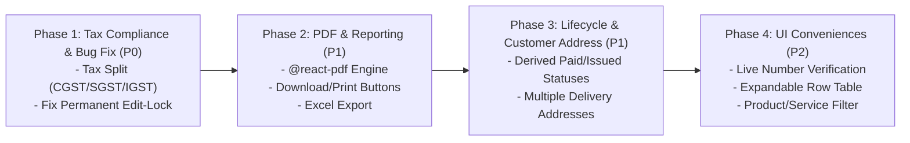

# Invoice Module Gap & Improvement Analysis

> **Document Status:** Complete Gap Analysis & Improvement Audit (NO IMPLEMENTATION)  
> **Target Project:** `D:\office-data\claude-projects\fashion-erp`  
> **Reference Module:** `https://indradhar.in/company/invoice` (Source: `D:\office-data\Project\indradhar\internal_project`)  
> **Audit Date:** 2026-10-14  
> **Implementation Scope:** Strictly Audit & Documentation Only (No Code Modifications)

---

## 1. Executive Summary

Fashion ERP में पहले से एक सुव्यवस्थित `CustomInvoice` (कस्टम इनवॉइस) मॉड्यूल मौजूद है, जिसे मुख्य रूप से Indradhar/HRMS के एड-हॉक बिलिंग पैटर्न के आधार पर डिज़ाइन किया गया था। यह मॉड्यूल नियमित `SalesInvoice` (जो सेल्स ऑर्डर से उत्पन्न होता है) से अलग, त्वरित बिलिंग (quick/petty billing) के लिए बनाया गया है।

### प्रमुख निष्कर्ष (Key Findings)
1. **मजबूत नींव (Architectural Strengths):** Fashion ERP का मौजूदा कस्टम इनवॉइस इंजन PostgreSQL `Decimal(18, 2)` और `Decimal(18, 4)` का उपयोग करता है (जबकि Reference में JavaScript `Float` प्रयुक्त है, जिससे फ्लोटिंग-पॉइंट राउंडिंग एरर का जोखिम रहता है)। इसके अलावा, Fashion ERP में पूर्ण ऑडिट लॉगिंग (`writeAuditLog`), स्ट्रिक्ट टेनेंट आइसोलेशन (`companyId`), और सुरक्षित कॉनकरेंसी गार्ड्स (`compare-and-swap`) मौजूद हैं।
2. **समान गणना तर्क (Calculation Parity):** इनवॉइस छूट (Discount %) को प्रत्येक लाइन की यूनिट दर पर घटाने (`discountedPrice = unitPrice * (1 - discount%)`) तथा रिवर्स चार्ज (RCM) पर GST को शून्य करने का मूल गणितीय नियम दोनों प्रणालियों में पूर्णतः समान (`MATCH`) है।
3. **गंभीर कमियाँ (Major Verified Gaps):**
   - **PDF / Print का पूर्ण अभाव (`MISSING`):** Fashion ERP के कस्टम इनवॉइस में PDF जनरेट करने, रेंडर करने या डाउनलोड करने की कोई कार्यप्रणाली मौजूद नहीं है।
   - **Excel एक्सपोर्ट का अभाव (`MISSING`):** ऑल-इनवॉइस रिपोर्ट में Excel एक्सपोर्ट नहीं है।
   - **CGST / SGST बनाम IGST विभाजन का अभाव (`BUG/RISK`):** Fashion ERP केवल एक फ्लैट `taxAmount` स्टोर करता है। कंपनी और डिलीवरी पते के राज्य कोड की तुलना करके कानूनी रूप से अनिवार्य CGST/SGST या IGST का विभाजन नहीं किया जाता।
   - **स्थायी संपादन लॉक (Permanent Edit-Lock Bug - `BUG/RISK`):** यदि किसी इनवॉइस पर क्रेडिट नोट बनाकर बाद में रद्द (CANCELLED) भी कर दिया जाए, तब भी इनवॉइस को एडिट नहीं किया जा सकता क्योंकि `replaceItemsAndNotes` पुराने आइटम्स को डिलीट करता है और डेटाबेस फॉरेन की (FK) एरर देता है।
   - **लाइफ़साइकिल स्टेटस भ्रम (`PARTIAL`):** Fashion ERP में केवल `DRAFT` और `CANCELLED` स्टेटस हैं। भुगतान पूर्ण होने के बाद भी स्टेटस बैज "DRAFT" ही दिखाता है, जिससे ऑपरेटर भ्रमित होते हैं।
   - **क्लाइंट डिलीवरी पता (`MISSING`):** एक ही क्लाइंट के कई डिलीवरी/शिपिंग पतों का समर्थन नहीं है।

---

## 2. Reference vs Fashion ERP Comparison Matrix

| ID | Feature / Rule | Reference Behavior (`indradhar.in`) | Fashion ERP Current State | Classification | Gap / Risk | Recommendation | Priority |
|---|---|---|---|---|---|---|---|
| **GAP-01** | **Invoice PDF Generation & Download** | Puppeteer द्वारा सर्वर-साइड A4 PDF जनरेट होता है, `uploads/invoice/` में सेव होता है और लिस्ट/डिटेल से सीधे डाउनलोड होता है। | कस्टम इनवॉइस हेतु कोई PDF टेम्पलेट, API रूट (`/pdf`) या डाउनलोड बटन मौजूद नहीं है। | `MISSING` | ग्राहक को देने योग्य कोई आधिकारिक प्रिंट/PDF इनवॉइस नहीं बन पाता। | `@react-pdf/renderer` द्वारा `document-pdf.tsx` की तर्ज पर सर्वर-साइड PDF रूट व UI बटन जोड़ें। | **P1** |
| **GAP-02** | **CGST / SGST vs IGST Tax Breakdown** | कंपनी और डिलीवरी पते के `stateCode` की तुलना करके CGST (Tax/2) + SGST (Tax/2) या IGST (Tax) में बांटता है और लिस्ट/PDF में दिखाता है। | केवल एक समग्र `taxAmount` व `lineTaxAmount` स्टोर करता है। कोई राज्य तुलना या टैक्स स्प्लिट नहीं है। | `BUG/RISK` | GST अनुपालन (GSTR-1 फाइलिंग और ऑडिट) में कानूनी अमान्यता। टैक्स इनवॉइस पर CGST/SGST अलग दिखना अनिवार्य है। | डिलीवरी पते का राज्य कोड प्राप्त करें, इंटर/इंट्रा स्टेट लॉजिक से CGST, SGST, IGST की गणना व स्टोरेज करें। | **P0** |
| **GAP-03** | **Excel Export of Invoices** | तिथि और ग्राहक फ़िल्टर के साथ पूरी इनवॉइस रिपोर्ट को GST ब्रेकडाउन सहित `.xlsx` में एक्सपोर्ट करता है। | लिस्ट पेज पर कोई Excel एक्सपोर्ट बटन या बैकएंड रूट नहीं है। | `MISSING` | लेखा परीक्षकों (CA/Accountants) को डेटा देने में भारी मानवीय श्रम। | `exceljs` का उपयोग करके `/api/v1/custom-invoices/export/xlsx` रूट और UI बटन जोड़ें। | **P1** |
| **GAP-04** | **Permanent Edit Lock on Cancelled Credit Note** | क्रेडिट नोट मौजूद होने पर एडिट ब्लॉक करता है (`creditNotes === 0`), लेकिन क्रेडिट नोट न होने पर पेमेंट री-एलोकेशन के साथ एडिट की अनुमति देता है। | किसी भी क्रेडिट नोट का इतिहास होने पर (भले ही वह CANCELLED हो) संपादन हमेशा के लिए ब्लॉक हो जाता है। | `BUG/RISK` | गलती से जारी होकर तुरंत रद्द किए गए क्रेडिट नोट के बाद इनवॉइस हमेशा के लिए फ्रीज हो जाती है; सुधार संभव नहीं रहता। | आइटम डिलीट करने के बजाय इन-प्लेस अपडेट करें अथवा केवल सक्रिय (`ISSUED`) क्रेडिट नोट पर ही ब्लॉक करें। | **P0** |
| **GAP-05** | **Invoice Status Lifecycle** | कोई औपचारिक स्टेटस फ़ील्ड नहीं; `balanceDue == 0` से पेड और क्रेडिट नोट से एडजस्टेड माना जाता है। | `enum CustomInvoiceStatus { DRAFT, CANCELLED }`। इनवॉइस पूरी तरह चुकता होने पर भी "DRAFT" बैज ही दिखता है। | `PARTIAL` | उपयोगकर्ताओं में यह भ्रम रहता है कि इनवॉइस अभी कच्ची/अंतिम रूप से जारी नहीं है। | स्टेटस मॉडल में `ISSUED`, `PARTIALLY_PAID`, `PAID` जोड़ें अथवा लिस्ट पर व्युत्पन्न (derived) स्टेटस बैज दिखाएं। | **P1** |
| **GAP-06** | **Multiple Delivery Addresses per Client** | क्लाइंट के कई पते समर्थित हैं; इनवॉइस पर डिफ़ॉल्ट बिलिंग पता तथा अलग डिलीवरी पता चुना जा सकता है। | केवल `customerId` लिंक होता है। अलग शिपिंग पते का कोई विकल्प नहीं है। | `MISSING` | यदि क्लाइंट की अलग-अलग साइट्स/वेयरहाउस हों तो सही GST राज्य और शिपिंग पता नहीं चुना जा सकता। | कस्टमर मास्टर के शिपिंग एड्रेस को इनवॉइस हेडर (`shippingAddressId`) से लिंक करने की सुविधा दें। | **P1** |
| **GAP-07** | **Invoice Number Live Verification** | इनलाइन "Edit" और "Verify" बटन; `/invoice/check-number` पर कॉल करके फॉर्म सबमिशन से पहले ही उपलब्धता जांचता है। | केवल सबमिट के समय बैकएंड पर डुप्लिकेट चेक होता है (P2002 एरर)। | `IMPROVEMENT` | लंबा फॉर्म भरने के बाद सबमिट पर डुप्लिकेट एरर आने से ऑपरेटर का समय बर्बाद होता है। | फ़ील्ड स्तर पर ऑन-ब्लर या लाइव चेक हेतु `/custom-invoices/check-number` एंडपॉइंट जोड़ें। | **P2** |
| **GAP-08** | **Expandable Row Item Breakdown on List** | लिस्ट में `▲`/`▼` टॉगल से इनलाइन टेबल खुलती है: Item Name, Quantity, Unit, Price, Total. | डेटाटेबल में केवल समरी रो है; आइटम देखने के लिए डिटेल पेज पर जाना पड़ता है। | `IMPROVEMENT` | त्वरित मिलान (quick reconciliation) में अतिरिक्त क्लिक और पृष्ठ लोडिंग। | `CustomInvoicesListClient` में एक्सपैंडेबल रो रेंडरिंग सपोर्ट जोड़ें। | **P2** |
| **GAP-09** | **Product vs Service Item Filtering** | "Product" चुनने पर केवल इकाई (`unit !== ""`) वाले और "Service" चुनने पर बिना इकाई वाले आइटम फ़िल्टर होते हैं। | स्टाइल और मटेरियल की संयुक्त सूची बिना वर्गीकरण के आती है। | `IMPROVEMENT` | उत्पादों की लंबी सूची में सेवा मदों (Services) को खोजना असुविधाजनक। | आइटम चयन में टाइप फ़िल्टर चिप्स या अलग टैब प्रदान करें। | **P2** |
| **GAP-10** | **Terms & Conditions Dynamic List** | गतिशील सूची (+ Add, अधिकतम 4 शर्तें), कंपनी प्रोफ़ाइल से स्वतः लोड होती हैं। | सिंगल मल्टीलाइन टेक्स्टएरिया (`termsAndConditions: string?`)। | `PARTIAL` | कंपनी की मानक शर्तें स्वतः नहीं आतीं; हर बार टाइप करना पड़ता है। | कंपनी सेटिंग्स से डिफ़ॉल्ट शर्तें फेच करके टेक्स्टएरिया में प्री-फ़िल करें। | **P2** |
| **GAP-11** | **Float Precision vs Decimal Data Type** | Reference में JS `Float` और SQLite/Postgres `Float` का उपयोग है, जिससे दशमलव गणना में मामूली अंतर आ सकता है। | Fashion ERP में उच्च-परिशुद्धता `Decimal(18, 2)` और `Decimal(18, 4)` का उपयोग है। | `MATCH` (Better in ERP) | कोई जोखिम नहीं — ERP का कार्यान्वयन वित्तीय रूप से अधिक सुरक्षित है। | इस परिशुद्धता को बिना बदले यथावत सुरक्षित रखें। | **Preserve** |
| **GAP-12** | **Optimistic Concurrency Guards** | सामान्य Prisma ट्रांज़ैक्शन। | `paidAmount` और `creditedAmount` पर compare-and-swap गार्ड्स। | `MATCH` (Better in ERP) | कोई जोखिम नहीं — दो ऑपरेटरों द्वारा एक साथ पेमेंट डालने पर ओवर-पेमेंट से बचाव। | इस गार्ड को सुरक्षित रखें। | **Preserve** |

---

## 3. Existing Custom Functionality to Preserve (मौजूदा ERP खूबियाँ जिन्हें सुरक्षित रखना है)

Fashion ERP में कस्टम इनवॉइस बनाते समय कुछ ऐसे महत्वपूर्ण आर्किटेक्चरल निर्णय लिए गए हैं जो Reference प्रोजेक्ट से भी बेहतर हैं। आगे किसी भी सुधार के दौरान इन्हें **कदापि न बदला जाए**:

1. **`Decimal(18, 2)` व `Decimal(18, 4)` डेटा प्रकार:**
   - Reference में फ्लोट प्रयुक्त है जो `0.1 + 0.2 = 0.30000000000000004` जैसी राउंडिंग त्रुटियाँ पैदा कर सकता है। Fashion ERP का Prisma Decimal स्कीमा वित्तीय दृष्टिकोण से शत-प्रतिशत सटीक है।
2. **`AuditLogger` का पूर्ण एकीकरण:**
   - प्रत्येक इनवॉइस निर्माण (`CREATE`), संपादन (`UPDATE`), तथा रद्दीकरण (`CANCEL`) पर `writeAuditLog` द्वारा पुराना और नया मान ऑडिट टेबल में दर्ज होता है।
3. **Compare-and-Swap (CAS) Concurrency Guards:**
   - `custom-invoice-payment.service.ts` में:
     ```typescript
     const guard = await tx.customInvoice.updateMany({
       where: { id: customInvoiceId, paidAmount: invoice.paidAmount },
       data: { paidAmount: { increment: input.amount } },
     });
     if (guard.count === 0) throw new BusinessRuleError("OVER_PAYMENT_NOT_ALLOWED", ...);
     ```
   - यह रेस कंडीशन (दो यूज़र्स द्वारा एक साथ भुगतान दर्ज करना) को रोकता है।
4. **Chart of Accounts (Income Category) एकीकरण:**
   - Reference में एक अलग फ्लैट "Categories" टेबल थी। Fashion ERP ने समझदारी से मौजूदा `ChartOfAccount` (AccountType: `INCOME`) का पुनः उपयोग किया है, जिससे सिस्टम में अवांछित तालिकाओं की भरमार नहीं हुई।
5. **स्वतंत्र कस्टमर लेजर (`custom-invoice-ledger.service.ts`):**
   - यह मुख्य जनरल लेजर को दूषित किए बिना केवल कस्टम इनवॉइस, भुगतानों और क्रेडिट नोट्स का शुद्ध रनिंग बैलेंस तैयार करता है।

---

## 4. Verified Gaps and Potential Bugs

### 4.1 Bug / Risk 1: Missing GST Classification (CGST / SGST / IGST)
- **स्थिति:** `BUG/RISK`
- **साक्ष्य:** `fashion-erp/src/modules/accounts/custom-invoice.service.ts` (Lines 55–62):
  ```typescript
  function computeTotals(items: CustomInvoiceInput["items"], lines: ComputedLine[]) {
    const subtotalAmount = round2(lines.reduce((sum, l) => sum + l.lineAmount, 0));
    ...
    const taxAmount = round2(lines.reduce((sum, l) => sum + l.lineTaxAmount, 0));
    const grandTotal = round2(subtotalAmount + taxAmount);
    return { subtotalAmount, discountAmount, taxAmount, grandTotal };
  }
  ```
- **समस्या:** यहाँ `taxAmount` को केवल एकमुश्त जोड़ा गया है। भारतीय GST नियमों के अनुसार, यदि सप्लायर और बायर एक ही राज्य में हैं तो टैक्स आधा-आधा CGST और SGST में विभाजित होना चाहिए; यदि राज्य भिन्न हैं तो संपूर्ण टैक्स IGST होना चाहिए। इसके बिना इनवॉइस वैधानिक रूप से अमान्य (legally non-compliant) है।

### 4.2 Bug / Risk 2: The Permanent Edit-Lock Cascade Bug
- **स्थिति:** `BUG/RISK`
- **साक्ष्य:** `custom-invoice.service.ts` (Lines 237–244) और `custom-invoice.repository.ts` (Lines 68–76):
  - सर्विस कोड में लिखा है:
    ```typescript
    const hasAnyCreditNoteHistory = (await CustomInvoiceCreditNoteRepository.countByInvoiceId(id)) > 0;
    if (Number(existing.paidAmount) > 0 || Number(existing.creditedAmount) > 0 || hasAnyCreditNoteHistory) {
      throw new BusinessRuleError("INVALID_STATE_TRANSITION", "Cannot edit this invoice...");
    }
    ```
  - और रिपॉजिटरी में:
    ```typescript
    await tx.customInvoiceItem.deleteMany({ where: { customInvoiceId: invoiceId } });
    ```
- **समस्या:** यदि किसी यूज़र ने गलती से क्रेडिट नोट बनाया और तुरंत उसे रद्द (CANCEL) कर दिया, तब भी `hasAnyCreditNoteHistory` का मान > 0 रहता है, जिससे वह इनवॉइस हमेशा के लिए एडिट होने से रुक जाती है। डेवलपर ने कमेंट में लिखा है कि ऐसा फॉरेन की (FK) एरर से बचने के लिए किया गया, लेकिन इसका सही समाधान आइटम को डिलीट करने के बजाय इन-प्लेस अपडेट करना या फॉरेन की को कैस्केड सेट-नल करना था।

### 4.3 Missing Feature 1: No PDF / Print Functionality
- **स्थिति:** `MISSING`
- **साक्ष्य:** `fashion-erp/src/app/(dashboard)/accounts/custom-invoices` में कोई प्रिंट या PDF रूट मौजूद नहीं है।
- **समस्या:** ऑपरेटर इनवॉइस बनाकर ग्राहक को प्रिंट या WhatsApp/Email PDF नहीं भेज सकता।

### 4.4 Missing Feature 2: No Excel Export
- **स्थिति:** `MISSING`
- **साक्ष्य:** `CustomInvoicesListClient.tsx` (Lines 42–75) में केवल डेटाटेबल है, कोई एक्सपोर्ट बटन या API नहीं है।

---

## 5. Improvement Recommendations with P0 / P1 / P2 Priorities

### Group P0: Critical (वित्तीय शुद्धता, डेटा अखंडता व वैधानिक अनुपालन)

#### Recommendation P0-1: Implement Legal CGST / SGST / IGST Tax Split Logic
- **वर्तमान समस्या & साक्ष्य:** इनवॉइस केवल एकल `taxAmount` स्टोर करती है। `stateCode` का कोई मिलान नहीं होता (`custom-invoice.service.ts#L59`)।
- **व्यावसायिक प्रभाव (Business Impact):** गैर-कानूनी इनवॉइस; ग्राहक इनपुट टैक्स क्रेडिट (ITC) क्लेम नहीं कर पाएगा; GST ऑडिट में पेनल्टी का जोखिम।
- **सुझाया गया सुधार:**
  1. इनवॉइस हेडर और लाइन स्तर पर `cgstAmount`, `sgstAmount`, और `igstAmount` की गणना जोड़ें।
  2. कंपनी के राज्य (`Company.stateCode`) और ग्राहक के बिलिंग/डिलीवरी राज्य (`Customer.state` / `Address.stateCode`) की तुलना करें।
  3. यदि समान राज्य हो: $\text{CGST} = \text{Tax}/2$, $\text{SGST} = \text{Tax}/2$, $\text{IGST} = 0$.
  4. यदि भिन्न राज्य हो: $\text{IGST} = \text{Tax}$, $\text{CGST} = 0$, $\text{SGST} = 0$.
- **संभावित प्रभावित फ़ाइलें:**
  - `prisma/schema.prisma` (`CustomInvoice`, `CustomInvoiceItem` में tax split कॉलम्स)
  - `src/modules/accounts/custom-invoice.service.ts` (`computeLines`, `computeTotals`)
  - `src/app/(dashboard)/accounts/custom-invoices/[id]/CustomInvoiceWorkflowPanel.tsx`
- **प्राथमिकता कारण:** GST वैधानिक अनुपालन के बिना इनवॉइस का वाणिज्यिक उपयोग असंभव है।
- **Acceptance Criteria:**
  - इंट्रा-स्टेट ग्राहक के लिए लाइन और हेडर पर CGST और SGST बराबर 50-50% बंटें और IGST 0 हो।
  - इंटर-स्टेट ग्राहक के लिए 100% टैक्स IGST में दर्ज हो और CGST/SGST 0 हों।
  - RCM चेक होने पर तीनों शून्य हों और लेज़र पर Reverse Charge का ध्वज दर्ज हो।

---

#### Recommendation P0-2: Fix Item Replacement Architecture to Avoid Permanent Edit Lock
- **वर्तमान समस्या & साक्ष्य:** रद्द किए गए क्रेडिट नोट के बाद भी इनवॉइस एडिट ब्लॉक रहती है क्योंकि `replaceItemsAndNotes` पुराने आइटम्स को `deleteMany` करता है जो FK एरर देता है (`custom-invoice.service.ts#L237`).
- **व्यावसायिक प्रभाव:** यदि ऑपरेटर से गलती से क्रेडिट नोट बन जाए और वह उसे कैंसिल कर दे, तब भी वह मूल इनवॉइस की टंकण त्रुटि (typo) ठीक नहीं कर सकता।
- **सुझाया गया सुधार:**
  1. `replaceItemsAndNotes` को `upsert` पैटर्न में बदलें: जो आइटम्स क्रेडिट नोट से जुड़े हैं उन्हें डिलीट करने के बजाय केवल उनकी दर/मात्रा अपडेट करें या इन-प्लेस सिंक करें।
  2. केवल तभी संपादन रोकें जब सक्रिय (`status === "ISSUED"`) क्रेडिट नोट मौजूद हो।
- **संभावित प्रभावित फ़ाइलें:**
  - `src/modules/accounts/custom-invoice.repository.ts` (`replaceItemsAndNotes`)
  - `src/modules/accounts/custom-invoice.service.ts` (`updateCustomInvoice`)
- **प्राथमिकता कारण:** अनावश्यक डेटा लॉकिंग और सिस्टम में डेड-एंड पैदा करता है।
- **Acceptance Criteria:**
  - यदि इनवॉइस पर क्रेडिट नोट बना और फिर कैंसिल हुआ, तो इनवॉइस सफलतापूर्वक एडिट हो सके बिना किसी 500 एरर के।

---

### Group P1: Important (कोर वर्कफ़्लो व अनिवार्य यूज़ेबिलिटी)

#### Recommendation P1-1: Add Server-Side PDF Generation & Download Action
- **वर्तमान समस्या & साक्ष्य:** कस्टम इनवॉइस में PDF का कोई विकल्प नहीं है।
- **व्यावसायिक प्रभाव:** बिलिंग क्लर्क ग्राहक को इनवॉइस नहीं सौंप सकता।
- **सुझाया गया सुधार:**
  1. Fashion ERP के स्थापित `@react-pdf/renderer` इंजन का उपयोग करके `src/core/documents/custom-invoice-pdf.tsx` तैयार करें (जिसमें कंपनी हेडर, GSTIN, बिलिंग/शिपिंग पता, लाइन आइटम्स, HSN समरी, CGST/SGST/IGST ब्रेकडाउन, अग्रिम भुगतान, देय राशि और नियम-शर्तें शामिल हों)।
  2. API रूट बनाएं: `GET /api/v1/custom-invoices/[id]/pdf` (जो `application/pdf` रिटर्न करे)।
  3. `CustomInvoicesListClient.tsx` तथा `CustomInvoiceWorkflowPanel.tsx` पर "Download PDF" और "Print" बटन जोड़ें।
- **संभावित प्रभावित फ़ाइलें:**
  - `src/core/documents/custom-invoice-pdf.tsx` (नया)
  - `src/app/api/v1/custom-invoices/[id]/pdf/route.ts` (नया)
  - `src/app/(dashboard)/accounts/custom-invoices/CustomInvoicesListClient.tsx`
  - `src/app/(dashboard)/accounts/custom-invoices/[id]/CustomInvoiceWorkflowPanel.tsx`
- **प्राथमिकता कारण:** इनवॉइस का मुख्य उद्देश्य प्रिंट/PDF दस्तावेज़ उपलब्ध कराना है।
- **Acceptance Criteria:**
  - एक क्लिक में A4 फॉर्मेटेड PDF डाउनलोड हो जिसमें कंपनी लोगो, पार्टी विवरण, कर विभाजन और हस्ताक्षर ब्लॉक सही दिखे।

---

#### Recommendation P1-2: Add Excel Export on Custom Invoices List
- **वर्तमान समस्या & साक्ष्य:** लिस्ट स्क्रीन पर कोई एक्सपोर्ट नहीं है (`CustomInvoicesListClient.tsx`).
- **व्यावसायिक प्रभाव:** मासिक लेखा मिलान (Monthly Reconciliation) और CA को रिपोर्टिंग में भारी असुविधा।
- **सुझाया गया सुधार:**
  1. `exceljs` का उपयोग करके `GET /api/v1/custom-invoices/export/xlsx` रूट बनाएं (फिल्टर्स: Search, Date From, Date To, Status, Client).
  2. लिस्ट हेडर पर "Export Excel" बटन जोड़ें।
- **संभावित प्रभावित फ़ाइलें:**
  - `src/app/api/v1/custom-invoices/export/xlsx/route.ts` (नया)
  - `src/app/(dashboard)/accounts/custom-invoices/CustomInvoicesListClient.tsx`
- **Acceptance Criteria:**
  - फ़िल्टर किए गए डेटा के साथ एक्सेल शीट डाउनलोड हो जिसमें इनवॉइस नंबर, ग्राहक, तिथि, बेसिक राशि, CGST, SGST, IGST, टोटल और बकाया राशि के अलग कॉलम हों।

---

#### Recommendation P1-3: Resolve Status Badge Confusion (Add Issued / Paid Derived Status)
- **वर्तमान समस्या & साक्ष्य:** इनवॉइस हमेशा "DRAFT" स्थिति में रहती है जब तक कि कैंसिल न हो (`custom-invoice.service.ts#L223`).
- **व्यावसायिक प्रभाव:** प्रबंधन यह नहीं समझ पाता कि कौन-सा बिल जारी हो चुका है और कौन-सा चुकता (Paid) हो चुका है।
- **सुझाया गया सुधार:**
  - या तो हेडर पर `ISSUED`, `PARTIALLY_PAID`, `PAID` का औपचारिक ट्रांज़िशन जोड़ें, या लिस्ट UI पर एक व्युत्पन्न (derived) स्थिति प्रदर्शित करें:
    - यदि `status === "CANCELLED"` $\rightarrow$ **Cancelled**
    - यदि `balanceDue <= 0` $\rightarrow$ **Paid**
    - यदि `paidAmount > 0` $\rightarrow$ **Partially Paid**
    - यदि अन्य $\rightarrow$ **Issued / Active**
- **संभावित प्रभावित फ़ाइलें:**
  - `src/app/(dashboard)/accounts/custom-invoices/statusLabels.ts`
  - `CustomInvoicesListClient.tsx`
- **Acceptance Criteria:**
  - पूर्ण भुगतान होने पर इनवॉइस लिस्ट और डिटेल पर "Paid" का हरा बैज दिखाई दे।

---

#### Recommendation P1-4: Support Multiple Customer Addresses (Billing vs Delivery)
- **वर्तमान समस्या & साक्ष्य:** इनवॉइस में केवल `customerId` है; डिलीवरी पता चुनने का विकल्प नहीं है (`CustomInvoiceForm.tsx#L94`).
- **व्यावसायिक प्रभाव:** यदि ग्राहक का कॉर्पोरेट ऑफिस दिल्ली में और डिलीवरी जयपुर साइट पर है, तो गलत राज्य कोड के कारण बिलिंग त्रुटिपूर्ण हो जाती है।
- **सुझाया गया सुधार:** कस्टमर मास्टर में पते जोड़ें और इनवॉइस में `deliveryAddressId` का ड्रॉपडाउन दें।
- **Acceptance Criteria:**
  - ग्राहक बदलने पर उसका डिफ़ॉल्ट डिलीवरी पता स्वतः भरे और आवश्यकतानुसार दूसरा पता चुना जा सके।

---

### Group P2: Optional (यूआई रिफाइनमेंट व कन्वीनियंस)

#### Recommendation P2-1: Add Pre-Submit Invoice Number Verification
- **वर्तमान समस्या:** डुप्लिकेट नंबर की जांच केवल अंतिम सबमिशन पर होती है।
- **सुझाया गया सुधार:** नंबर इनपुट के पास Reference की तरह "Verify" बटन दें जो `/api/v1/custom-invoices/next-number?check=...` पर कॉल करके हरा/लाल संकेत दे।
- **Priority:** **P2**

#### Recommendation P2-2: Add Expandable Row on Invoice List
- **वर्तमान समस्या:** लाइन आइटम्स देखने के लिए हर बार इनवॉइस खोलनी पड़ती है।
- **सुझाया गया सुधार:** टेबल रो पर एरो आइकन से इनलाइन आइटम ब्रेकडाउन दिखाएं (Reference के `allInvoiceTable.jsx` की तरह)।
- **Priority:** **P2**

#### Recommendation P2-3: Product vs Service Selection Filter
- **सुझाया गया सुधार:** आइटम ड्रॉपडाउन के ऊपर "Product" और "Service" का त्वरित टॉगल प्रदान करें।
- **Priority:** **P2**

---

## 6. Risks, Dependencies and Unresolved Questions

### 6.1 Risks & Dependencies
1. **Prisma Schema Migration Risk:**
   - यदि कर विभाजन हेतु `cgstAmount`, `sgstAmount`, `igstAmount` कॉलम जोड़े जाते हैं, तो मौजूदा डेटाबेस पर नॉन-डिस्ट्रक्टिव माइग्रेशन (`prisma migrate dev`) की आवश्यकता होगी। मौजूदा डेटा के लिए बैकफ़िल स्क्रिप्ट लिखनी होगी।
2. **General Ledger Boundary Risk:**
   - Fashion ERP में कस्टम इनवॉइस जानबूझकर मुख्य AR लेजर से बाहर रखी गई है। यदि भविष्य में इसे सीधे AR लेजर से जोड़ने की मांग आती है, तो यह डबल-एंट्री सिस्टम में बड़ी उथल-पुथल कर सकता है। जब तक स्पष्ट आदेश न हो, इसे स्टैंडअलोन लेजर (`CustomInvoicePayment`) पर ही रखना सुरक्षित है।

### 6.2 Unresolved Questions (अस्पष्ट प्रश्न)
1. क्या Fashion ERP में कस्टम इनवॉइस के लिए भी Tally XML एक्सपोर्ट की आवश्यकता है, जैसा Reference में मौजूद है?
2. क्या कस्टम इनवॉइस पर अधिकतम 5 उत्पादों की सीमा लागू करनी चाहिए (जैसे Reference में है), या असीमित (unlimited) रहने देना चाहिए? (सुझाव: असीमित रहने देना अधिक व्यावहारिक है)।
3. क्या ग्राहक के पते के लिए अलग `Address` तालिका बनाई जाए या मौजूदा `Customer` मॉडल के फ़ील्ड्स का विस्तार किया जाए?

---

## 7. Recommended Implementation Sequence (Planning Only)

भविष्य में जब यूज़र कार्यान्वयन (Implementation) की अनुमति दे, तब निम्नलिखित 4 चरणों में काम करने की सिफारिश की जाती है:



- **Phase 1 (P0):** टैक्स विभाजन का गणितीय व डेटा मॉडल सुधार और परमानेंट एडिट लॉक बग का समाधान।
- **Phase 2 (P1):** PDF जनरेटर (`@react-pdf/renderer`) और Excel एक्सपोर्ट कार्यान्वयन।
- **Phase 3 (P1):** स्टेटस लाइफ़साइकिल का दृश्य सुधार और बहु-पता (Multi-address) समर्थन।
- **Phase 4 (P2):** यूआई संवर्द्धन (लाइव नंबर वेरिफिकेशन, एक्सपैंडेबल टेबल)।

---

## 8. Acceptance Criteria for Future Implementation

जब भविष्य में यह कार्य शुरू किया जाए, तो निम्नलिखित 8 बिंदुओं पर अंतिम सत्यापन किया जाएगा:
1. **टैक्स विभाजन सटीकता:** इंट्रा-स्टेट और इंटर-स्टेट बिलों पर CGST, SGST और IGST का जोड़ हमेशा कुल टैक्स और ग्रैंड टोटल से ₹0.00 के अंतर पर सटीक बैठे।
2. **PDF लेआउट व डाउनलोड:** इनवॉइस लिस्ट और डिटेल पेज से एक क्लिक पर संपूर्ण A4 PDF बिना किसी लेआउट डिस्टॉर्शन के डाउनलोड हो।
3. **Excel शीट मिलान:** Excel एक्सपोर्ट की पंक्तियों का कुल योग इनवॉइस लिस्ट के समरी योग से 100% मेल खाए।
4. **रद्दीकरण के बाद संपादन:** क्रेडिट नोट को रद्द करने के बाद इनवॉइस बिना किसी डेटाबेस या सर्वर त्रुटि के एडिट हो सके।
5. **स्टेटस बैज:** भुगतान दर्ज होते ही इनवॉइस का बैज "Paid" या "Partially Paid" में अपडेट हो।
6. **कोई रिग्रेशन नहीं:** मौजूदा यूनिट टेस्ट्स (`custom-invoice.service.test.ts`, `custom-invoice-payment.service.test.ts`, `custom-invoice-credit-note.service.test.ts`) पूर्णतः पास होने चाहिए।
7. **ऑडिट लॉगिंग:** हर नए या संशोधित फ़ील्ड पर `writeAuditLog` सही मान दर्ज करे।
8. **टेनेंट आइसोलेशन:** कंपनी A का डेटा कंपनी B के ऑपरेटर को किसी भी परिस्थिति (API या UI) में दिखाई न दे।
