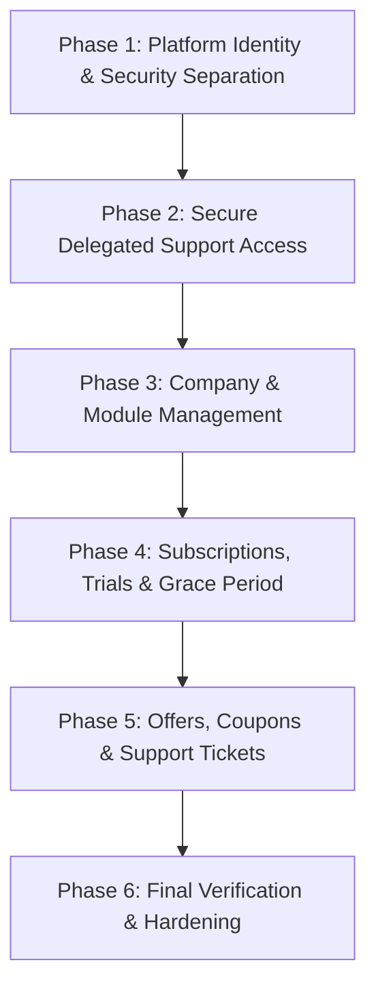
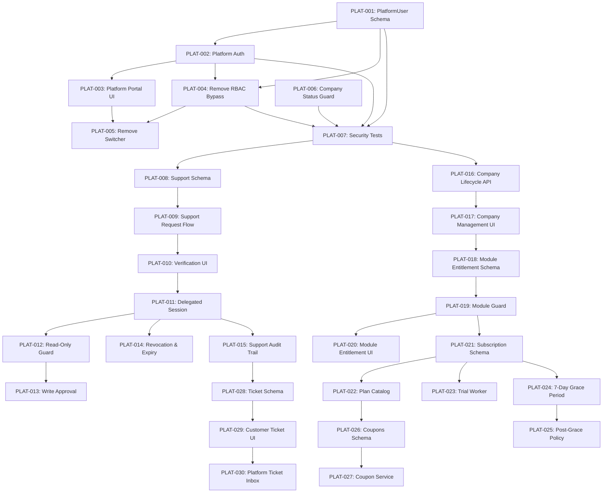

# Fashion ERP — SaaS Master Implementation Tracker

**Single Source of Truth (SSOT)** for Platform Administration & SaaS Transformation  
**Document Path**: `docs/PLATFORM_SAAS_MASTER_TRACKER.md`  
**Initial Baseline Date**: 2026-10-12  
**Current Active Phase**: Phase 1 (Planning / Not Started)  
**Current Active Task**: PLAT-001 (Ready for Approval)  

---

## 1. PROGRESS DASHBOARD

| Metric | Value |
|---|---|
| **Total Tasks Identified** | 30 |
| **NOT STARTED** | 30 |
| **IN PROGRESS** | 0 |
| **BLOCKED** | 0 |
| **IMPLEMENTED** | 0 |
| **VERIFIED** | 0 |
| **DEFERRED** | 0 |
| **Overall Verified Completion** | **0.0%** (0 / 30) |
| **Current Active Phase** | **Phase 1 — Platform Identity & Security Separation** |
| **Current Active Task** | None (Awaiting Phase 1 Approval) |
| **Next Eligible Task** | `PLAT-001` (PlatformUser Schema & Separation) |
| **Open Decisions Requiring Clarification** | 4 |

> [!NOTE]
> Progress percentage is calculated strictly on **VERIFIED** tasks (meaning code written, unit & integration tests passing, and acceptance criteria validated). Pre-existing partial features are recorded in the *Current Project State* section and are not counted towards verified completion until their Phase-specific acceptance criteria are formally validated.

---

## 2. PROJECT OBJECTIVE

Transform the existing, production-grade, multi-tenant Fashion ERP into a secure, robust SaaS platform by:
1. **Separating Platform Administration from Customer ERP**: Completely isolating platform operators, super admins, and support staff from tenant ERP modules, UI, and default permissions.
2. **Implementing Secure Delegated Support Access**: Replacing unrestricted tenant switching with a time-limited, audited, customer-approved verification workflow (read-only by default).
3. **Establishing Subscription & Entitlement Lifecycle**: Introducing modular plans, automated trial lifecycles with a 7-day read-only grace period, company suspension enforcement, offers/coupons, and customer support ticketing.
4. **Preserving Core ERP Integrity**: Ensuring zero regression or disruption to existing manufacturing workflows (Cutting, Stitching, Finishing, QC, Job Work, Dispatch, Invoicing).

---

## 3. CONFIRMED BUSINESS DECISIONS

The following decisions are approved and bind all future implementation tasks:

1. **Platform Identity Model**:
   - Platform users must be stored in a dedicated `PlatformUser` model, completely decoupled from the tenant `Company` table (`company_id` will not exist on `PlatformUser`).
   - Platform Administration interfaces must live in a dedicated route group `src/app/(platform)/` with independent layouts, navigation, and middleware guards.
2. **Secure Delegated Support Access**:
   - Platform staff have **no implicit access** to customer ERP tenant data.
   - Access requires a customer-side approval workflow using an ephemeral, cryptographically secure 6-digit verification code.
   - Delegated support sessions are **Read-Only by default**.
   - Write access requires a separate, explicit customer approval step with mandatory justification.
   - All support sessions are strictly time-limited (max 2 hours) and instantly revocable by the customer.
   - Every read and mutation during a support session is tagged in a dedicated, tamper-evident support audit log.
3. **Subscription Expiry & Grace Period**:
   - When a company subscription or trial expires, the system enters an automatic **7-day read-only grace period**.
   - During the grace period, users can log in, view existing data, print documents, and export reports, but all mutation actions (creating orders, stage receipts, inventory movements, dispatches, payments) are blocked.
   - Post-grace period policy (hard lock vs. extended archive access) remains pending approval.

---

## 4. CURRENT ARCHITECTURE SUMMARY

- **Web Framework**: Next.js 16.3.1 (React 19, Turbopack, App Router)
- **Database & Schema**: PostgreSQL via Prisma 6.19.2 (`prisma/schema.prisma`)
- **Authentication**: NextAuth v5 (Auth.js beta) using credentials provider & Edge-safe JWT (`src/core/auth/auth.ts`, `src/core/auth/auth.config.ts`)
- **Authorization**: Tenant RBAC with live DB re-check on status/password (`src/core/rbac/PermissionService.ts`, `src/config/rbac.ts`)
- **Background Jobs**: BullMQ + Redis worker process running outside Next.js (`src/core/jobs/worker.ts`, `src/core/jobs/queue.ts`)
- **Audit Logging**: Synchronous transactional logging to `audit_logs` table (`src/core/audit/AuditLogger.ts`)
- **Encryption**: AES-256-GCM authenticated encryption using `AUTH_SECRET` (`src/core/security/encryption.ts`)

---

## 5. CURRENT PROJECT STATE (EVIDENCE-BASED)

| ID | Feature / Component | Current Implementation | Status | Evidence | Gap |
|---|---|---|---|---|---|
| **CPS-01** | Platform User Identity | Stored in tenant `users` table with `isPlatformAdmin` boolean | PARTIAL | `prisma/schema.prisma:327`, `User.companyId` is non-nullable | Tied to a specific customer company; violates platform separation |
| **CPS-02** | Platform Authentication | Shared `/login` route with customer users | EXISTING | `src/core/auth/auth.ts:16-57` | No separate platform login endpoint or session guard |
| **CPS-03** | Platform RBAC | Universal bypass in `PermissionService.ts` | EXISTING / RISKY | `src/core/rbac/PermissionService.ts:122` (`if (user.isPlatformAdmin) return true;`) | Platform admin has god-mode across all tenant ERP modules |
| **CPS-04** | Platform Dashboard | Single page inside customer dashboard layout | PARTIAL | `src/app/(dashboard)/platform/companies/page.tsx` | Nested inside customer ERP layout; shows ERP sidebar |
| **CPS-05** | Company Management | List & create company with first admin & branch | EXISTING | `src/modules/platform/platform-company.service.ts` | No company edit, suspension, plan linking, or metrics |
| **CPS-06** | Company Suspension | `Company.isActive` boolean column exists in DB | PARTIAL | `prisma/schema.prisma:25` | `requireSession()` in `api-route.ts` does not check `company.isActive` |
| **CPS-07** | Company Settings | Basic company info (name, taxNo, fiscalYear) | EXISTING | `src/modules/administration/company-settings.service.ts` | No SaaS quota limits, storage caps, or billing contacts |
| **CPS-08** | Submodule Settings | Tab visibility for 6 fabric masters | EXISTING | `src/core/submodule-visibility/SubmoduleVisibilityService.ts` | Only toggles fabric master tabs; not a general module entitlement |
| **CPS-09** | Company Switching | Unrestricted `update({ companyId })` in JWT | EXISTING / INSECURE | `src/components/layout/CompanySwitcher.tsx`, `auth.config.ts:55` | Platform admin can jump to any customer tenant without authorization |
| **CPS-10** | Tenant Isolation | Isolated via `companyId` in repositories | EXISTING | Verified across 38 modules | Platform admin bypass punches a hole through tenant isolation |
| **CPS-11** | Support Access | Ad-hoc company switcher | INSECURE | `CompanySwitcher.tsx:38` | Zero customer consent, no verification code, no auto-expiry |
| **CPS-12** | Audit Logging | `writeAuditLog` records DB mutations | EXISTING | `src/core/audit/AuditLogger.ts:27` | Support sessions do not log support agent identity distinctly |
| **CPS-13** | Subscription Plans | None | NEW | Absent in `schema.prisma` and codebase | No plan catalog or pricing tiers |
| **CPS-14** | Company Subscriptions | None | NEW | Absent in `schema.prisma` and codebase | No active subscription records or renewal dates |
| **CPS-15** | Trial Management | None | NEW | Absent in `schema.prisma` and codebase | No trial start/end tracking or conversion workflow |
| **CPS-16** | Offers Management | None | NEW | Absent in `schema.prisma` and codebase | No promotional offers system |
| **CPS-17** | Coupons Management | None | NEW | Absent in `schema.prisma` and codebase | No coupon validation or discount logic |
| **CPS-18** | Support Tickets | None | NEW | Absent in `schema.prisma` and codebase | No ticketing system for customer support |
| **CPS-19** | Module Entitlements | None | NEW | Absent in `schema.prisma` and codebase | Cannot enable/disable ERP modules per tenant |
| **CPS-20** | Expiry Grace Period | None | NEW | Absent in `schema.prisma` and codebase | No read-only enforcement mechanism on billing expiry |

---

## 6. MASTER CHANGE MATRIX

| Task ID | Module | Existing State | Required Change | Change Type | Priority | Phase | Status | Dependencies |
|---|---|---|---|---|---|---|---|---|
| **PLAT-001** | Platform Identity | `User.isPlatformAdmin` inside tenant `User` table | Create `PlatformUser` model, migrate existing platform accounts | MODIFY / NEW | CRITICAL | Phase 1 | NOT STARTED | None |
| **PLAT-002** | Platform Auth | Shared credentials auth in `auth.ts` | Dedicated platform auth callback / token discriminator | MODIFY | CRITICAL | Phase 1 | NOT STARTED | PLAT-001 |
| **PLAT-003** | Platform Portal UI | `/platform/companies` inside `(dashboard)` | Create dedicated `src/app/(platform)/` route group with own layout & nav | MODIFY / NEW | HIGH | Phase 1 | NOT STARTED | PLAT-002 |
| **PLAT-004** | RBAC Separation | Universal bypass in `PermissionService.ts:122` | Remove universal bypass; platform users blocked from ERP modules | MODIFY | CRITICAL | Phase 1 | NOT STARTED | PLAT-001, PLAT-002 |
| **PLAT-005** | Company Switcher Removal | Unrestricted `CompanySwitcher.tsx` | Remove unrestricted company switcher from customer sidebar | MODIFY | CRITICAL | Phase 1 | NOT STARTED | PLAT-003, PLAT-004 |
| **PLAT-006** | Company Status Guard | `Company.isActive` not checked in `requireSession` | Enforce `company.isActive === true` in `requireSession()` | MODIFY | HIGH | Phase 1 | NOT STARTED | None |
| **PLAT-007** | Platform Auth Tests | Only tenant auth tests exist | Add comprehensive unit & integration tests for platform auth | NEW | HIGH | Phase 1 | NOT STARTED | PLAT-001, PLAT-002, PLAT-004 |
| **PLAT-008** | Support Schema | No support access models | Create `SupportAccessRequest` and `SupportAccessSession` models | NEW | HIGH | Phase 2 | NOT STARTED | PLAT-001 |
| **PLAT-009** | Support Request Flow | None | Platform staff initiates access request with reason & duration | NEW | HIGH | Phase 2 | NOT STARTED | PLAT-008 |
| **PLAT-010** | Customer Verification UI | None | Customer admin receives verification code and approves request | NEW | HIGH | Phase 2 | NOT STARTED | PLAT-008, PLAT-009 |
| **PLAT-011** | Delegated Session Exchange | None | Issue scoped, time-limited delegated support session | NEW | HIGH | Phase 2 | NOT STARTED | PLAT-008, PLAT-010 |
| **PLAT-012** | Read-Only Default Guard | `PermissionService` has no delegated concept | Enforce read-only mode during support sessions; block all mutations | MODIFY / NEW | CRITICAL | Phase 2 | NOT STARTED | PLAT-011 |
| **PLAT-013** | Write Approval Workflow | None | Explicit step with distinct approval code for write operations | NEW | HIGH | Phase 2 | NOT STARTED | PLAT-012 |
| **PLAT-014** | Support Revocation & Expiry | None | Instant customer revocation button and automatic time expiry | NEW | HIGH | Phase 2 | NOT STARTED | PLAT-011 |
| **PLAT-015** | Support Audit Trail | Standard audit log only | Log support agent ID, target tenant, reason, approved time, and actions | NEW | HIGH | Phase 2 | NOT STARTED | PLAT-011, PLAT-012 |
| **PLAT-016** | Company Lifecycle API | Only `listCompanies` and `createCompany` | Add activate, suspend, update company details, and stats API | EXTEND | MEDIUM | Phase 3 | NOT STARTED | PLAT-001, PLAT-006 |
| **PLAT-017** | Company Management UI | Basic read-only table and create form | Rich platform company management portal with suspension & details | EXTEND | MEDIUM | Phase 3 | NOT STARTED | PLAT-016 |
| **PLAT-018** | Module Entitlements Schema | Only 6-submodule UI visibility table | Create `CompanyModuleEntitlement` model for high-level ERP modules | NEW | HIGH | Phase 3 | NOT STARTED | None |
| **PLAT-019** | Module Guard Middleware | Modules accessible if user has role | Middleware & API route gates asserting module entitlement | NEW | HIGH | Phase 3 | NOT STARTED | PLAT-018 |
| **PLAT-020** | Module Entitlement UI | None | Platform interface to enable/disable ERP modules per tenant | NEW | MEDIUM | Phase 3 | NOT STARTED | PLAT-018, PLAT-019 |
| **PLAT-021** | Subscription Schema | None | Add `SubscriptionPlan` and `CompanySubscription` models | NEW | HIGH | Phase 4 | NOT STARTED | None |
| **PLAT-022** | Plan Catalog Service | None | Manage plans, features, quotas, billing cycles (Monthly/Annual) | NEW | HIGH | Phase 4 | NOT STARTED | PLAT-021 |
| **PLAT-023** | Trial Lifecycle Worker | None | BullMQ worker managing trial countdown, notifications, and expiry | NEW | MEDIUM | Phase 4 | NOT STARTED | PLAT-021 |
| **PLAT-024** | 7-Day Grace Period Guard | None | Enforce read-only mode across all ERP mutations during grace period | NEW | CRITICAL | Phase 4 | NOT STARTED | PLAT-021 |
| **PLAT-025** | Post-Grace Lockout Policy | None | Enforce approved post-grace behavior (account lockout or restricted) | NEW | HIGH | Phase 4 | NOT STARTED | PLAT-024 |
| **PLAT-026** | Offers & Coupons Schema | None | Add `Coupon`, `Offer`, and `CouponRedemption` models | NEW | MEDIUM | Phase 5 | NOT STARTED | PLAT-021 |
| **PLAT-027** | Coupon Service & API | None | Validate coupon code, discount rules, expiry, and redemption limits | NEW | MEDIUM | Phase 5 | NOT STARTED | PLAT-026 |
| **PLAT-028** | Support Ticket Schema | None | Add `SupportTicket`, `TicketMessage`, and `TicketAttachment` models | NEW | MEDIUM | Phase 5 | NOT STARTED | None |
| **PLAT-029** | Customer Ticket UI & API | None | In-app customer support widget & ticket submission interface | NEW | MEDIUM | Phase 5 | NOT STARTED | PLAT-028 |
| **PLAT-030** | Platform Ticket Inbox | None | Platform staff ticketing dashboard with status workflow & replies | NEW | MEDIUM | Phase 5 | NOT STARTED | PLAT-028, PLAT-029 |

---

## 7. PHASE-WISE IMPLEMENTATION ROADMAP



### Phase 1 — Platform Identity & Security Separation (Mandatory Security)
- **Objective**: Decouple platform user accounts from customer tenant tables, remove god-mode permissions from the customer ERP, and establish an isolated platform portal.
- **Tasks**: `PLAT-001`, `PLAT-002`, `PLAT-003`, `PLAT-004`, `PLAT-005`, `PLAT-006`, `PLAT-007`.
- **Exit Criteria**:
  - `PlatformUser` exists and has zero dependency on `Company.id`.
  - Platform users authenticate via platform credentials and cannot view or operate regular customer ERP menus.
  - `PermissionService.ts` has zero universal bypasses.
  - Suspended companies (`isActive === false`) cannot access the ERP.
  - All existing tenant unit and integration tests remain 100% green.

### Phase 2 — Secure Delegated Support Access (Customer Privacy & Trust)
- **Objective**: Provide a safe, transparent, customer-approved mechanism for support staff to troubleshoot tenant issues without permanent or unmonitored access.
- **Tasks**: `PLAT-008`, `PLAT-009`, `PLAT-010`, `PLAT-011`, `PLAT-012`, `PLAT-013`, `PLAT-014`, `PLAT-015`.
- **Exit Criteria**:
  - Support staff cannot access a customer tenant without generating an access request.
  - Customer receives and approves request via verification code.
  - Support sessions default to strictly Read-Only.
  - Write access requires secondary customer approval with audit reason.
  - Sessions automatically expire after approved duration (max 2 hours) and are instantly revocable.

### Phase 3 — Company & Module Management (Tenant Operations)
- **Objective**: Equip platform administrators with tools to manage company lifecycles, view tenant health, and toggle module entitlements.
- **Tasks**: `PLAT-016`, `PLAT-017`, `PLAT-018`, `PLAT-019`, `PLAT-020`.
- **Exit Criteria**:
  - Platform portal allows activating, suspending, and inspecting customer tenants.
  - ERP modules (CRM, Sampling, AI Designer, Barcodes, Dispatch) can be toggled per company.
  - Disabled modules are hidden from navigation and rejected with `403 FORBIDDEN` at API boundaries.

### Phase 4 — Subscriptions, Trials & Grace Period (SaaS Monetization)
- **Objective**: Introduce subscription plans, trial lifecycle management, and non-disruptive 7-day read-only grace periods.
- **Tasks**: `PLAT-021`, `PLAT-022`, `PLAT-023`, `PLAT-024`, `PLAT-025`.
- **Exit Criteria**:
  - Subscription plans define price, billing frequency, and entitled modules.
  - Companies have an active subscription or trial record.
  - On trial/plan expiry, tenant enters automatic 7-day read-only grace period.
  - Factory floor workers can view existing orders and lots, but cannot post new records during grace period.

### Phase 5 — Offers, Coupons & Support Tickets (Customer Engagement & Support)
- **Objective**: Implement promotional discounts and an integrated ticketing workflow between customers and platform support staff.
- **Tasks**: `PLAT-026`, `PLAT-027`, `PLAT-028`, `PLAT-029`, `PLAT-030`.
- **Exit Criteria**:
  - Coupons can be created, applied to subscriptions, and validated against discount rules.
  - Customers can submit support tickets with attachments directly inside the ERP.
  - Platform staff have a ticketing inbox to manage, reply to, and resolve tickets.

### Phase 6 — Final Verification & Production Readiness
- **Objective**: End-to-end verification, tenant isolation penetration testing, migration rehearsal, and production runbook preparation.
- **Exit Criteria**:
  - 100% of test suites pass with zero regressions.
  - Cross-tenant data leakage tests pass.
  - Rollback migration scripts tested on staging snapshot.

---

## 8. DETAILED TASK CHECKLISTS

### PLAT-001 — Platform Identity Separation
- **Current State**: Platform admin flag `isPlatformAdmin` resides on tenant `User` model (`schema.prisma:327`), requiring every platform admin to belong to a tenant `Company`.
- **Required Change**: Create a standalone `PlatformUser` model in `schema.prisma` without `companyId`. Backfill existing platform users into `PlatformUser`.
- **Affected Files**: `prisma/schema.prisma`, `src/modules/platform/platform-company.service.ts`, `prisma/seed.ts`.
- **Dependencies**: None.
- **Risk**: High (requires clean migration of existing platform user accounts).
- **Status**: NOT STARTED.
- **Acceptance Criteria**:
  - [ ] `PlatformUser` model created with `id`, `email`, `passwordHash`, `fullName`, `role`, `status`, `lastLoginAt`.
  - [ ] Existing `User` records with `isPlatformAdmin === true` migrated to `PlatformUser`.
  - [ ] Migration is purely additive; existing tenant `users` table remains functional.
  - [ ] Tests verify `PlatformUser` CRUD independent of any `Company`.
- **Verification Evidence**: Pending.
- **Implementation Notes**: Pending.
- **Last Updated**: 2026-10-12.

---

### PLAT-002 — Platform Authentication Pipeline
- **Current State**: Single NextAuth credentials configuration in `src/core/auth/auth.ts` authenticates against tenant `User`.
- **Required Change**: Extend NextAuth credentials authorization to distinguish `PlatformUser` logins and issue platform-specific JWT claims.
- **Affected Files**: `src/core/auth/auth.ts`, `src/core/auth/auth.config.ts`, `src/types/next-auth.d.ts`.
- **Dependencies**: PLAT-001.
- **Risk**: Critical (core authentication path).
- **Status**: NOT STARTED.
- **Acceptance Criteria**:
  - [ ] Platform login validates against `PlatformUser` table.
  - [ ] JWT token receives distinct `userType: "PLATFORM"` claim.
  - [ ] Platform session carries no default tenant `companyId`.
  - [ ] Tenant user login continues functioning without change.
- **Verification Evidence**: Pending.
- **Implementation Notes**: Pending.
- **Last Updated**: 2026-10-12.

---

### PLAT-003 — Dedicated Platform Portal UI Route Group
- **Current State**: `/platform/companies` is nested inside `src/app/(dashboard)/platform/companies/page.tsx` and wrapped in customer ERP sidebar.
- **Required Change**: Move platform pages to `src/app/(platform)/` with independent `PlatformLayout`, `PlatformSidebar`, and platform auth guard.
- **Affected Files**: `src/app/(platform)/layout.tsx`, `src/app/(platform)/page.tsx`, `src/app/(platform)/companies/`, `src/components/platform/`.
- **Dependencies**: PLAT-002.
- **Risk**: Low (UI routing reorganization).
- **Status**: NOT STARTED.
- **Acceptance Criteria**:
  - [ ] Dedicated `src/app/(platform)/` route group created.
  - [ ] Layout renders dedicated Platform Admin sidebar (Companies, Subscriptions, Platform Users).
  - [ ] Non-platform users attempting to access `/(platform)` are redirected to `/login` or returned `404`.
  - [ ] Customer ERP navigation contains zero links to platform pages.
- **Verification Evidence**: Pending.
- **Implementation Notes**: Pending.
- **Last Updated**: 2026-10-12.

---

### PLAT-004 — Remove Universal Platform RBAC Bypass
- **Current State**: `src/core/rbac/PermissionService.ts:122` executes `if (user.isPlatformAdmin) return true;` granting unconstrained access to all ERP modules.
- **Required Change**: Remove the universal bypass. Platform users cannot access customer ERP modules unless acting under an active, approved `DelegatedSupportSession`.
- **Affected Files**: `src/core/rbac/PermissionService.ts`.
- **Dependencies**: PLAT-001, PLAT-002.
- **Risk**: Critical (security gate).
- **Status**: NOT STARTED.
- **Acceptance Criteria**:
  - [ ] Universal bypass removed from `PermissionService.can()`.
  - [ ] Calling `PermissionService.can()` as a platform user outside a delegated support session returns `false`.
  - [ ] Normal tenant user permission resolution remains unaffected.
- **Verification Evidence**: Pending.
- **Implementation Notes**: Pending.
- **Last Updated**: 2026-10-12.

---

### PLAT-005 — Remove Unrestricted Company Switcher
- **Current State**: `src/components/layout/CompanySwitcher.tsx` allows platform admins to switch active `companyId` in their session token without restriction.
- **Required Change**: Remove `CompanySwitcher.tsx` from the customer ERP layout. Company context switching only allowed via approved Support Access.
- **Affected Files**: `src/components/layout/Sidebar.tsx`, `src/components/layout/CompanySwitcher.tsx`, `src/core/auth/auth.config.ts`.
- **Dependencies**: PLAT-003, PLAT-004.
- **Risk**: High (breaks previous ad-hoc workflow, replaces with secure support flow).
- **Status**: NOT STARTED.
- **Acceptance Criteria**:
  - [ ] `CompanySwitcher` removed from ERP sidebar.
  - [ ] `auth.config.ts` rejects arbitrary `trigger === "update"` company switches.
- **Verification Evidence**: Pending.
- **Implementation Notes**: Pending.
- **Last Updated**: 2026-10-12.

---

### PLAT-006 — Enforce Company Active Status in API Guards
- **Current State**: `requireSession()` in `src/lib/api-route.ts:32` checks `user.status === "ACTIVE"` but does not inspect `Company.isActive`.
- **Required Change**: Add live verification of `company.isActive` in `requireSession()`. If company is inactive/suspended, reject requests immediately with `ACCOUNT_SUSPENDED`.
- **Affected Files**: `src/lib/api-route.ts`.
- **Dependencies**: None.
- **Risk**: Low.
- **Status**: NOT STARTED.
- **Acceptance Criteria**:
  - [ ] `requireSession()` queries company status or verifies it in active user check.
  - [ ] Inactive company returns `403 FORBIDDEN` with code `ACCOUNT_SUSPENDED`.
  - [ ] Unit tests verify that suspended company blocks all API requests.
- **Verification Evidence**: Pending.
- **Implementation Notes**: Pending.
- **Last Updated**: 2026-10-12.

---

### PLAT-007 — Platform Security & Isolation Test Suite
- **Current State**: Tests exist for `platform-company.service.ts` but none exist for platform auth separation or isolation boundaries.
- **Required Change**: Implement comprehensive test suite covering platform authentication, route guarding, and privilege escalation prevention.
- **Affected Files**: `src/modules/platform/__tests__/platform-auth.test.ts`, `src/core/rbac/PermissionService.test.ts`.
- **Dependencies**: PLAT-001, PLAT-002, PLAT-004, PLAT-006.
- **Risk**: Low.
- **Status**: NOT STARTED.
- **Acceptance Criteria**:
  - [ ] Test verifies platform user cannot query tenant ERP endpoints.
  - [ ] Test verifies tenant user cannot access platform routes.
  - [ ] Test verifies suspended company users are rejected.
  - [ ] All tests pass in `vitest run`.
- **Verification Evidence**: Pending.
- **Implementation Notes**: Pending.
- **Last Updated**: 2026-10-12.

---

### PLAT-008 to PLAT-015 — Phase 2 Checklists (Delegated Support Access)
- **Status**: ALL NOT STARTED. Detailed acceptance criteria documented in Phase 2 roadmap.
- **Key Models**: `SupportAccessRequest`, `SupportAccessSession`.
- **Key Guards**: Ephemeral 6-digit OTP verification, default Read-Only session flag, customer revocation button.

---

### PLAT-016 to PLAT-020 — Phase 3 Checklists (Company & Module Management)
- **Status**: ALL NOT STARTED. Detailed acceptance criteria documented in Phase 3 roadmap.
- **Key Models**: `CompanyModuleEntitlement`.
- **Key Guards**: Module entitlement verification in navigation and API handlers.

---

### PLAT-021 to PLAT-025 — Phase 4 Checklists (Subscriptions & Trials)
- **Status**: ALL NOT STARTED. Detailed acceptance criteria documented in Phase 4 roadmap.
- **Key Models**: `SubscriptionPlan`, `CompanySubscription`.
- **Key Guards**: 7-day read-only grace period enforcement.

---

### PLAT-026 to PLAT-030 — Phase 5 Checklists (Offers, Coupons & Tickets)
- **Status**: ALL NOT STARTED. Detailed acceptance criteria documented in Phase 5 roadmap.
- **Key Models**: `Coupon`, `Offer`, `SupportTicket`, `SupportTicketMessage`.

---

## 9. TASK DEPENDENCIES & EXECUTION ORDER



---

## 10. RISK REGISTER

| Risk ID | Category | Description | Impact | Likelihood | Mitigation Strategy |
|---|---|---|---|---|---|
| **RSK-01** | Security | Platform admin bypass currently gives god-mode across all customer tenants | CRITICAL | HIGH | Remove bypass immediately in Phase 1 (`PLAT-004`); enforce delegated support access (`PLAT-012`) |
| **RSK-02** | Data Integrity | Disrupting live factory floor operations by hard-locking expired accounts | HIGH | HIGH | Approved 7-day read-only grace period (`PLAT-024`); allows document viewing & printing |
| **RSK-03** | Migration | Existing platform admin accounts losing access during `PlatformUser` migration | HIGH | MEDIUM | Additive migration script in `PLAT-001` with fallback verification before deprecating old flags |
| **RSK-04** | Performance | Repeated database lookups for company status & module entitlements on every API route | MEDIUM | MEDIUM | Short-TTL in-memory cache pattern matching `SubmoduleVisibilityService.ts` (8-second lock cache) |
| **RSK-05** | Backward Compat | Existing customer ERP routes or forms breaking due to route group reorganization | HIGH | LOW | Leave `src/app/(dashboard)/` routes untouched; only move `/platform/` paths to `src/app/(platform)/` |

---

## 11. PENDING BUSINESS & ARCHITECTURAL DECISIONS

The following decisions require explicit business sign-off before their respective phases can start:

1. **DEC-01 (Phase 4): Post-Grace Period Expired Account Policy**:
   - *Option A*: Complete lockout (users cannot log in; contact sales screen displayed).
   - *Option B*: Extended read-only archive access (users can log in and view historical records, but cannot add or edit any data).
   - *Status*: PENDING.
2. **DEC-02 (Phase 2): Support Write Access Permissibility**:
   - *Option A*: Support staff are strictly Read-Only under all circumstances (no write access ever granted).
   - *Option B*: Support staff can request write access only when customer explicitly authorizes with a separate secondary approval code.
   - *Status*: Approved as Option B in Confirmed Business Decisions (needs UX confirmation).
3. **DEC-03 (Phase 4): Automated Self-Service Payment Gateway**:
   - *Decision*: Will SaaS billing in V1 be handled via manual invoice/bank transfer, or requires immediate payment gateway integration (Stripe / Razorpay)?
   - *Status*: PENDING.
4. **DEC-04 (Phase 3): AI Quota / Token Metering**:
   - *Decision*: Should AI Garment Flow / AI Designer token usage be metered and capped per subscription plan to prevent third-party API cost overruns?
   - *Status*: PENDING.

---

## 12. SCOPE CHANGE REGISTER

No scope changes have been requested or approved. Any newly proposed feature must be added here and evaluated for impact before inclusion in the roadmap.

| Change ID | Date | Proposed By | Description | Impacted Phases | Status |
|---|---|---|---|---|---|
| None | — | — | — | — | — |

---

## 13. MANDATORY RULES FOR ALL FUTURE AI DEVELOPMENT SESSIONS

All AI agents, engineers, and contributors working on this codebase **MUST strictly adhere to the following rules**:

1. **Read this tracker first**: Review `docs/PLATFORM_SAAS_MASTER_TRACKER.md` before starting any Platform SaaS task.
2. **Work strictly on the active task**: Only execute the task currently approved by the user. Do not jump ahead to future phases.
3. **Verify dependencies**: Never begin a task if its predecessor tasks are not marked `VERIFIED`.
4. **Inspect before modifying**: Always inspect existing models, services, and tests before writing new code.
5. **No scope creep**: Do not introduce unapproved features or duplicate existing functionality.
6. **Preserve ERP workflows**: Never modify customer ERP business logic (production stages, dispatch gates, invoicing) unless explicitly required by an approved entitlement task.
7. **Purely additive database changes**: Never drop columns or tables; ensure all migrations are backward-compatible.
8. **Test verification required**: A task cannot be marked `VERIFIED` without executing `vitest run` and proving green test execution.
9. **Update the tracker**: Update this tracker after every completed task, logging changed files, tests, and remaining items.
10. **Awaiting approval**: Stop and report to the user at the end of each phase. Do not begin the next phase automatically.

---

## 14. PROGRESS UPDATE TEMPLATE

When updating this document after completing a task, use the following template:

```markdown
### Task Progress Update
- **Date**: YYYY-MM-DD
- **Task ID**: PLAT-XXX
- **Phase**: Phase X
- **Previous Status**: NOT STARTED / IN PROGRESS
- **New Status**: IMPLEMENTED / VERIFIED
- **Work Completed**: [Concise description of changes]
- **Files Changed**: [List of exact file paths]
- **Database Changes**: [Prisma models or migrations added]
- **Tests Executed**: [Test command and file paths]
- **Test Results**: [Passed / Skipped / Coverage]
- **Remaining Work**: [Any follow-up tasks]
- **Blockers / Notes**: [Any observations or warnings]
- **Next Task**: PLAT-YYY
```

---

## 15. CHRONOLOGICAL CHANGE LOG

| Timestamp | Task ID | Author | Action | Summary |
|---|---|---|---|---|
| 2026-10-12 | INIT | Principal Architect | Created Master Tracker | Initialized `PLATFORM_SAAS_MASTER_TRACKER.md` with 30 tasks across 6 phases based on read-only audit. |

---

## 16. NEXT RECOMMENDED TASK

**Recommended Next Step**: **PLAT-001 — Platform Identity Separation**.
- **Objective**: Create `PlatformUser` model in `prisma/schema.prisma` and prepare the additive migration to decouple platform administrators from tenant company records.
- **Prerequisites**: User approval to start Phase 1.

---

**MASTER TRACKER CREATED — READY FOR PHASE 1 PLANNING**
