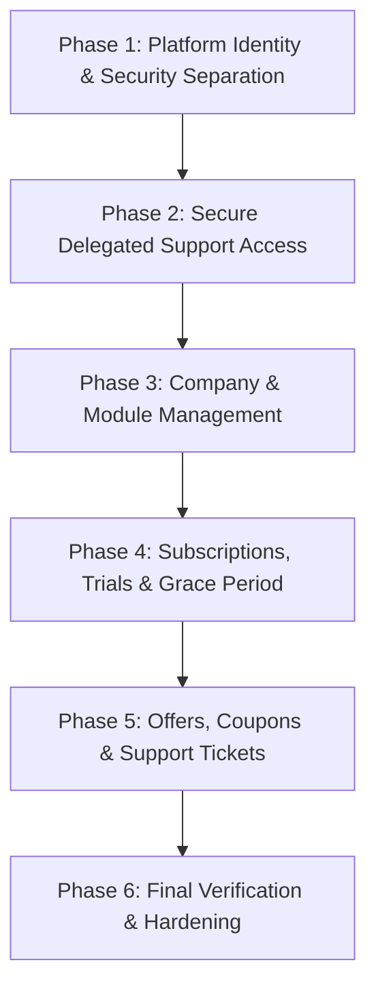
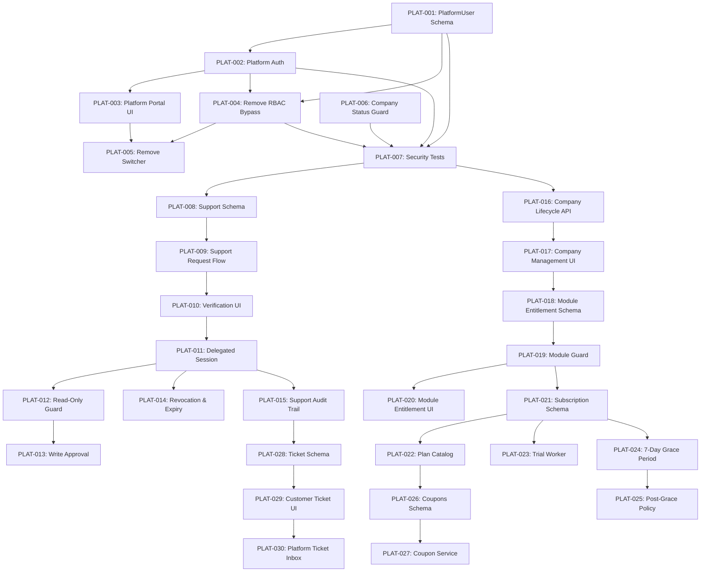

# Fashion ERP — SaaS Master Implementation Tracker

**Single Source of Truth (SSOT)** for Platform Administration & SaaS Transformation  
**Document Path**: `docs/PLATFORM_SAAS_MASTER_TRACKER.md`  
**Initial Baseline Date**: 2026-10-12  
**Current Active Phase**: ALL PHASES COMPLETE — Phase 6 verified 2026-10-14  
**Current Active Task**: None  

---

## 1. PROGRESS DASHBOARD

| Metric | Value |
|---|---|
| **Total Tasks Identified** | 35 |
| **NOT STARTED** | 0 |
| **IN PROGRESS** | 0 |
| **BLOCKED** | 0 |
| **IMPLEMENTED** | 0 |
| **VERIFIED** | 35 (PLAT-001 – PLAT-035) |
| **DEFERRED** | 0 |
| **Overall Verified Completion** | **100%** (35 / 35) |
| **Current Active Phase** | **All six phases complete** |
| **Current Active Task** | None |
| **Next Eligible Task** | None — production deployment per `docs/PLATFORM_SAAS_RUNBOOK.md` |
| **Open Decisions Requiring Clarification** | 0 (DEC-04 AI metering deferred to a later phase) |

> [!NOTE]
> Progress percentage is calculated strictly on **VERIFIED** tasks (meaning code written, unit & integration tests passing, and acceptance criteria validated). Pre-existing partial features are recorded in the *Current Project State* section and are not counted towards verified completion until their Phase-specific acceptance criteria are formally validated.

---

## 2. PROJECT OBJECTIVE

Transform the existing, production-grade, multi-tenant Fashion ERP into a secure, robust SaaS platform by:
1. **Separating Platform Administration from Customer ERP**: Completely isolating platform operators, super admins, and support staff from tenant ERP modules, UI, and default permissions.
2. **Implementing Secure Delegated Support Access**: Replacing unrestricted tenant switching with a time-limited, audited, customer-approved verification workflow (read-only by default).
3. **Establishing Subscription & Entitlement Lifecycle**: Introducing modular plans, automated trial lifecycles with a 7-day read-only grace period, company suspension enforcement, offers/coupons, and customer support ticketing.
4. **Preserving Core ERP Integrity**: Ensuring zero regression or disruption to existing manufacturing workflows (Cutting, Stitching, Finishing, QC, Job Work, Dispatch, Invoicing).

---

## 3. CONFIRMED BUSINESS DECISIONS

The following decisions are approved and bind all future implementation tasks:

1. **Platform Identity Model**:
   - Platform users must be stored in a dedicated `PlatformUser` model, completely decoupled from the tenant `Company` table (`company_id` will not exist on `PlatformUser`).
   - Platform Administration interfaces must live in a dedicated route group `src/app/(platform)/` with independent layouts, navigation, and middleware guards.
2. **Secure Delegated Support Access**:
   - Platform staff have **no implicit access** to customer ERP tenant data.
   - Access requires a customer-side approval workflow using an ephemeral, cryptographically secure 6-digit verification code.
   - Delegated support sessions are **Read-Only by default**.
   - Write access requires a separate, explicit customer approval step with mandatory justification.
   - All support sessions are strictly time-limited (max 2 hours) and instantly revocable by the customer.
   - Every read and mutation during a support session is tagged in a dedicated, tamper-evident support audit log.
3. **Subscription Expiry & Grace Period**:
   - When a company subscription or trial expires, the system enters an automatic **7-day read-only grace period**.
   - During the grace period, users can log in, view existing data, print documents, and export reports, but all mutation actions (creating orders, stage receipts, inventory movements, dispatches, payments) are blocked.
   - Post-grace period policy: read-only archive (DEC-01 resolved 2026-10-13). New companies get a 14-day trial by default (editable per plan).

---

## 4. CURRENT ARCHITECTURE SUMMARY

- **Web Framework**: Next.js 16.3.1 (React 19, Turbopack, App Router)
- **Database & Schema**: PostgreSQL via Prisma 7.9.1 with the `@prisma/adapter-pg` driver adapter (`prisma/schema.prisma`, `prisma.config.ts`) — corrected 2026-10-13; the baseline said 6.19.2
- **Authentication**: NextAuth v5 (Auth.js beta) using credentials provider & Edge-safe JWT (`src/core/auth/auth.ts`, `src/core/auth/auth.config.ts`)
- **Authorization**: Tenant RBAC with live DB re-check on status/password (`src/core/rbac/PermissionService.ts`, `src/config/rbac.ts`)
- **Background Jobs**: BullMQ + Redis worker process running outside Next.js (`src/core/jobs/worker.ts`, `src/core/jobs/queue.ts`)
- **Audit Logging**: Synchronous transactional logging to `audit_logs` table (`src/core/audit/AuditLogger.ts`)
- **Encryption**: AES-256-GCM authenticated encryption using `AUTH_SECRET` (`src/core/security/encryption.ts`)

---

## 5. CURRENT PROJECT STATE (EVIDENCE-BASED)

| ID | Feature / Component | Current Implementation | Status | Evidence | Gap |
|---|---|---|---|---|---|
| **CPS-01** | Platform User Identity | Stored in tenant `users` table with `isPlatformAdmin` boolean | PARTIAL | `prisma/schema.prisma:327`, `User.companyId` is non-nullable | Tied to a specific customer company; violates platform separation |
| **CPS-02** | Platform Authentication | Shared `/login` route with customer users | EXISTING | `src/core/auth/auth.ts:16-57` | No separate platform login endpoint or session guard |
| **CPS-03** | Platform RBAC | Universal bypass in `PermissionService.ts` | EXISTING / RISKY | `src/core/rbac/PermissionService.ts:122` (`if (user.isPlatformAdmin) return true;`) | Platform admin has god-mode across all tenant ERP modules |
| **CPS-04** | Platform Dashboard | Single page inside customer dashboard layout | PARTIAL | `src/app/(dashboard)/platform/companies/page.tsx` | Nested inside customer ERP layout; shows ERP sidebar |
| **CPS-05** | Company Management | List & create company with first admin & branch | EXISTING | `src/modules/platform/platform-company.service.ts` | No company edit, suspension, plan linking, or metrics |
| **CPS-06** | Company Suspension | `Company.isActive` boolean column exists in DB | PARTIAL | `prisma/schema.prisma:25` | `requireSession()` in `api-route.ts` does not check `company.isActive` |
| **CPS-07** | Company Settings | Basic company info (name, taxNo, fiscalYear) | EXISTING | `src/modules/administration/company-settings.service.ts` | No SaaS quota limits, storage caps, or billing contacts |
| **CPS-08** | Submodule Settings | Tab visibility for 6 fabric masters | EXISTING | `src/core/submodule-visibility/SubmoduleVisibilityService.ts` | Only toggles fabric master tabs; not a general module entitlement |
| **CPS-09** | Company Switching | Unrestricted `update({ companyId })` in JWT | EXISTING / INSECURE | `src/components/layout/CompanySwitcher.tsx`, `auth.config.ts:55` | Platform admin can jump to any customer tenant without authorization |
| **CPS-10** | Tenant Isolation | Isolated via `companyId` in repositories | EXISTING | Verified across 38 modules | Platform admin bypass punches a hole through tenant isolation |
| **CPS-11** | Support Access | Ad-hoc company switcher | INSECURE | `CompanySwitcher.tsx:38` | Zero customer consent, no verification code, no auto-expiry |
| **CPS-12** | Audit Logging | `writeAuditLog` records DB mutations | EXISTING | `src/core/audit/AuditLogger.ts:27` | Support sessions do not log support agent identity distinctly |
| **CPS-13** | Subscription Plans | None | NEW | Absent in `schema.prisma` and codebase | No plan catalog or pricing tiers |
| **CPS-14** | Company Subscriptions | None | NEW | Absent in `schema.prisma` and codebase | No active subscription records or renewal dates |
| **CPS-15** | Trial Management | None | NEW | Absent in `schema.prisma` and codebase | No trial start/end tracking or conversion workflow |
| **CPS-16** | Offers Management | None | NEW | Absent in `schema.prisma` and codebase | No promotional offers system |
| **CPS-17** | Coupons Management | None | NEW | Absent in `schema.prisma` and codebase | No coupon validation or discount logic |
| **CPS-18** | Support Tickets | None | NEW | Absent in `schema.prisma` and codebase | No ticketing system for customer support |
| **CPS-19** | Module Entitlements | None | NEW | Absent in `schema.prisma` and codebase | Cannot enable/disable ERP modules per tenant |
| **CPS-20** | Expiry Grace Period | None | NEW | Absent in `schema.prisma` and codebase | No read-only enforcement mechanism on billing expiry |

---

## 6. MASTER CHANGE MATRIX

| Task ID | Module | Existing State | Required Change | Change Type | Priority | Phase | Status | Dependencies |
|---|---|---|---|---|---|---|---|---|
| **PLAT-001** | Platform Identity | `User.isPlatformAdmin` inside tenant `User` table | Create `PlatformUser` model, migrate existing platform accounts | MODIFY / NEW | CRITICAL | Phase 1 | **VERIFIED** | None |
| **PLAT-002** | Platform Auth | Shared credentials auth in `auth.ts` | Dedicated platform auth callback / token discriminator | MODIFY | CRITICAL | Phase 1 | **VERIFIED** | PLAT-001 |
| **PLAT-003** | Platform Portal UI | `/platform/companies` inside `(dashboard)` | Create dedicated `src/app/(platform)/` route group with own layout & nav | MODIFY / NEW | HIGH | Phase 1 | **VERIFIED** | PLAT-002 |
| **PLAT-004** | RBAC Separation | Universal bypass in `PermissionService.ts:122` | Remove universal bypass; platform users blocked from ERP modules | MODIFY | CRITICAL | Phase 1 | **VERIFIED** | PLAT-001, PLAT-002 |
| **PLAT-005** | Company Switcher Removal | Unrestricted `CompanySwitcher.tsx` | Remove unrestricted company switcher from customer sidebar | MODIFY | CRITICAL | Phase 1 | **VERIFIED** | PLAT-003, PLAT-004 |
| **PLAT-006** | Company Status Guard | `Company.isActive` not checked in `requireSession` | Enforce `company.isActive === true` in `requireSession()` | MODIFY | HIGH | Phase 1 | **VERIFIED** | None |
| **PLAT-007** | Platform Auth Tests | Only tenant auth tests exist | Add comprehensive unit & integration tests for platform auth | NEW | HIGH | Phase 1 | **VERIFIED** | PLAT-001, PLAT-002, PLAT-004 |
| **PLAT-008** | Support Schema | No support access models | Create `SupportAccessRequest` and `SupportAccessSession` models | NEW | HIGH | Phase 2 | **VERIFIED** | PLAT-001 |
| **PLAT-009** | Support Request Flow | None | Platform staff initiates access request with reason & duration | NEW | HIGH | Phase 2 | **VERIFIED** | PLAT-008 |
| **PLAT-010** | Customer Verification UI | None | Customer admin receives verification code and approves request | NEW | HIGH | Phase 2 | **VERIFIED** | PLAT-008, PLAT-009 |
| **PLAT-011** | Delegated Session Exchange | None | Issue scoped, time-limited delegated support session | NEW | HIGH | Phase 2 | **VERIFIED** | PLAT-008, PLAT-010 |
| **PLAT-012** | Read-Only Default Guard | `PermissionService` has no delegated concept | Enforce read-only mode during support sessions; block all mutations | MODIFY / NEW | CRITICAL | Phase 2 | **VERIFIED** | PLAT-011 |
| **PLAT-013** | Write Approval Workflow | None | Explicit step with distinct approval code for write operations | NEW | HIGH | Phase 2 | **VERIFIED** | PLAT-012 |
| **PLAT-014** | Support Revocation & Expiry | None | Instant customer revocation button and automatic time expiry | NEW | HIGH | Phase 2 | **VERIFIED** | PLAT-011 |
| **PLAT-015** | Support Audit Trail | Standard audit log only | Log support agent ID, target tenant, reason, approved time, and actions | NEW | HIGH | Phase 2 | **VERIFIED** | PLAT-011, PLAT-012 |
| **PLAT-016** | Company Lifecycle API | Only `listCompanies` and `createCompany` | Add activate, suspend, update company details, and stats API | EXTEND | MEDIUM | Phase 3 | **VERIFIED** | PLAT-001, PLAT-006 |
| **PLAT-017** | Company Management UI | Basic read-only table and create form | Rich platform company management portal with suspension & details | EXTEND | MEDIUM | Phase 3 | **VERIFIED** | PLAT-016 |
| **PLAT-018** | Module Entitlements Schema | Only 6-submodule UI visibility table | Create `CompanyModuleEntitlement` model for high-level ERP modules | NEW | HIGH | Phase 3 | **VERIFIED** | None |
| **PLAT-019** | Module Guard Middleware | Modules accessible if user has role | Middleware & API route gates asserting module entitlement | NEW | HIGH | Phase 3 | **VERIFIED** | PLAT-018 |
| **PLAT-020** | Module Entitlement UI | None | Platform interface to enable/disable ERP modules per tenant | NEW | MEDIUM | Phase 3 | **VERIFIED** | PLAT-018, PLAT-019 |
| **PLAT-021** | Subscription Schema | None | Add `SubscriptionPlan` and `CompanySubscription` models | NEW | HIGH | Phase 4 | **VERIFIED** | None |
| **PLAT-022** | Plan Catalog Service | None | Manage plans, features, quotas, billing cycles (Monthly/Annual) | NEW | HIGH | Phase 4 | **VERIFIED** | PLAT-021 |
| **PLAT-023** | Trial Lifecycle Worker | None | BullMQ worker managing trial countdown, notifications, and expiry | NEW | MEDIUM | Phase 4 | **VERIFIED** | PLAT-021 |
| **PLAT-024** | 7-Day Grace Period Guard | None | Enforce read-only mode across all ERP mutations during grace period | NEW | CRITICAL | Phase 4 | **VERIFIED** | PLAT-021 |
| **PLAT-025** | Post-Grace Lockout Policy | None | Enforce approved post-grace behavior (account lockout or restricted) | NEW | HIGH | Phase 4 | **VERIFIED** | PLAT-024 |
| **PLAT-026** | Offers & Coupons Schema | None | Add `Coupon`, `Offer`, and `CouponRedemption` models | NEW | MEDIUM | Phase 5 | **VERIFIED** | PLAT-021 |
| **PLAT-027** | Coupon Service & API | None | Validate coupon code, discount rules, expiry, and redemption limits | NEW | MEDIUM | Phase 5 | **VERIFIED** | PLAT-026 |
| **PLAT-028** | Support Ticket Schema | None | Add `SupportTicket`, `TicketMessage`, and `TicketAttachment` models | NEW | MEDIUM | Phase 5 | **VERIFIED** | None |
| **PLAT-029** | Customer Ticket UI & API | None | In-app customer support widget & ticket submission interface | NEW | MEDIUM | Phase 5 | **VERIFIED** | PLAT-028 |
| **PLAT-030** | Platform Ticket Inbox | None | Platform staff ticketing dashboard with status workflow & replies | NEW | MEDIUM | Phase 5 | **VERIFIED** | PLAT-028, PLAT-029 |
| **PLAT-031** | Permission Catalog Sync | Catalog only written by `prisma db seed`; dev DB missing 108 keys | Idempotent sync script run on every deploy | NEW | HIGH | Phase 6 | **VERIFIED** | None |
| **PLAT-032** | Tenant Isolation Test | Manual spot checks only | Automated cross-tenant leakage sweep over every `/api/v1/**/[id]` route + lists, files, tickets, support requests | NEW | CRITICAL | Phase 6 | **VERIFIED** | PLAT-031 |
| **PLAT-033** | Migration Rehearsal | None | Apply all migrations + seed + sync to an empty DB, check for drift | NEW | HIGH | Phase 6 | **VERIFIED** | PLAT-031 |
| **PLAT-034** | Rollback Scripts | None | Down scripts for the 5 SaaS migrations, rehearsed on a snapshot | NEW | HIGH | Phase 6 | **VERIFIED** | None |
| **PLAT-035** | Regression & Runbook | None | Full regression + production runbook | NEW | HIGH | Phase 6 | **VERIFIED** | PLAT-031 – PLAT-034 |

---

## 7. PHASE-WISE IMPLEMENTATION ROADMAP



### Phase 1 — Platform Identity & Security Separation (Mandatory Security)
- **Objective**: Decouple platform user accounts from customer tenant tables, remove god-mode permissions from the customer ERP, and establish an isolated platform portal.
- **Tasks**: `PLAT-001`, `PLAT-002`, `PLAT-003`, `PLAT-004`, `PLAT-005`, `PLAT-006`, `PLAT-007`.
- **Exit Criteria**:
  - `PlatformUser` exists and has zero dependency on `Company.id`.
  - Platform users authenticate via platform credentials and cannot view or operate regular customer ERP menus.
  - `PermissionService.ts` has zero universal bypasses.
  - Suspended companies (`isActive === false`) cannot access the ERP.
  - All existing tenant unit and integration tests remain 100% green.

### Phase 2 — Secure Delegated Support Access (Customer Privacy & Trust)
- **Objective**: Provide a safe, transparent, customer-approved mechanism for support staff to troubleshoot tenant issues without permanent or unmonitored access.
- **Tasks**: `PLAT-008`, `PLAT-009`, `PLAT-010`, `PLAT-011`, `PLAT-012`, `PLAT-013`, `PLAT-014`, `PLAT-015`.
- **Exit Criteria**:
  - Support staff cannot access a customer tenant without generating an access request.
  - Customer receives and approves request via verification code.
  - Support sessions default to strictly Read-Only.
  - Write access requires secondary customer approval with audit reason.
  - Sessions automatically expire after approved duration (max 2 hours) and are instantly revocable.

### Phase 3 — Company & Module Management (Tenant Operations)
- **Objective**: Equip platform administrators with tools to manage company lifecycles, view tenant health, and toggle module entitlements.
- **Tasks**: `PLAT-016`, `PLAT-017`, `PLAT-018`, `PLAT-019`, `PLAT-020`.
- **Exit Criteria**:
  - Platform portal allows activating, suspending, and inspecting customer tenants.
  - ERP modules (CRM, Sampling, AI Designer, Barcodes, Dispatch) can be toggled per company.
  - Disabled modules are hidden from navigation and rejected with `403 FORBIDDEN` at API boundaries.

### Phase 4 — Subscriptions, Trials & Grace Period (SaaS Monetization)
- **Objective**: Introduce subscription plans, trial lifecycle management, and non-disruptive 7-day read-only grace periods.
- **Tasks**: `PLAT-021`, `PLAT-022`, `PLAT-023`, `PLAT-024`, `PLAT-025`.
- **Exit Criteria**:
  - Subscription plans define price, billing frequency, and entitled modules.
  - Companies have an active subscription or trial record.
  - On trial/plan expiry, tenant enters automatic 7-day read-only grace period.
  - Factory floor workers can view existing orders and lots, but cannot post new records during grace period.

### Phase 5 — Offers, Coupons & Support Tickets (Customer Engagement & Support)
- **Objective**: Implement promotional discounts and an integrated ticketing workflow between customers and platform support staff.
- **Tasks**: `PLAT-026`, `PLAT-027`, `PLAT-028`, `PLAT-029`, `PLAT-030`.
- **Exit Criteria**:
  - Coupons can be created, applied to subscriptions, and validated against discount rules.
  - Customers can submit support tickets with attachments directly inside the ERP.
  - Platform staff have a ticketing inbox to manage, reply to, and resolve tickets.

### Phase 6 — Final Verification & Production Readiness
- **Objective**: End-to-end verification, tenant isolation penetration testing, migration rehearsal, and production runbook preparation.
- **Tasks**: `PLAT-031`, `PLAT-032`, `PLAT-033`, `PLAT-034`, `PLAT-035`.
- **Status**: VERIFIED (2026-10-14) — all three exit criteria met.
- **Exit Criteria**:
  - 100% of test suites pass with zero regressions.
  - Cross-tenant data leakage tests pass.
  - Rollback migration scripts tested on staging snapshot.

---

## 8. DETAILED TASK CHECKLISTS

### PLAT-001 — Platform Identity Separation
- **Status**: VERIFIED (2026-10-13).
- **Acceptance Criteria**:
  - [x] `PlatformUser` model created with `id`, `email`, `passwordHash`, `fullName`, `role` (`PlatformUserRole`: PLATFORM_SUPER_ADMIN / SUPPORT_AGENT / BILLING_ADMIN), `status`, `lastLoginAt`, `passwordChangedAt`, `migratedFromUserId` — no `companyId`.
  - [x] Existing `User` records with `isPlatformAdmin === true` migrated to `PlatformUser` (same email + password hash, role PLATFORM_SUPER_ADMIN). Dev DB: 1 account (`admin@indradhar.com`) backfilled.
  - [x] Migration is purely additive; `users.is_platform_admin` kept (marked deprecated, read by nothing). `audit_logs.platform_user_id` added for platform-performed actions.
  - [x] Tests: `authenticate.test.ts` covers platform sign-in against `platform_users` independent of any company.
- **Verification Evidence**: migration `20261013100000_platform_users` applied with `prisma migrate deploy`; backfilled row and new column confirmed by direct SQL. Dev seed (`prisma/seed.ts`) also creates the platform account.
- **Implementation Notes**: the tenant account of a migrated admin is untouched — it keeps its own company roles and signs in at `/login` as before.
- **Last Updated**: 2026-10-13.

---

### PLAT-002 — Platform Authentication Pipeline
- **Status**: VERIFIED (2026-10-13).
- **Acceptance Criteria**:
  - [x] Platform login validates against `PlatformUser` only — second NextAuth provider `platform-credentials` (`src/core/auth/auth.ts`, logic in `src/core/auth/authenticate.ts`), page `/platform/login`.
  - [x] JWT/session carries `userType: "PLATFORM"` (tenant sessions carry `"TENANT"`; pre-change sessions with no claim are treated as TENANT).
  - [x] Platform session has no tenant `companyId` (empty string, rejected by every tenant guard).
  - [x] Tenant login unchanged (still `/login`, provider `credentials`).
  - [x] New API guard `requirePlatformSession(roles?)` (`src/lib/api-route.ts`) re-checks the platform account live (status, password change, role). Replaces `requirePlatformAdmin()`.
  - [x] Separate lockout bucket for platform logins (`platform:<email>`).
- **Verification Evidence**: live HTTP sign-in through the real NextAuth flow — platform session `userType=PLATFORM`, `companyId=""`; `/api/v1/platform/companies` 200 for platform, 403 for tenant.
- **Last Updated**: 2026-10-13.

---

### PLAT-003 — Dedicated Platform Portal UI Route Group
- **Status**: VERIFIED (2026-10-13).
- **Acceptance Criteria**:
  - [x] `src/app/(platform)/` route group with its own layout (`PlatformShell`: Overview, Companies). Pages: `/platform` (cross-company counts, moved from the tenant dashboard), `/platform/companies`, `/platform/companies/new` (Platform Super Admin only).
  - [x] Sidebar shows only platform items. *Subscriptions / Platform Users* links deliberately NOT added — those features don't exist yet (Phase 4 / not scoped); adding dead links would be scope creep.
  - [x] Non-platform users are redirected away from `/platform/*` (to `/dashboard`); signed-out users go to `/platform/login`. Routing rules in `src/core/auth/route-access.ts`, applied in `src/proxy.ts`.
  - [x] Customer ERP navigation has zero platform links.
- **Verification Evidence**: live — platform user 200 on `/platform` and `/platform/companies`; tenant user 302 → `/dashboard`; browser screenshot of the portal.
- **Last Updated**: 2026-10-13.

---

### PLAT-004 — Remove Universal Platform RBAC Bypass
- **Status**: VERIFIED (2026-10-13).
- **Acceptance Criteria**:
  - [x] All **four** bypasses removed from `PermissionService.ts` (the baseline listed one): `can()`, `getAllowedProductionStageIds()`, `getAllowedBranchIds()`, `getModulesWithAction()`/`getViewableModules()` (no more `"all"`).
  - [x] A platform operator outside a support session gets nothing: their id isn't in the tenant `users` table, so `can()` is false; `requireSession()` refuses `userType=PLATFORM` sessions on every customer ERP API; the proxy redirects them away from every ERP page.
  - [x] Normal tenant permission resolution unchanged (full suite green).
- **Verification Evidence**: `PermissionService.test.ts` (flag grants nothing, self-approval applies to everyone, platform id gets no permission); live — platform session 403 on `/api/v1/customers`, 302 from `/dashboard` and `/sales-orders`.
- **Last Updated**: 2026-10-13.

---

### PLAT-005 — Remove Unrestricted Company Switcher
- **Status**: VERIFIED (2026-10-13).
- **Acceptance Criteria**:
  - [x] `CompanySwitcher.tsx` deleted and removed from the ERP sidebar.
  - [x] `auth.config.ts` no longer handles `trigger === "update"` — a session can't be re-pointed at another company at all.
- **Verification Evidence**: live — rendered dashboard HTML contains no switcher or platform link.
- **Last Updated**: 2026-10-13.

---

### PLAT-006 — Enforce Company Active Status
- **Status**: VERIFIED (2026-10-13).
- **Acceptance Criteria**:
  - [x] `requireSession()` checks `company.isActive` live in the same query; inactive → `403 ACCOUNT_SUSPENDED` (new `BusinessRuleError` code).
  - [x] Sign-in refused for users of a suspended company (`authenticateTenantUser`).
  - [x] `PermissionService` denies everything for a suspended company (covers Server Component pages).
  - [x] Pages: the proxy redirects a suspended company's users to `/account-suspended` before anything renders. (A layout-level redirect alone was found to still stream the page's data in the response body in dev — the layout and page render in parallel — so the check lives in the proxy, with the layout redirect kept as a second layer.)
  - [x] Unit tests for the API guard, login, and permission checks.
- **Verification Evidence**: live — dev company suspended briefly inside try/finally: existing session's API call 403 `ACCOUNT_SUSPENDED`; `/dashboard` 302 → `/account-suspended` with an 18-byte body (no page data); re-login refused; platform overview showed "Suspended"; company restored and tenant working again.
- **Last Updated**: 2026-10-13.

---

### PLAT-007 — Platform Security & Isolation Test Suite
- **Status**: VERIFIED (2026-10-13).
- **Acceptance Criteria**:
  - [x] Platform user can't query tenant ERP endpoints (`api-route.test.ts`, `route-access.test.ts`).
  - [x] Tenant user can't access platform routes, including a company's own Super Admin and pre-change sessions (`api-route.test.ts`, `route-access.test.ts`).
  - [x] Suspended company users are rejected (`api-route.test.ts`, `authenticate.test.ts`, `PermissionService.test.ts`).
  - [x] All tests pass in `vitest run`.
- **Verification Evidence**: `npx vitest run` — 2607 passed / 161 skipped (180 files; one file's worker timed out under memory pressure and passed 11/11 on re-run); `npx tsc --noEmit` clean; `npx eslint` clean on all changed files; 24/24 live HTTP checks against the running dev server.
- **Last Updated**: 2026-10-13.

---

### PLAT-008 — Support Access Schema
- **Status**: VERIFIED (2026-10-13).
- **Acceptance Criteria**:
  - [x] `SupportAccessRequest` (company, operator, reason, duration, status PENDING/APPROVED/REJECTED/EXPIRED/CANCELLED/LOCKED, code hash + expiry, failed attempts, decided by/at, rejection reason).
  - [x] `SupportAccessSession` (one per approved request: proxy user, mode READ_ONLY/READ_WRITE, expires/revoked/ended, write-request fields with a separate code hash, single-use exchange token hash).
  - [x] `SupportAccessEvent` — append-only hash-chained event log (also used by PLAT-015).
  - [x] `users.support_for_platform_user_id` — marks a company's "Support — <operator>" proxy user (unique per company + operator).
  - [x] Purely additive migration `20261013120000_support_access`, plus a trigger that refuses UPDATE/DELETE on `support_access_events`.
- **Verification Evidence**: `prisma migrate deploy` applied; tables, column and trigger confirmed by direct SQL; a live UPDATE on the event table was refused by the database.
- **Last Updated**: 2026-10-13.

---

### PLAT-009 — Support Request Flow
- **Status**: VERIFIED (2026-10-13).
- **Acceptance Criteria**:
  - [x] Platform portal → Support Access (`/platform/support`, also linked per company from Companies): company, reason (min 10 chars, shown to the customer), duration 15/30/60/120 min.
  - [x] Only PLATFORM_SUPER_ADMIN and SUPPORT_AGENT can request; BILLING_ADMIN can't. Suspended companies can't be requested. One pending request per operator per company.
  - [x] A 6-digit code (crypto random) is shown to the operator once; only an HMAC bound to the request id is stored. Code valid 15 minutes; pending requests expire automatically.
  - [x] Operator can cancel a pending request.
- **Verification Evidence**: live — request created (201), code not in the stored hash, short reason/over-2-hour duration/second pending request refused (400). Unit tests in `support-access.service.test.ts`, `codes.test.ts`.
- **Last Updated**: 2026-10-13.

---

### PLAT-010 — Customer Verification UI
- **Status**: VERIFIED (2026-10-13).
- **Acceptance Criteria**:
  - [x] Customer page Administration → Support Access (`/admin/support-access`), visible only to the company's own Super Admin (role checked live; a support session itself can't use it).
  - [x] Banner across the ERP for the Super Admin while a request or write request is waiting.
  - [x] Approve by entering the code; reject with an optional reason. Wrong code: "N attempts left"; 5 wrong codes lock the request; an expired code is refused.
- **Verification Evidence**: live — pending request visible, banner shown, wrong code refused with attempts left, right code approved (READ_ONLY session). Browser screenshots of the page and the activity log.
- **Last Updated**: 2026-10-13.

---

### PLAT-011 — Delegated Session Exchange
- **Status**: VERIFIED (2026-10-13).
- **Acceptance Criteria**:
  - [x] Approval creates a session for the approved duration (max 2 hours) and a company proxy user ("Support — <operator>", no roles, unusable password, can't sign in at `/login`, hidden from user lists, pickers and user counts).
  - [x] "Open ERP" (only the requesting operator, only while live) issues a single-use 60-second exchange token; the new `support-session` NextAuth provider exchanges it for a SUPPORT session (`userType: "SUPPORT"`, the proxy user's id, `supportSessionId`).
  - [x] Every request re-checks the session live (proxy, `requireSession()`, `PermissionService`): not revoked/ended/expired, request approved, company active, operator active.
  - [x] A support session can use ERP pages only, never the platform portal.
- **Verification Evidence**: live — token issued after approval only, sign-in as SUPPORT for the right company, second use of the token refused, /platform redirected to /dashboard, proxy user's login at /login refused.
- **Last Updated**: 2026-10-13.

---

### PLAT-012 — Read-Only Default Guard
- **Status**: VERIFIED (2026-10-13).
- **Acceptance Criteria**:
  - [x] Two independent layers: the proxy refuses every POST/PUT/PATCH/DELETE (pages and API) in a READ_ONLY session, except sign-out and the session's own controls; `PermissionService` grants a proxy user only view/view_all/print in READ_ONLY.
  - [x] Export is not granted in any support mode (no bulk copies of customer data).
  - [x] Branch and production-stage scope: unrestricted while live, nothing once ended.
  - [x] Grants are never cached — they change on the next request after a revoke or write approval.
- **Verification Evidence**: live — reads 200, POST refused 403 "read-only". `PermissionService.support.test.ts`, `support-session-guard.test.ts`.
- **Last Updated**: 2026-10-13.

---

### PLAT-013 — Write Approval Workflow
- **Status**: VERIFIED (2026-10-13).
- **Acceptance Criteria**:
  - [x] Support requests write access from the support banner with a justification (min 10 chars); a second 6-digit code (10 minutes) is shown to the operator once.
  - [x] The customer's Super Admin approves it with that code (the access code doesn't work) or rejects it; 5 wrong codes lock write access for that session.
  - [x] READ_WRITE adds create/edit/cancel/scan only — never approve, post, delete, reject, override or export; Administration modules stay read-only.
- **Verification Evidence**: live — access code refused for write, write code approved, mode READ_WRITE, a write request then reached the route (400 validation instead of 403), Administration write still 403.
- **Last Updated**: 2026-10-13.

---

### PLAT-014 — Support Revocation & Expiry
- **Status**: VERIFIED (2026-10-13).
- **Acceptance Criteria**:
  - [x] Customer "Revoke access" ends the session immediately: next API call 403, next page redirects to `/support-ended`; a revoked session can't be reopened.
  - [x] Sessions end automatically at the approved time; the support banner shows minutes left and sends the browser to `/support-ended` when the session is gone.
  - [x] Support can end the session themselves ("End session" signs them out to the platform login).
- **Verification Evidence**: live — revoke → API 403, page 302 /support-ended, reopen 409; browser: End session → platform login. Expiry covered by `isSupportSessionLive` unit tests.
- **Last Updated**: 2026-10-13.

---

### PLAT-015 — Support Audit Trail
- **Status**: VERIFIED (2026-10-13).
- **Acceptance Criteria**:
  - [x] `support_access_events` records request, cancel, approve/reject, wrong codes, locks, session opened/revoked/ended, write requested/approved/rejected, and every page/API request in the session (method + path), including refused ones (ACCESS_DENIED). Status polling of the banner is not logged.
  - [x] Tamper-evident: each event stores the previous event's hash and its own hash; editing or deleting any row breaks the chain. The database refuses UPDATE/DELETE on the table.
  - [x] Customer sees the log per request ("Activity log"), with a "Log verified / altered at entry #N" check.
  - [x] Records written by support in a write session carry the proxy user ("Support — <operator>") as their creator in the normal audit log.
- **Verification Evidence**: live — chain valid with all expected event types; database UPDATE refused. `support-events.test.ts` (edited and deleted events detected).
- **Last Updated**: 2026-10-13.

---

### PLAT-016 — Company Lifecycle API
- **Status**: VERIFIED (2026-10-13).
- **Acceptance Criteria**:
  - [x] `GET /api/v1/platform/companies/:id` — details, suspension info and stats (active/total users, last login, branches, customers, suppliers, styles, sales/production orders, dispatches, files + storage, support requests, live support sessions). Any platform role.
  - [x] `PATCH /api/v1/platform/companies/:id` — name, legal name, tax registration no. (unique), fiscal year start. PLATFORM_SUPER_ADMIN only.
  - [x] `POST .../suspend` (reason 5–1000 chars) and `POST .../activate` — guarded state changes (409 when already suspended/active); suspension stores `suspended_at`, `suspension_reason`, `suspended_by_platform_user_id`. PLATFORM_SUPER_ADMIN only.
  - [x] Every change is audited with `audit_logs.platform_user_id`.
- **Verification Evidence**: `platform-company-lifecycle.service.test.ts`; live — suspend → tenant API 403, second suspend 409, reactivate → tenant API 200, SUPPORT_AGENT refused (403).

### PLAT-017 — Company Management UI
- **Status**: VERIFIED (2026-10-13).
- **Acceptance Criteria**:
  - [x] Companies list shows active users, last login, modules off and Active/Suspended; name links to the company page.
  - [x] `/platform/companies/:id` — status badge + suspension banner (when, who, reason), details with Edit, usage stats, modules panel, "Request support access".
  - [x] Suspend needs a reason; reactivate and module changes confirm first. Controls hidden for non-super-admin roles.
- **Verification Evidence**: browser — list, detail page and a real HRMS off/on through the switch + confirm dialog.

### PLAT-018 — Module Entitlements Schema
- **Status**: VERIFIED (2026-10-13).
- **Acceptance Criteria**:
  - [x] `company_module_entitlements` (company × package key, `is_enabled`, `changed_by_platform_user_id`). No row = enabled, so no backfill.
  - [x] 13 packages in `src/config/module-entitlements.ts` (Sampling, Production, Purchasing, Inventory, Dispatch, Accounts, CRM, Marketing, HRMS, Barcodes, AI Garment Flow, AI Designer, Reports). Dashboard, Masters, Sales Orders and Administration are core (always on).
  - [x] Test guarantees every RBAC module is either core or in exactly one package.
- **Verification Evidence**: `module-entitlements.test.ts`; migration `20261013140000_company_lifecycle_and_module_entitlements` (additive) applied; row stored with operator verified by SQL.

### PLAT-019 — Module Guard
- **Status**: VERIFIED (2026-10-13).
- **Acceptance Criteria**:
  - [x] `PermissionService` refuses any action on a disabled module, whatever the role; `assert()` throws 403 `MODULE_NOT_ENABLED` (not `PERMISSION_DENIED`).
  - [x] Sidebar hides disabled modules (`getModulesWithAction` excludes them).
  - [x] `src/proxy.ts` redirects pages of a disabled module to `/module-unavailable` (page → modules taken from the sidebar config, longest link wins).
  - [x] `EntitlementService`: 15 s per-company cache, globalThis singleton, cleared immediately on change.
- **Verification Evidence**: `EntitlementService.test.ts`, `route-modules.test.ts`, `PermissionService.test.ts` (entitlement block); live — CRM off → `/api/v1/crm/leads` 403 MODULE_NOT_ENABLED, `/crm` → 302 `/module-unavailable`, sidebar without CRM, Sales Orders unaffected; CRM back on → all restored.

### PLAT-020 — Module Entitlement UI
- **Status**: VERIFIED (2026-10-13).
- **Acceptance Criteria**:
  - [x] `GET/PUT /api/v1/platform/companies/:id/modules` (PUT PLATFORM_SUPER_ADMIN only, audited).
  - [x] Modules panel on the company page: one switch per package with description and confirmation; turning off never deletes data.
- **Verification Evidence**: browser toggle; live — SUPPORT_AGENT PUT refused (403).

---

### PLAT-021 — Subscription Schema
- **Status**: VERIFIED (2026-10-13).
- **Acceptance Criteria**:
  - [x] `subscription_plans` (prices monthly/annual, currency, trial days, max users, active, default-trial flag), `subscription_plan_modules`, `company_subscriptions` (one per company: plan, cycle, trial flag, period end — null = no expiry), `subscription_payments` (manual payment record). Additive migration `20261013160000_subscriptions_trials_grace` with CHECK guards and a one-default-trial-plan partial unique index.
  - [x] Backfill: a "Standard" plan with every module, default trial plan; every existing company on it with **no expiry**, so nothing changes for current customers.
- **Verification Evidence**: SQL — 1 plan, 13 modules, 1 company subscription after migration; live — Standard plan and the company's UNLIMITED state returned by the API.

### PLAT-022 — Plan Catalog Service
- **Status**: VERIFIED (2026-10-13).
- **Acceptance Criteria**:
  - [x] `/platform/plans` — list, create, edit (prices, trial days, user limit, included modules, active, default trial). PLATFORM_SUPER_ADMIN or BILLING_ADMIN.
  - [x] The plan decides a company's modules; a Phase 3 per-company override still wins and can be reset to the plan.
  - [x] User limit (`maxUsers`) enforced when creating or reactivating a user (409 `SUBSCRIPTION_LIMIT_REACHED`).
- **Verification Evidence**: `subscription-plan.service.test.ts`, `EntitlementService.test.ts`, `company-subscription.service.test.ts`; live — plan without CRM → CRM API 403, override on → 200, reset → 403; user limit refused at 1 with 2 active users against the real DB.

### PLAT-023 — Trial Lifecycle Worker
- **Status**: VERIFIED (2026-10-13).
- **Acceptance Criteria**:
  - [x] New companies start a trial on the chosen (or default) plan — 14 days by default.
  - [x] Hourly BullMQ job (`platform-jobs-<db hash>` queue) notifies the company's Super Admins in the app: 3 days before the end, when the grace period starts, and when the archive starts. Each notice once per period (claimed with a conditional update).
- **Verification Evidence**: `subscription-lifecycle.service.test.ts`, `company-subscription.service.test.ts`; live — worker logs "Platform jobs worker started". New-company creation not run live (pre-existing dev-DB permission-catalog gap, see Phase 1 notes).

### PLAT-024 — 7-Day Grace Period Guard
- **Status**: VERIFIED (2026-10-13).
- **Acceptance Criteria**:
  - [x] Access state is derived from the period end at read time (never stored): TRIAL/ACTIVE → GRACE (7 days, read-only) → EXPIRED.
  - [x] Read-only allows only view, view_all, print and export — enforced in `PermissionService` (403 `SUBSCRIPTION_READ_ONLY`), and write-only sidebar links are hidden.
  - [x] Every tenant user sees a banner (trial ending, grace, archive).
- **Verification Evidence**: `subscription-state.test.ts`, `PermissionService.test.ts`; live — grace: reads 200, writes 403 SUBSCRIPTION_READ_ONLY, banner shown.

### PLAT-025 — Post-Grace Policy
- **Status**: VERIFIED (2026-10-13).
- **Acceptance Criteria**:
  - [x] After grace the company is a read-only archive (DEC-01): users can still sign in, view and export; nothing can be changed until renewed.
  - [x] Recording a payment renews from the current end (or today if lapsed) by whole billing periods and ends any trial; "Adjust dates" sets an exact end date, extends a trial or removes the expiry, with a required reason.
- **Verification Evidence**: live — 30 days lapsed: read 200, write 403, archive banner; billing admin payment → ACTIVE, writes allowed again; support agent refused (403).

---

### PLAT-026 — Offers & Coupons Schema
- **Status**: VERIFIED (2026-10-14).
- **Acceptance Criteria**:
  - [x] A coupon IS the offer (no separate Offer table): `coupons` (code, offer type PERCENT / FIXED_AMOUNT / FREE_MONTHS / TRIAL_EXTENSION, value, validity window, total and per-company limits, billing cycles, active), `coupon_plans` (empty = any plan), `coupon_redemptions` (one row per use, linked to the payment).
  - [x] DB guards: percent ≤ 100, value > 0, limits ≥ 1, valid-until after valid-from; payment discount ≥ 0.
  - [x] `subscription_payments` gained list amount, discount, free months and the coupon used.
- **Verification Evidence**: migration `20261014100000_coupons_and_support_tickets` applied; tables and CHECK constraints confirmed by SQL.

### PLAT-027 — Coupon Service & API
- **Status**: VERIFIED (2026-10-14).
- **Acceptance Criteria**:
  - [x] Platform staff (Super Admin / Billing Admin) create and edit coupons at `/platform/coupons`; once used, the code and discount are locked (dates, limits, plans and on/off can still change).
  - [x] Applied by staff when recording a payment (percent / fixed amount off, or free extra months) or when creating a company (longer free trial); "Apply" previews the effect before saving.
  - [x] Checked with the coupon row locked: active, dates, plan, billing cycle, usage type, total and per-company limits. Failure → 422 `COUPON_INVALID` with a plain reason; nothing is saved.
- **Verification Evidence**: `coupon.service.test.ts`, `company-subscription.service.test.ts`; live — 20% coupon 5000 → 4000 with redemption row, second use by the same company refused, annual-only coupon refused on monthly, 2 free months → 14-month period, trial coupon preview +10 days, tenant session refused (403).

### PLAT-028 — Support Ticket Schema
- **Status**: VERIFIED (2026-10-14).
- **Acceptance Criteria**:
  - [x] `support_tickets` (number `TKT-YYYY-#####`, subject, category, priority, status OPEN / IN_PROGRESS / WAITING_ON_CUSTOMER / RESOLVED / CLOSED, assignee, last message by), `support_ticket_messages` (customer or platform author, internal-note flag), `support_ticket_attachments` (files in the existing private file store).
- **Verification Evidence**: migration applied; tables confirmed by SQL.

### PLAT-029 — Customer Ticket UI & API
- **Status**: VERIFIED (2026-10-14).
- **Acceptance Criteria**:
  - [x] "Help & Support" for every user (`/support-tickets`): raise a ticket with up to 5 attachments, reply, close. Each user sees their own tickets; the company's Super Admin sees all of the company's tickets.
  - [x] Works even during the read-only grace period (no module permission needed); refused for support sessions.
  - [x] Files checked by type and content (magic bytes), 20 MB each; internal notes are never shown to the customer.
- **Verification Evidence**: `support-ticket.service.test.ts`; live — ticket with attachment, byte-for-byte download, disguised file refused, user can't open another user's ticket (404).

### PLAT-030 — Platform Ticket Inbox
- **Status**: VERIFIED (2026-10-14).
- **Acceptance Criteria**:
  - [x] `/platform/tickets`: filter by status, assignment and search; tickets waiting on a reply are marked.
  - [x] Reply (default next status "Waiting on customer", picks up an unassigned ticket, notifies the customer in-app) or add an internal note; change status, priority and assignee; link to request support access for the company.
  - [x] A customer reply reopens a ticket waiting on them; CLOSED is final.
- **Verification Evidence**: live — reply → Waiting on customer + auto-assigned + customer notification; internal note hidden from customer; customer reply → Open; resolve + priority change; closed ticket refuses replies and reopening (409).

---

## 9. TASK DEPENDENCIES & EXECUTION ORDER



---

## 10. RISK REGISTER

| Risk ID | Category | Description | Impact | Likelihood | Mitigation Strategy |
|---|---|---|---|---|---|
| **RSK-01** | Security | Platform admin bypass currently gives god-mode across all customer tenants | CRITICAL | HIGH | Remove bypass immediately in Phase 1 (`PLAT-004`); enforce delegated support access (`PLAT-012`) |
| **RSK-02** | Data Integrity | Disrupting live factory floor operations by hard-locking expired accounts | HIGH | HIGH | Approved 7-day read-only grace period (`PLAT-024`); allows document viewing & printing |
| **RSK-03** | Migration | Existing platform admin accounts losing access during `PlatformUser` migration | HIGH | MEDIUM | Additive migration script in `PLAT-001` with fallback verification before deprecating old flags |
| **RSK-04** | Performance | Repeated database lookups for company status & module entitlements on every API route | MEDIUM | MEDIUM | Short-TTL in-memory cache pattern matching `SubmoduleVisibilityService.ts` (8-second lock cache) |
| **RSK-05** | Backward Compat | Existing customer ERP routes or forms breaking due to route group reorganization | HIGH | LOW | Leave `src/app/(dashboard)/` routes untouched; only move `/platform/` paths to `src/app/(platform)/` |

---

## 11. PENDING BUSINESS & ARCHITECTURAL DECISIONS

The following decisions require explicit business sign-off before their respective phases can start:

1. **DEC-01 (Phase 4): Post-Grace Period Expired Account Policy**:
   - *Option A*: Complete lockout (users cannot log in; contact sales screen displayed).
   - *Option B*: Extended read-only archive access (users can log in and view historical records, but cannot add or edit any data).
   - *Status*: **RESOLVED (2026-10-13)** — Option B: after the 7-day grace period the company stays a read-only archive (sign in, view, print, export; nothing can be added or changed) until renewed.
2. **DEC-02 (Phase 2): Support Write Access Permissibility**:
   - *Option A*: Support staff are strictly Read-Only under all circumstances (no write access ever granted).
   - *Option B*: Support staff can request write access only when customer explicitly authorizes with a separate secondary approval code.
   - *Status*: **RESOLVED (2026-10-13)** — Option B implemented: support requests write access from the support-session banner with a justification; the customer's Super Admin approves it with a second, separate 6-digit code. Write access never includes approve/post/delete/reject/export, and Administration stays read-only.
3. **DEC-03 (Phase 4): Automated Self-Service Payment Gateway**:
   - *Decision*: Will SaaS billing in V1 be handled via manual invoice/bank transfer, or requires immediate payment gateway integration (Stripe / Razorpay)?
   - *Status*: **RESOLVED (2026-10-13)** — manual: customers pay outside the app; a Platform Super Admin or Billing Admin records the payment, which renews the subscription. No gateway in V1.
4. **DEC-04 (Phase 3): AI Quota / Token Metering**:
   - *Decision*: Should AI Garment Flow / AI Designer token usage be metered and capped per subscription plan to prevent third-party API cost overruns?
   - *Status*: **DEFERRED (2026-10-13)** — plans only switch the AI modules on or off; usage metering/caps will be a later phase.

---

## 12. SCOPE CHANGE REGISTER

No scope changes have been requested or approved. Any newly proposed feature must be added here and evaluated for impact before inclusion in the roadmap.

| Change ID | Date | Proposed By | Description | Impacted Phases | Status |
|---|---|---|---|---|---|
| None | — | — | — | — | — |

---

## 13. MANDATORY RULES FOR ALL FUTURE AI DEVELOPMENT SESSIONS

All AI agents, engineers, and contributors working on this codebase **MUST strictly adhere to the following rules**:

1. **Read this tracker first**: Review `docs/PLATFORM_SAAS_MASTER_TRACKER.md` before starting any Platform SaaS task.
2. **Work strictly on the active task**: Only execute the task currently approved by the user. Do not jump ahead to future phases.
3. **Verify dependencies**: Never begin a task if its predecessor tasks are not marked `VERIFIED`.
4. **Inspect before modifying**: Always inspect existing models, services, and tests before writing new code.
5. **No scope creep**: Do not introduce unapproved features or duplicate existing functionality.
6. **Preserve ERP workflows**: Never modify customer ERP business logic (production stages, dispatch gates, invoicing) unless explicitly required by an approved entitlement task.
7. **Purely additive database changes**: Never drop columns or tables; ensure all migrations are backward-compatible.
8. **Test verification required**: A task cannot be marked `VERIFIED` without executing `vitest run` and proving green test execution.
9. **Update the tracker**: Update this tracker after every completed task, logging changed files, tests, and remaining items.
10. **Awaiting approval**: Stop and report to the user at the end of each phase. Do not begin the next phase automatically.

---

## 14. PROGRESS UPDATE TEMPLATE

When updating this document after completing a task, use the following template:

```markdown
### Task Progress Update
- **Date**: YYYY-MM-DD
- **Task ID**: PLAT-XXX
- **Phase**: Phase X
- **Previous Status**: NOT STARTED / IN PROGRESS
- **New Status**: IMPLEMENTED / VERIFIED
- **Work Completed**: [Concise description of changes]
- **Files Changed**: [List of exact file paths]
- **Database Changes**: [Prisma models or migrations added]
- **Tests Executed**: [Test command and file paths]
- **Test Results**: [Passed / Skipped / Coverage]
- **Remaining Work**: [Any follow-up tasks]
- **Blockers / Notes**: [Any observations or warnings]
- **Next Task**: PLAT-YYY
```

---

## 15. CHRONOLOGICAL CHANGE LOG

| Timestamp | Task ID | Author | Action | Summary |
|---|---|---|---|---|
| 2026-10-12 | INIT | Principal Architect | Created Master Tracker | Initialized `PLATFORM_SAAS_MASTER_TRACKER.md` with 30 tasks across 6 phases based on read-only audit. |
| 2026-10-13 | PLAT-021–025 | Claude Code | Phase 4 implemented & verified | Plans, per-company subscriptions with 14-day trials, manual payment recording, plan-driven modules + user limits, 7-day read-only grace and read-only archive (DEC-01/03 resolved, DEC-04 deferred), hourly lifecycle notices. Migration `20261013160000_subscriptions_trials_grace`. 2720 tests green, tsc/eslint clean, 20/21 live checks + 2 direct DB checks (the 21st was blocked by the known dev-DB permission gap). |
| 2026-10-13 | PLAT-016–020 | Claude Code | Phase 3 implemented & verified | Company lifecycle (details, suspend with reason, reactivate, usage stats) and per-company module packages enforced in PermissionService, sidebar and proxy. Migration `20261013140000_company_lifecycle_and_module_entitlements`. 2688 tests green, tsc/eslint clean, 21/21 live API checks + browser check. |
| 2026-10-13 | PLAT-008–015 | Claude Code | Phase 2 implemented & verified | Customer-approved support access: request with reason + 6-digit code, customer Super Admin approval, read-only session as a company proxy user, separate write approval, instant revoke + expiry, hash-chained append-only event log. Migration `20261013120000_support_access`. 2666 tests green, tsc/eslint clean, 38/38 live checks + browser check. |
| 2026-10-13 | PLAT-001–007 | Claude Code | Phase 1 implemented & verified | Separate `PlatformUser` identity + `/platform/login`; `(platform)` portal; all 4 RBAC bypasses removed; company switcher removed; suspended companies blocked at login, API, permission checks and proxy. Migration `20261013100000_platform_users`. 2607 tests green, tsc/eslint clean, 24/24 live checks. |

### Task Progress Update — Phase 1
- **Date**: 2026-10-13
- **Task ID**: PLAT-001 – PLAT-007
- **Phase**: Phase 1
- **Previous Status**: NOT STARTED
- **New Status**: VERIFIED
- **Work Completed**: see the PLAT-001 – PLAT-007 checklists in section 8.
- **Files Changed**:
  - Schema/data: `prisma/schema.prisma`, `prisma/migrations/20261013100000_platform_users/migration.sql`, `prisma/seed.ts`
  - Auth: `src/core/auth/auth.ts`, `auth.config.ts`, new `authenticate.ts`, new `route-access.ts`, `src/types/next-auth.d.ts`, `src/proxy.ts`
  - Guards: `src/lib/api-route.ts` (`requireSession` changes, `requirePlatformSession` replaces `requirePlatformAdmin`), `src/core/rbac/PermissionService.ts`, `src/core/errors/BusinessRuleError.ts` (`ACCOUNT_SUSPENDED`), `src/core/audit/AuditLogger.ts` (`platformUserId`)
  - Platform portal: `src/app/(platform)/layout.tsx`, `src/app/(platform)/platform/page.tsx`, `src/app/(platform)/platform/companies/**` (moved from `(dashboard)`), `src/app/(auth)/platform/login/page.tsx`, `src/components/platform/PlatformShell.tsx`, `src/modules/platform/platform-page.ts`, `src/modules/platform/platform-overview.service.ts`, `src/modules/platform/platform-company.service.ts`, `src/app/api/v1/platform/companies/route.ts`
  - Customer ERP: `src/app/(dashboard)/layout.tsx`, `src/app/(dashboard)/dashboard/page.tsx`, `src/app/(auth)/account-suspended/page.tsx`, `src/components/layout/{Sidebar,DashboardShell,AccountSuspendedScreen}.tsx`, `CompanySwitcher.tsx` (deleted), `src/modules/dashboard/dashboard.service.ts`, `src/modules/search/global-search.service.ts`, `src/modules/administration/role-admin.service.ts` (comment)
  - Tests: `authenticate.test.ts`, `route-access.test.ts`, `platform-overview.service.test.ts` (new); `api-route.test.ts`, `PermissionService.test.ts`, `dashboard.service.test.ts`, `platform-company.service.test.ts`, `global-search.service.test.ts` (updated)
- **Database Changes**: enum `PlatformUserRole`; table `platform_users`; column `audit_logs.platform_user_id` (FK, nullable). Additive only.
- **Tests Executed**: `npx vitest run`; `npx tsc --noEmit`; `npx eslint` on changed files; live HTTP verification against the dev server.
- **Test Results**: 2607 passed / 161 skipped; tsc 0 errors; eslint 0 errors; 24/24 live checks.
- **Remaining Work**: none for Phase 1.
- **Blockers / Notes**:
  - **Behaviour change**: platform operators can no longer open any customer company's ERP — not even their own former company — until Phase 2's customer-approved support access exists. Their tenant account (if any) still works at `/login`.
  - **Pre-existing, not caused by Phase 1**: provisioning a new company fails (500 `Unknown permission key: dashboard.scan`) because the dev database's permission catalog is missing 108 keys added by later modules (barcodes, administration_*, rate_card, material_request, purchase_order, and every `.scan` action). Needs the usual idempotent catalog backfill; not done here (out of Phase 1 scope).
- **Next Task**: PLAT-008 — after Phase 2 approval.

### Task Progress Update — Phase 2
- **Date**: 2026-10-13
- **Task ID**: PLAT-008 – PLAT-015
- **Phase**: Phase 2
- **Previous Status**: NOT STARTED
- **New Status**: VERIFIED
- **Work Completed**: see the PLAT-008 – PLAT-015 checklists in section 8.
- **Files Changed**:
  - Schema: `prisma/schema.prisma`, `prisma/migrations/20261013120000_support_access/migration.sql`
  - Core: `src/core/support-access/{codes,support-events,support-session-guard}.ts` (new), `src/core/auth/{auth,auth.config,authenticate,route-access}.ts`, `src/types/next-auth.d.ts`, `src/proxy.ts` (now also matches API routes, for support sessions only), `src/lib/api-route.ts` (`requireSupportSession`, support check in `requireSession`), `src/core/rbac/PermissionService.ts`
  - Service/API: `src/modules/support-access/*` (new); `src/app/api/v1/platform/support-requests/**`, `src/app/api/v1/support-access/**`, `src/app/api/v1/support-session/**` (new)
  - UI: `src/app/(platform)/platform/support/*` (new), `src/app/(platform)/platform/companies/page.tsx`, `src/components/platform/PlatformShell.tsx`, `src/app/(dashboard)/admin/support-access/*` (new), `src/app/(dashboard)/admin/page.tsx`, `src/app/(dashboard)/layout.tsx`, `src/components/layout/DashboardShell.tsx`, `src/components/support/SupportSessionBanner.tsx` (new), `src/app/(auth)/support-ended/page.tsx` (new)
  - Proxy users hidden: `src/app/api/v1/users/route.ts`, `src/modules/administration/user-admin.repository.ts`, `src/modules/crm/ingestion/lead-ingest.repository.ts`, `src/modules/dashboard/dashboard.service.ts`
  - Tests: `codes.test.ts`, `support-events.test.ts`, `support-session-guard.test.ts`, `PermissionService.support.test.ts`, `support-access.service.test.ts` (new); `route-access.test.ts`, `api-route.test.ts` (extended)
- **Database Changes**: enums `SupportAccessRequestStatus`, `SupportAccessMode`, `SupportWriteRequestStatus`, `SupportEventActorType`; tables `support_access_requests`, `support_access_sessions`, `support_access_events`; column `users.support_for_platform_user_id` (+ unique with company); append-only trigger on `support_access_events`. Additive only.
- **Tests Executed**: `npx vitest run`; `npx tsc --noEmit`; `npx eslint` on changed files; live HTTP verification; browser walkthrough (platform request → code → customer approval → Open ERP → banner → End session → customer page + activity log).
- **Test Results**: 2666 passed / 161 skipped; tsc 0 errors; eslint 0 errors; 38/38 live checks.
- **Remaining Work**: none for Phase 2.
- **Blockers / Notes**:
  - Support access is approved by the customer company's **Super Admin role** only (not a permission key), so it can't be widened by editing a role's permission matrix.
  - Opening a support session replaces the operator's platform sign-in in that browser; ending it returns them to the platform login.
  - Notifications to the customer are in-app (banner + page) only; no email is sent (no email infrastructure exists yet).
  - The dev database's missing permission keys (noted in Phase 1) still hide the Administration sidebar link for the dev Super Admin; Support Access is reachable from the waiting-request banner and `/admin/support-access`.
- **Next Task**: PLAT-016 — after Phase 3 approval.

### Task Progress Update — Phase 3
- **Date**: 2026-10-13
- **Task ID**: PLAT-016 – PLAT-020
- **Phase**: Phase 3
- **Previous Status**: NOT STARTED
- **New Status**: VERIFIED
- **Work Completed**: see the PLAT-016 – PLAT-020 checklists in section 8.
- **Files Changed**:
  - Schema: `prisma/schema.prisma`, `prisma/migrations/20261013140000_company_lifecycle_and_module_entitlements/migration.sql`
  - Config/core: `src/config/module-entitlements.ts` (new), `src/core/entitlements/{EntitlementService,route-modules}.ts` (new), `src/core/rbac/PermissionService.ts`, `src/core/errors/BusinessRuleError.ts` (`MODULE_NOT_ENABLED`), `src/proxy.ts`
  - Service/API: `src/modules/platform/platform-company-lifecycle.{schema,service}.ts` (new); `src/app/api/v1/platform/companies/[id]/{route,suspend/route,activate/route,modules/route}.ts` (new)
  - UI: `src/app/(platform)/platform/companies/page.tsx`, `src/app/(platform)/platform/companies/[id]/{page,PlatformCompanyDetailClient}.tsx` (new), `src/app/(dashboard)/module-unavailable/page.tsx` (new)
  - Tests: `module-entitlements.test.ts`, `EntitlementService.test.ts`, `route-modules.test.ts`, `platform-company-lifecycle.service.test.ts` (new); `PermissionService.test.ts`, `PermissionService.support.test.ts`, `company-scoping.contract.test.ts` (allowlist: `updateCompanyDetails` is a platform action) (updated)
- **Database Changes**: columns `companies.suspended_at`, `suspension_reason`, `suspended_by_platform_user_id` (FK); table `company_module_entitlements`. Additive only.
- **Tests Executed**: `npx vitest run`; `npx tsc --noEmit`; `npx eslint` on changed files; live HTTP verification; browser check.
- **Test Results**: 2688 passed / 161 skipped; tsc 0 errors; eslint 0 errors; 21/21 live API checks (state restored afterwards).
- **Remaining Work**: none for Phase 3.
- **Blockers / Notes**:
  - Modules are switched as packages (e.g. CRM = CRM + CRM Settings), not single RBAC modules.
  - A module change reaches other server processes within 15 s (cache); the process that made the change sees it immediately.
  - DEC-04 (AI usage metering) was not needed for Phase 3; still open for Phase 4.
- **Next Task**: PLAT-021 — after Phase 4 approval.

### Task Progress Update — Phase 4
- **Date**: 2026-10-13
- **Task ID**: PLAT-021 – PLAT-025
- **Phase**: Phase 4
- **Previous Status**: NOT STARTED
- **New Status**: VERIFIED
- **Decisions taken (user, 2026-10-13)**: DEC-01 read-only archive; DEC-03 manual payment recording; DEC-04 deferred; trial length 14 days by default.
- **Files Changed**:
  - Schema: `prisma/schema.prisma`, `prisma/migrations/20261013160000_subscriptions_trials_grace/migration.sql`
  - Core: `src/core/subscriptions/subscription-state.ts` (new), `src/core/entitlements/EntitlementService.ts` (plan-driven), `src/core/rbac/PermissionService.ts` (read-only mode), `src/core/errors/BusinessRuleError.ts` (`SUBSCRIPTION_READ_ONLY`, `SUBSCRIPTION_LIMIT_REACHED`), `src/core/jobs/worker.ts`
  - Services: `src/modules/platform/{subscription.schema,subscription-plan.service,company-subscription.service,subscription-lifecycle.service,platform-jobs.worker}.ts` (new); `platform-company.service.ts` / `.schema.ts` (trial on creation), `platform-company-lifecycle.service.ts` (plan/state in list, override reset), `src/modules/administration/user-admin.service.ts` (user limit)
  - API: `src/app/api/v1/platform/plans/**`, `src/app/api/v1/platform/companies/[id]/subscription/**` (new), `.../modules` (DELETE = reset to plan)
  - UI: `src/app/(platform)/platform/plans/*` (new), `companies/[id]/SubscriptionPanel.tsx` (new), `companies/[id]/{page,PlatformCompanyDetailClient}.tsx`, `companies/page.tsx`, `companies/new/NewPlatformCompanyClient.tsx`, `src/components/platform/PlatformShell.tsx`, `src/components/layout/SubscriptionBanner.tsx` (new), `src/app/(dashboard)/layout.tsx`
  - Tests: `subscription-state.test.ts`, `subscription-plan.service.test.ts`, `company-subscription.service.test.ts`, `subscription-lifecycle.service.test.ts` (new); `EntitlementService.test.ts`, `PermissionService.test.ts`, `user-admin.service.test.ts`, `platform-company.service.test.ts`, `company-scoping.contract.test.ts` (updated)
- **Database Changes**: enums `SubscriptionBillingCycle`, `SubscriptionPaymentMethod`; tables `subscription_plans`, `subscription_plan_modules`, `company_subscriptions`, `subscription_payments`; backfill of a Standard plan + no-expiry subscriptions for existing companies. Additive only.
- **Test Results**: 2720 passed / 161 skipped; tsc 0 errors; eslint 0 errors; 20/21 live API checks + 2 direct DB checks (state restored).
- **Remaining Work**: none for Phase 4.
- **Blockers / Notes**:
  - Existing companies have **no expiry** until a platform admin records a payment or sets a date — nothing becomes read-only on deploy.
  - Read-only applies to every permission-checked action; a handful of personal actions that need no module permission (change your own password, mark notifications read) still work, by design.
  - Notices are in-app only (no email infrastructure yet).
  - The live user-limit check via HTTP was blocked by the known dev-DB permission-catalog gap (`administration_users.create` missing for the dev Super Admin); the same rule was verified directly against the real database.
- **Next Task**: PLAT-026 — after Phase 5 approval.

### Task Progress Update — Phase 5
- **Date**: 2026-10-14
- **Task ID**: PLAT-026 – PLAT-030
- **Phase**: Phase 5
- **Previous Status**: NOT STARTED
- **New Status**: VERIFIED
- **Decisions taken (user, 2026-10-14)**: coupons applied by platform staff when recording a payment; offer types percentage, fixed amount, free months, longer trial; tickets — any user raises, own tickets visible, company Super Admin sees all.
- **Files Changed**:
  - Schema: `prisma/schema.prisma`, `prisma/migrations/20261014100000_coupons_and_support_tickets/migration.sql`
  - Core: `src/core/errors/BusinessRuleError.ts` (`COUPON_INVALID`), `src/core/numbering/DocumentNumberingService.ts` (`TKT`)
  - Services: `src/modules/platform/coupon.{schema,service}.ts` (new), `company-subscription.service.ts` (coupon on payment / trial), `subscription.schema.ts`, `platform-company.{schema,service}.ts`; `src/modules/support-tickets/support-ticket.{schema,service,http}.ts` (new)
  - API: `src/app/api/v1/platform/coupons/**`, `src/app/api/v1/platform/support-tickets/**`, `src/app/api/v1/support-tickets/**` (new)
  - UI: `src/app/(platform)/platform/coupons/*`, `src/app/(platform)/platform/tickets/**`, `src/app/(dashboard)/support-tickets/**`, `src/components/support/TicketThread.tsx` (new); `companies/[id]/SubscriptionPanel.tsx` (coupon field), `companies/new/NewPlatformCompanyClient.tsx` (trial coupon), `src/components/platform/PlatformShell.tsx`, `src/components/layout/navigation.ts` (Help & Support)
  - Tests: `coupon.service.test.ts`, `support-ticket.service.test.ts` (new); `company-subscription.service.test.ts`, `navigation.test.ts`, `company-scoping.contract.test.ts` (updated)
- **Database Changes**: enums `CouponDiscountType`, `SupportTicketStatus`, `SupportTicketPriority`, `SupportTicketCategory`, `SupportTicketAuthorType`, `DocumentType.SUPPORT_TICKET`; tables `coupons`, `coupon_plans`, `coupon_redemptions`, `support_tickets`, `support_ticket_messages`, `support_ticket_attachments`; new columns on `subscription_payments`. Additive only.
- **Test Results**: 2748 passed / 161 skipped; tsc 0 errors; eslint 0 errors; 39/39 live API checks (all test data removed, subscription restored).
- **Remaining Work**: none for Phase 5.
- **Blockers / Notes**:
  - The trial coupon at company creation was verified through its preview endpoint and the shared service; creating a whole company over HTTP is still blocked by the known dev-DB permission-catalog gap.
  - Ticket notifications are in-app only (no email yet).
  - Coupons are platform-wide, so creating/editing one has no company audit row; each use is audited on the payment.
- **Next Task**: Phase 6 — Final Verification & Production Readiness.

### Task Progress Update — Phase 6
- **Date**: 2026-10-14
- **Task ID**: PLAT-031 – PLAT-035
- **Phase**: Phase 6
- **Previous Status**: NOT STARTED
- **New Status**: VERIFIED
- **Work Completed**:
  - PLAT-031: `scripts/sync-permission-catalog.mjs` adds missing permission keys, grants only brand-new keys to system roles (full set to SUPER_ADMIN), never deletes, never re-grants a permission an admin removed. Dev run: +108 permissions, +183 grants; second run: 0 changes. This closes the dev-DB catalog gap noted in Phases 1–5.
  - PLAT-032: `scripts/qa/verify-tenant-isolation.mjs` — 41 record routes probed by a second company (GET + PATCH, row hash compared before/after), list endpoints, attachment download, tickets both ways, support-request approval with the real code, platform/tenant session separation, and live-session cut-off on suspension.
  - PLAT-033: `scripts/qa/rehearse-migrations.mjs` — throwaway DB, 173 migrations + seed + sync, no drift against `schema.prisma`.
  - PLAT-034: `prisma/rollback/*.down.sql` (one per SaaS migration) and `scripts/qa/rehearse-rollback.mjs` (pg_dump snapshot → roll back all 5 → check → roll forward → check).
  - PLAT-035: full regression; `docs/PLATFORM_SAAS_RUNBOOK.md`; `REDIS_URL` added to `.env.example`.
- **Test Results**:
  - Unit/integration: 2748 passed / 161 skipped (same as Phase 5 — no regressions). The skipped suites are DB integration tests that only run when `CRM_IT_DATABASE_URL` is set.
  - `tsc --noEmit` 0 errors; `eslint .` 0 errors (19 pre-existing warnings); `npm run build` succeeded.
  - Tenant isolation: 140 / 140 checks passed, no leakage found.
  - Migration rehearsal: passed.
  - Rollback rehearsal: passed — all SaaS tables removed, last migration back to `20261011100000_crm_message_templates`, 16 core tables unchanged, clean roll-forward with no SaaS drift.
- **Blockers / Notes**:
  - The isolation sweep's first run reported 14 "failures" that were the check itself (a refusal response echoes back the requested id). No real leak; the check now requires a 4xx error with no record data.
  - The rollback deliberately deletes `SUPPORT_TICKET` document-number counters (Postgres can't drop an enum value still in use); the rehearsal excludes those rows from the core-data comparison.
  - On a fresh install the seeded company has no subscription row (seed runs after the back-fill migration), so it has every module and no expiry — documented in the runbook.
  - The isolation sweep leaves its test company (`QA-ISOLATION-TENANT`) suspended in the dev DB.

---

## 16. NEXT RECOMMENDED TASK

**All six phases are complete.** Next step: production deployment following `docs/PLATFORM_SAAS_RUNBOOK.md`.
Still open by choice: DEC-04 (AI usage metering), email notifications (in-app only today), a payment gateway (payments are recorded manually per DEC-03).

---

**PLATFORM SAAS TRACKER COMPLETE (2026-10-14) — 35 / 35 TASKS VERIFIED**
